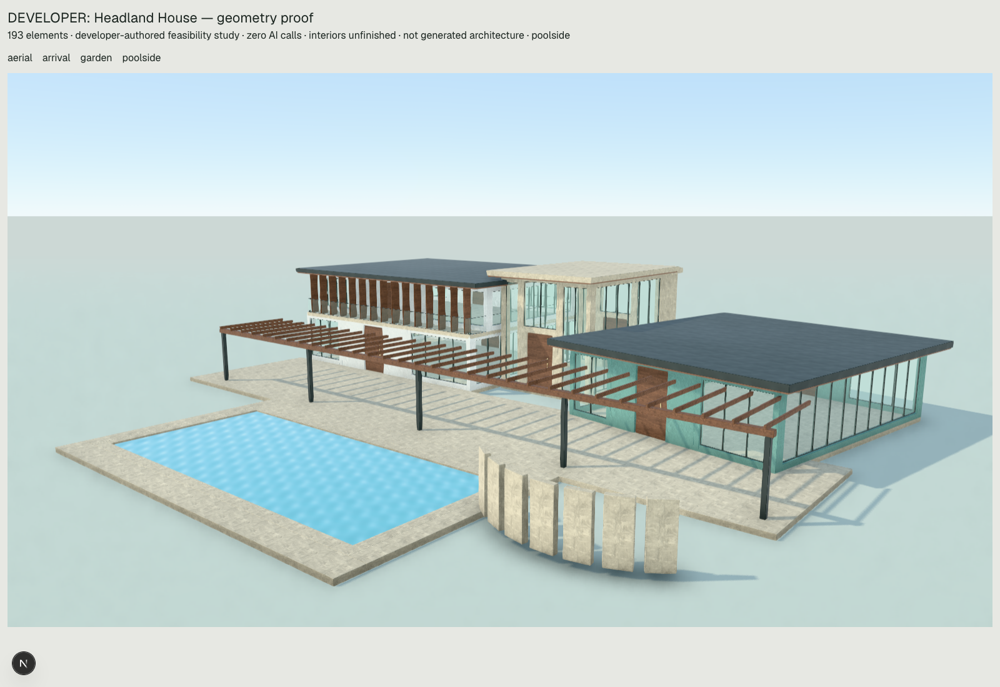

# Why the latest exterior is basic

The latest accepted Terra response chose a broad single-storey composition before construction. The renderer did not flatten a sophisticated proposal. There is a concrete model-facing bias worth removing: its two verbal alternatives closely reproduce the system's supplied concept example, and its three principal masses use a helper that supplies an entire rectangular storey, equal front bays and a finished roof. These are observed correspondences, not proof of the model's private reasoning. This task removes those examples and makes unequal wing bays executable. It does **not** establish that another Terra response will be better.

No OpenAI calls, external research, database operations, migrations, commits or deployments were made. Existing uncommitted work and retained responses were preserved.

1. **Why did it look like a basic bungalow?** Response `c8d01439-962e-4575-8fd5-f1d47c5ffca1`, accepted on 29 October at approximately 15:43 Saint Lucia time, explicitly says `levels:1`, `enclosedAreaM2:952`, and “approximately 950 m² enclosed, single-storey”. Its section varies wall heights by only 0.5 m: a 4 m salon between 3.5 m wings. All principal enclosure is at the same ground datum. Twenty authored operations expand to 76 elements. There is no lost upper storey, truncation, exhausted element budget or downstream replacement of an ambitious design. The response stopped normally at 5,217 output tokens, including 2,223 reasoning tokens; the existing ceiling is 30,000. Unused budget does not explain why it chose to stop.

2. **What did Terra actually decide to build?** “Water Court Estate”: a 28×14 m hip-roofed great hall, two identical 14×20 m gabled private wings at X ±22, and a rectangular 18×10 m water court. All three wing operations explicitly select ivory. The central assembly has four equal 7 m bays; each side assembly has three equal approximately 4.667 m bays. Terra removes the salon rear wall and replaces it with three fitted bays, but does not similarly develop the side wings. The arrival is a 6.4×3 m canopy and two 0.5 m square stone posts, below the main eave. It is a real entrance, but subordinate in scale and section. The wings are symmetric copies, despite the plan's claim “without equal-box repetition”. A larger floor area is the principal expression of “massive”.

   The exact retained user message is **“generate me a massive Caribbean mansion on the water”**. No $25 million figure, bedroom count, required two storeys or explicit detailed style was sent. Retrieval classified it as a mansion, but the selected list contains no property-value record. We cannot conclude that this particular call discarded a supplied $25m requirement. There is also no observed rich concept that was subsequently simplified: the **first visible loss of ambition is already in architecturalPlan**, followed faithfully by the operations. JSON field order does not reveal the model's internal reasoning chronology.

3. **Which choices came from the model and which from code?** The model selected the concept, one storey, dimensions, symmetric placement, all-ivory shells, hip/gable combination, overhangs, canopy and minimal facade interventions. Code supplied each selected wing's rectangular slab, solid rear/side walls, equally divided front openings, two-panel infill, limestone reveal strips and complete roof. The helper does not choose a second floor or recessed upper envelope. The schema allowed arbitrary Y positions, multiple floors, five finishes, free yaw and independent parts; it did not demand one storey or ivory. The renderer faithfully displays the 76 retained elements. All 76 replay from normalized retained operations with exact serialized equality; all rendered IDs and local transforms match the retained component inventory.

4. **Did instructions/examples bias it?** The historical concept guidance says: “For example a vertically layered compact residence and a court-led pavilion estate can share a tropical waterfront brief.” Terra says: “Two alternatives were considered—a vertically layered villa and a court-led estate”. This is specific evidence of example uptake. The wing documentation also provided a complete numeric ivory, hip-roofed one-storey example. Repeating the helper makes its hard-coded facade pattern repeat. Selected knowledge reinforces hall-plus-subordinate-wings and restrained finishes: `composition-hierarchy` says to give the living hall the strongest volume and step bedroom/service wings down; `court-water-separation` recommends timber shade and limestone paving with ivory supports. Those can be sensible recommendations, but are not neutral evidence of architectural diversity. Other selected entries included `facade-materials`, `estate-composition`, `tropical-contemporary`, `tropical-envelope`, `covered-threshold`, `outdoor-entertaining`, `hip-shelter`, `private-bedroom-wing` and a legacy roof recipe. The complete selection and text are preserved in [latest-evidence.json](latest-evidence.json); no knowledge records or retrieval ranking were changed. Instructions already requested depth, material contrast and hierarchy. Adding another general checklist would not explain their weak execution.

5. **What limitations were corrected?** `residential-wing` previously could only divide its chosen frontage equally. Optional `bayWidths` now selects each frontage span, with length equal to `bays` and sum equal to `width`. Wall centres, openings, infill and reveal positions derive from those widths; IDs and element counts remain stable. Invalid selections fail rather than being resized. Omitting widths uses the original arithmetic exactly, preserving historical expansions. The provider's strict schema exposes the field; null follows the existing optional-field adapter. This removes one real helper restriction. **No general polygon, curved-solid, pitch/roll or CSG capability was added.** Those limitations remain real, but this sample does not demonstrate that they caused its one-storey, symmetric, ivory design.

   In `designGuide.ts`, the copied two-concept example is replaced by brief-derived alternatives and explicit section reasoning. In `terra.ts`, the numeric wing example is replaced by its parameter contract, and its one-storey/solid-elevation assumptions are made explicit before selection. Primitive construction is presented as the direct option for individually composed envelopes. No prescribed mansion, minimum storey count, mandatory palette, new pipeline, model setting, budget increase or validator relaxation was introduced.

6. **What can normal Generate genuinely construct?** Independently editable floors/decks, walls with actual rectangular openings, framed glazing, doors, thin glass guards, vertical screens, box beams/piers, flat/gable/hip roof sections and rectangular water. Free yaw and elevations permit angled compositions, setbacks, layered roofs, multiple occupied floors and geometrically connected cantilevers. Fitted facade bays, selected stairs, pools and now unequal wing bays expand through the existing executor. Roof/soffit layering, deep glazing setbacks, segmented elevations, portal blades/lintels, fins and pergola members use existing parts. A pinned curved pavilion is available, but its interior pieces are not independently editable. General polygonal/curved solids, arbitrary inclined members, bespoke curved roofs, roof unions and whole-house circulation solving remain unavailable. Faceted arrangements of rectangular pieces are possible; they are not smooth curves or polygonal solids.

7. **Can the renderer show a substantially stronger editable exterior?** Yes, in the limited technical sense visible below. The new **193-element developer study** uses the normal Generate resolver, schemas, operation executor, relationship checks and OperationScene renderer. It has two occupied west levels, a recessed upper facade and wraparound slab, a taller limestone entrance with separate door/transom, a lower angled sage salon, dark thin roof sections, timber fins/pergola, fitted glazing and a connected rectangular pool circuit. A faceted garden screen uses separately rotated rectangular blades. No opaque pavilion, custom renderer geometry, imported mansion or production template is used. The study is not sent to Terra or retrieval.

   Solana source was read directly: `UpperSuite` uses a separate upper slab, sill/header, recessed glazing, roof and screens; `Entrance` uses tall stone blades, lintel, sidelights/transom and canopy; `Roof` supplies a thin layered silhouette. Those construction relationships transfer to the study through ordinary editable scene parts. Its dimensions, layout, room count and identity were not copied. Solana's emissive accents, furnishing, arbitrary rotations and decorative geometry are not all reproduced. This is a more articulated technical exterior, not proof of Solana parity or a completed mansion.

   The unchanged relationship gate returns zero findings. The architectural audit still reports unrecorded programme/completeness and two overlapping floor-surface pairs (landing/upper slab and terrace/angled salon); usable area is withheld. Stair guards, full route/headroom, interiors, site and engineering remain unfinished or unverified. Passing connectivity checks does not certify the entrance sequence, human circulation, construction readiness or beauty. The studio's historical scope behavior was not changed.

8. **What still prevents autonomous use?** No hard code constraint forces the latest simple composition. The model must select and coordinate a richer section and facade, then spend its response on those operations. The existing shortcut is much cheaper to author than a complete layered envelope. One-shot coordinate authoring, conservative junction constraints and lack of visual feedback can plausibly encourage that shortcut, but their causal contribution is unproven. The demonstrable prompt examples and equal-bay restriction have been addressed; autonomous design quality remains **unproven**, rather than solved by this offline study. No additional aesthetic validator was added, and “accepted” still means construction acceptance, not accomplished architecture.

9. **Smallest next test?** One separately authorized normal Generate call using the exact retained prompt, unchanged model/settings and current production path. Preserve its full provider wire and render arrival, aerial and poolside before judging. Compare the chosen section, mass differentiation, facade depth, material distribution and entrance against the retained 76-element scene—not operation count or validation success alone. This is an initial regression comparison, not a causal A/B or reliability claim. If a $25m or two-storey brief is intended, state it explicitly in a separate test rather than retrospectively assigning it to this one. No call was made or scheduled here.

Actual local renders; retained geometry is unchanged, the new study is developer-authored:

| Scene | Arrival | Aerial | Poolside |
|---|---|---|---|
| Latest retained Terra | [Arrival](latest.RETAINED-arrival.png) | [Aerial](latest.RETAINED-aerial.png) | [Poolside](latest.RETAINED-poolside.png) |
| Developer construction proof | [Arrival](ambitious.DEVELOPER-arrival.png) | [Aerial](ambitious.DEVELOPER-aerial.png) | [Poolside](ambitious.DEVELOPER-poolside.png) |



Evidence: [study scene](ambitious.DEVELOPER.json), [operations](ambitious.operations.json), [unfiltered audit](ambitious.audit.json), [study browser evidence](ambitious.browser-result.json), [retained browser evidence](latest.browser-result.json), [retained evidence and hashes](latest-evidence.json). Private complete originals remain `.data/scene-responses/c8d01439-962e-4575-8fd5-f1d47c5ffca1.{json,provider.txt,wire.json,diagnostics.json}`; no original was edited. Browser captures block all API paths and external page resources and verify every element ID/local position/yaw, no browser errors and no WebGL context loss.

Verification: **221 tests pass across 39 files**, typecheck and focused ESLint pass. Tests cover unequal-bay geometry/rejection, legacy exact expansion, provider schema exposure, new study execution/reload/independent edits, and the existing scene/library/route regression set. [Results](tests.json). Reproduce offline:

```sh
npx vite-node --config vitest.config.mts scripts/architectural-freedom-offline.ts
npx vitest run src/lib/villa/scene src/lib/library/architecture src/app/api/ai/scene/route.test.ts src/app/api/ai/scene/route.providerSchema.test.ts
npm run typecheck
# Existing local dev server at 3015; local Chrome + playwright-core only.
node scripts/exterior-first-capture.mjs ambitious
node scripts/exterior-first-capture.mjs latest
```

New work: `architecturalFreedom.fixture.ts`, `architecturalFreedom.test.ts`, `architectural-freedom-offline.ts`, this evidence directory; targeted edits to `assemblyContract.ts`, `assemblies.ts`, `designGuide.ts`, `terra.ts` and the existing local-only preview/capture files. Earlier exterior-first, roof, programme, retention and UI changes remain separate work and are not claimed here.
