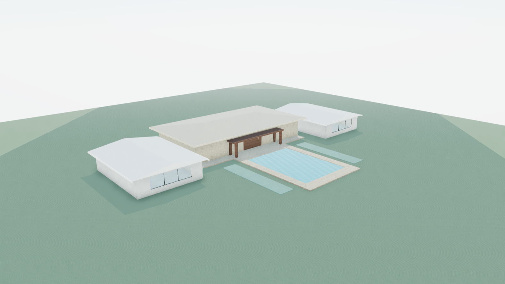
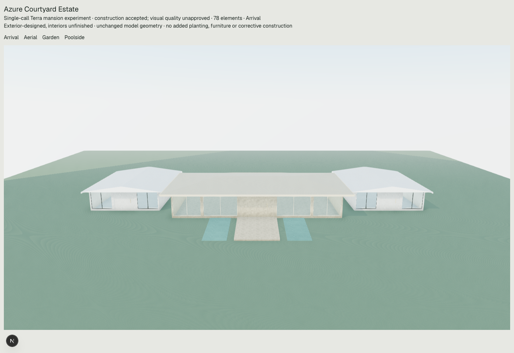
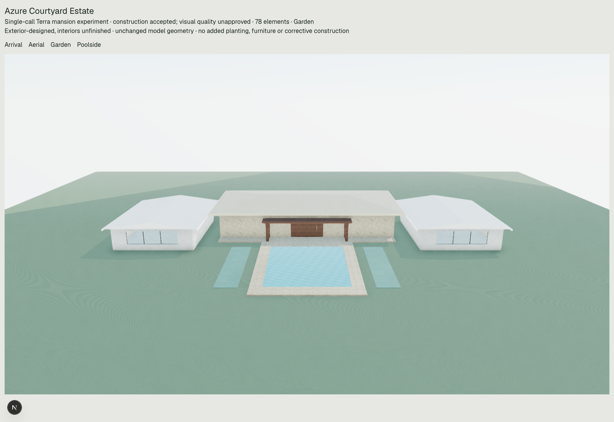

# Azure Courtyard Estate — actual single-call Terra result

**Terra constructed a substantial 776 m² exterior, but this is not a complete or architecturally exceptional six-suite luxury mansion.** The composition is again a broad hall between two matching single-storey private pavilions. The construction was accepted and remains editable; it has not been rejected on aesthetic grounds or repaired. The failure of the overall brief is principally architectural, not a minor roof defect.

| Aerial | Entrance / arrival | Garden | Poolside |
|---|---|---|---|
| [Actual view](aerial.png) | [Actual view](arrival.png) | [Actual view](garden.png) | [Actual view](poolside.png) |

## 1. Substantial mansion scale: substantial floor area, incomplete programme evidence

Actual occupied slabs are `main-living` **28 × 14 m = 392 m²**, `suite-west` **12 × 16 m = 192 m²** and `suite-east` **12 × 16 m = 192 m²**. The three disjoint rectangles give **776 m²** of gross slab union, within a **58 × 20 m** occupied footprint bounding rectangle. The bounding rectangle contains gaps and must not be reported as 1,160 m² of occupied construction. No roofs, pool, terraces, driveway or planting beds are included in the 776 m² figure. All other plates were inspected and classified in [postflight.json](postflight.json); no upper occupied floor was omitted.

There is **one occupied level**, slab tops at **Y=0.20 m**, with no stairs or upper-level connections. A single-storey estate is permissible; storey count alone is not the defect. The central enclosure is 4.2 m high, versus 3.4 m side enclosures. Actual roof ridge tops are 5.6 m and 4.6 m. This provides some hierarchy but little spatial/sectional complexity.

Terra's numeric commitments sum to **791 m²**, although its scale rationale calls the design 776 m²:

| Authored allocation | Numeric demand |
|---|---:|
| Six suites: 6 × 37 m² net + 48 m² dressing/bathroom allowance | 270 m² |
| Living/dining/entertaining: 210 + 54 | 264 m² |
| Kitchen/pantry/laundry/service: 72 + 36 | 108 m² |
| Entry/circulation/storage/walls: 95 + 54 | 149 m² |
| **Total** | **791 m²** |

The existing capacity check correctly reports **15 m² underprovided**, about **1.90%** of demand. This small shortfall is not by itself a reason to dismiss a promising mansion. More important, the shared circulation allocation ties all slabs into one accounting group; an overall capacity total does not prove the local distribution, enclosure or room layout works.

**Scale verdict:** substantial estate-sized physical area is demonstrated. Complete accommodation for the intended programme is not verified. Gross slab area is an upper bound, not measured net enclosed floor area or six built suites.

## 2. Composition: legible hierarchy, still repetitive and underdeveloped

The first three authored operations select a 28 × 14 m central residential-wing assembly and two identical 12 × 16 m side assemblies at X ±23 m. The side wings are mirror-positioned copies with identical dimensions, height, roof and front-bay rhythm. They remain **3 m apart from the central slab** and have no authored interconnecting slab routes or covered links. The plan's claim of a shared arrival court is represented by a **6.5 × 10 m** central driveway, which does not reach the side entries. Walking across the ground is not claimed to be impossible; a coordinated constructed estate circulation system is absent.

There is a taller primary hall and a consistent hip/gable roof vocabulary. The central front bays use widths 5/6/6/6/5 m, an observed departure from equal subdivision, and the limestone hall differs from ivory wings. These are modest improvements in articulation. They do not establish a bespoke entrance sequence, rich massing, strong facade depth or exceptional material composition.

The waterfront facade is particularly weak: a **5.2 m door opening in a 28 m rear elevation**, leaving **22.8 m** of opaque wall width. Both suite rear elevations get a 7.6 m fixed glazed opening, but their side walls remain blank. The broad central roof and small timber canopy dominate the garden image. The authored narrative mentions warm timber roof planes and bronze-toned frames; the actual roof assembly defaults produce pale roofs, and there is no separately authored bronze screen/frame system. No renderer discarded a more developed facade.

**Composition verdict:** understandable and construction-coherent in its main datums, but basic and repetitive. It does not meaningfully exceed the earlier large-building architecture.

## 3. Major requested components: envelopes and capacity, not completed six-suite architecture

| Requested component | Actual geometry and conclusion |
|---|---|
| Six generous suites | Two 192 m² private envelopes, labelled as three-suite capacity each. Each has one front entrance and broad rear fixed glazing. No six distinct suite subdivisions, bathrooms, dressing spaces, private internal routes or room-specific openings are constructed. |
| Principal living/entertainment | One 392 m² hall with front entrance and a real sill-zero rear garden door. Living, dining, entertaining, kitchen and service areas remain allocations in an undivided envelope. |
| Memorable entrance | A real, approximately 5.55 m-wide central entrance panel in a fitted front opening, reached by the 6.5 × 10 m drive. Deep roof overhang offers shelter. No bespoke portal, developed forecourt, gate, drop-off composition or landscape sequence. |
| Substantial terraces | A **28 × 2.35 m = 65.8 m²** rear terrace plus the pool dry decks. Its shallow proportions limit the claimed expansive outdoor room. The **14 × 2.4 m canopy** shelters the central threshold, not the whole terrace. |
| Infinity pool | An **11 × 15 m = 165 m²** water plane, basin floor and four perimeter walls, coping and dry perimeter decks. It is a real constructed rectangular pool. The far wall/coping is **Y=0.20 m**, above water **Y=0.10 m**, with a far dry deck; no vanishing edge or catchment trough is authored. It does not visually or physically demonstrate the requested infinity edge. |
| Tropical landscaping | Four flat sage planting-bed plates, **160 m²** in total. No planted/tree volumes, palms, ground layering or developed garden composition. |
| Waterfront and gentle slope | An assumed view axis directs the terrace/pool away from arrival. No shore or ocean geometry is constructed. The separately disclosed controlled approximation uses flat ground **Y=0**; accurate gentle slope is not represented. |

The model explicitly discloses deferred interiors. That disclosure is honest and consistent with exterior scope, but it cannot be used as proof that six individually usable suites have been represented. Likewise, its claim that planting geometry is unsupported is not a certified capability fact: the current direct-scene vocabulary permits editable volume representations of plants/trees; this response did not use them. Accurate terrain and true hydraulic engineering remain separate limitations.

**Completeness verdict:** partial exterior architecture. The central hall, two private shells, real doors, pool basin, terrace, canopy and beds exist. Suite individuation, inter-pavilion circulation, developed arrival/landscape and a true infinity-edge composition remain missing.

## 4. Actual visual quality and earlier attempts

| Result | Gross occupied-floor evidence | Occupied bounding dimensions | Architectural observation |
|---|---:|---:|---|
| [Earlier Tidal Court Estate](../physical-programme/estate/aerial.png), rejected construction draft | 510 m² | 38.72 × 23.34 m | Central salon with six individual suite shells and a separate curved pavilion; roof/circulation findings remain preserved. |
| [Earlier Water Court mansion](../architectural-bottleneck/latest.RETAINED-aerial.png) | 952 m² | 58 × 20 m | A 28 × 14 m central hall and two matching 14 × 20 m wings; broad roofs, simple canopy, underdeveloped elevations. |
| **Azure Courtyard, this call** | **776 m²** | **58 × 20 m** | The same broad hall-plus-two-wing type, now 12 × 16 m private wings, a shallow terrace and ordinary rectangular pool. |

Historical figures are retained gross rectangular floor sums; the current figure is a union of three disjoint occupied slabs. None certifies net enclosed area. The earlier prompts/settings are not identical, so this is a case comparison, not a controlled causal result.

This output has **266 m² more** occupied slabs than the 510 m² estate (+52.2%), but fewer individually distinguished suite envelopes. It has **176 m² less** than the 952 m² mansion (−18.5%) and repeats its **392 m² central hall**, single-storey arrangement and **58 × 20 m** bounding dimensions. These observed similarities establish repeated architectural choices, not memory reuse or hidden reasoning.

The arrival view is orderly but generic. The aerial shows three detached rectangles, without an intentionally formed courtyard despite the name. Garden and Poolside reveal broad opaque surfaces, a small canopy and unplanted surroundings. Eaves, facade rhythm and the real rear opening are useful details, but the property does not resemble an exceptional US$25 million Caribbean waterfront estate. The existing stylized materials, repetitive ground patterns and lighting limit presentation; the simple massing, blank walls and missing connections are also present in the actual geometry and cannot be attributed solely to rendering.

**Design verdict:** not exceptional and not substantially better than the 952 m² attempt. Compared with the 510 m² rejected draft, it is technically cleaner but less individually articulated as suite architecture. This is not a rejection of a strong concept because of a minor component defect.

## 5. Findings and first demonstrated loss of ambition

Normal construction acceptance passed; the retained current hard relationship audit has **zero findings**. All **38 architectural findings** remain unfiltered in [architecture-audit.json](architecture-audit.json), with [relationship-findings.json](relationship-findings.json) separately preserved. Some findings concern incomplete evidence or metadata rather than defective geometry: intended-space names do not exactly match programme commitment names; canopy posts are referenced as enclosure; the blanket `covering` relation overstates partial shade; and the pool's declared `facing` relation conflicts with its accompanying description of an edge facing away from the house. Missing required kinds in a decision's cited IDs does not mean those kinds are absent elsewhere in the scene. None of these findings was silently repaired or exempted.

Observed substantive discrepancies include the 791/776 m² mismatch; unsupported shared side-wing arrival routes; the **claimed 3 m roof-edge separation versus approximately 0.7 m actually remaining** after 1.4 m and 0.9 m eaves; only partial terrace shade; ordinary pool perimeter instead of an infinity edge; and unfinished landscape. The eaves are separated and no current hard roof-junction failure is asserted. Missing suite subdivision and weak elevations are the larger completeness/design issues.

The **first demonstrated loss is in the returned architectural plan**. It already selects a low, 776 m² campus, groups six suites into two capacity reservations, and says an upper level is avoided to avoid unresolved stair access. Low-rise design itself is allowed; the underdeveloped composition and accommodation decisions are already explicit at this stage. The plan's numeric allocations also already exceed its chosen slab area. Field order does not reveal private model reasoning chronology.

The first three authored operations then implement exactly that plan through repeated `residential-wing` helpers. Those helpers contribute default rectangular shells, side walls, roof geometry and facade components; the model selects them and makes only a few facade interventions. Richer independent roofs, walls, profiles, openings, terraces, level arrangements and material finishes exist in the current vocabulary, but are not selected. **Exact offline replay reproduces the retained scene**, and all four captures match its 78 IDs and local transforms. There is no demonstrated later execution or rendering loss of richer mansion massing. Small roof/material mismatches occur within the selected helper/default choices, not a wholesale loss of an ambitious constructed proposal.

The new numeric planning successfully exposes a measurable demand discrepancy. Corrected retrieval supplied appropriate estate knowledge. Neither caused this one response to develop substantially better architecture. This experiment does not justify adding aesthetic validators or increasing validator strictness; no such changes were made.

## Paid-call and preservation record

Exactly **one** paid `gpt-5.6-terra` generation was sent, with default reasoning and maximum 30,000 output tokens. HTTP status was **200**, provider response status `completed`, SDK finish reason `stop`. There were no retries, fallback models, paid visual-review calls or refinements. Original request fingerprint/source equality passed before sending.

Provider-reported usage: **26,409 input tokens**, **8,467 output tokens**, including **3,429 reasoning tokens**; **34,876 total**. Of input tokens, 26,406 are reported as cache writes and zero as cache reads. Local standard-rate bookkeeping estimates **US$0.154422**; including the documented 1.25× cache-write rate yields **US$0.167625**, approximately **US$0.17**. Reasoning is already included in output and is not charged twice. These are rate-based estimates, not an invoice. [Exact usage and cost calculation](usage-and-cost.json).

There are **23 authored operations**, **84 indexed expanded operations** and **78 surviving editable elements**. This bookkeeping is not evidence of aesthetic quality. The response used 8,467 output tokens against 30,000; neither truncation nor the operation ceiling caused the simple result.

Preserved evidence: [exact provider request](provider-request.exact.json), [raw provider response](provider-response.exact.json), [retrieval/instructions/schema](preflight.json), [programme](programme.json), [authored operations](operations.json), [indexed expansion](expanded-operations.json), [editable scene](scene.json), [actual geometry ledger](geometry-ledger.json), [measurements](measurements.json), [postflight comparison/replay](postflight.json), [four-view browser record](browser-result.json), [additional camera-only oblique capture](oblique-browser-result.json) and [final verification/hashes](final-verification.json). The original preparation is retained as [PREPARATION.md](PREPARATION.md).

All rendering used the actual scene unchanged through `OperationScene` and normal `VillaScene` daylight presentation, with APIs/non-local browser resources blocked. The extra oblique capture changes only the camera and records its position; it adds no geometry, vegetation, shoreline or decorative assets. No current or historical scene was manually repaired or replaced. Database statements remained SELECT-only with read-only sessions; usage bookkeeping was redirected locally. There were no production database changes, commits, deployments or credential changes.

**Overall result:** substantial scale demonstrated; complete six-suite architecture unproved; exceptional design not achieved. The house and its shortcomings remain available for the learning cycle without another paid request.
