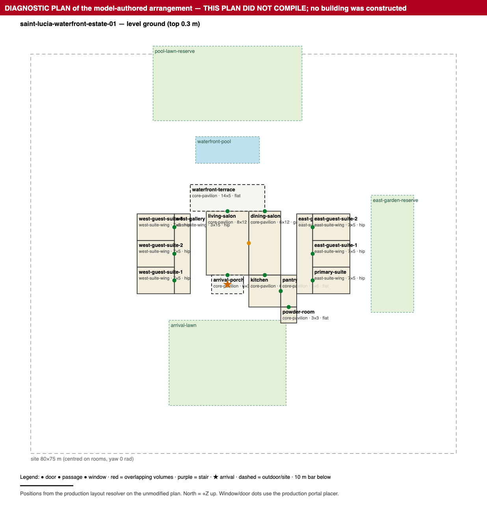

# End-to-end instrumented generation (2026-11-03): one paid call, plan rejected by the compiler

All numbers below come from files in this directory. Nothing in the application was modified for this experiment (only new `scripts/e2e-diagnostic-*` files were added). No retry, fallback, repair or visual-review call. No commit, push, deploy or database write (every statement was a SELECT; the usage INSERT was redirected to `live-usage-log-values.json`).

## A. Overall outcome

**Provider call succeeded; plan parsed against the production schema; the authoritative compiler REJECTED it. No scene, no render.**

- Frozen request SHA-256 `12fa2869bc0d86f1dabebb78f27f6b25563fbc0fdff2258533f09dc61aa974dd` (45,357 bytes), approved before execution; the live run asserted byte-equality with it. Provider request id `req_75cf2e90eabb433f832ae19f7fd08761`, HTTP 200, response `completed`, 1 paid request.
- Usage 8,149 in / 6,294 out (2,667 reasoning), 21% of the 30,000-token ceiling. Local estimate **US$0.0918** (approved maximum US$0.385). Provider time 76.3 s.
- Compiler stopped at its derive phase with 2 errors. Phases 3–10 were **not reached** and are not claimed to pass.
- Stage F (browser render, editability, save/reload, undo/redo) was **not executed** because nothing compiled. No building was substituted, repaired or fabricated. The only drawings are the labelled diagnostic plans below.

*Diagnostic reconstruction from the production layout resolver on the unmodified plan. It is not a building.*

## B. Generation timeline

Full data: `timeline.json` (preflight rows were offline and made no provider call).

| Stage | What | Duration | Outcome |
|---|---|---:|---|
| A | Knowledge retrieval (normal path, read-only DB) | 1.7 s | 12 of 115 eligible records, 18,000-char budget, tier complex |
| A | Request assembly and freeze (preflight) | – | 45,357-byte request, SHA above, approval obtained |
| B | Provider request (gpt-5.6-terra, strict JSON schema, no effort sent) | 76.3 s | HTTP 200, completed, 7 output items (6 reasoning, 1 message), 13,034 chars |
| B | Parse with production strict schema | 10 ms | `status: proposed` |
| C | `diagnosePlan` + `coordinatePlan` (read-only, independent) | 6 ms | see C |
| D | `compileArchitecturalPlan` | 1 ms | **REJECTED** (derive phase) |
| E | Plan-level fidelity measurements | <1 s | `concept-review.json` |
| F | Render | – | **not executed (no scene)** |

Route total 78.5 s; route returned HTTP 422 with `{error, providerCalls, decisions}` only.

## C. Root-cause inventory

Seven independent causes explain everything observed (`root-causes.json`, which also holds evidence, origin, dependencies, deterministic-fix answer and verification for each). Raw findings overstate the problem: 15 diagnostic errors + 2 coordinator errors reduce to **6 real physical conflicts** plus **11 false positives** from a diagnostic defect.

| # | Root cause | Origin | Real conflicts it explains |
|---|---|---|---|
| RC1 | Wings were placed against an inflated wing envelope (porch, terrace and service rooms share the hero wing), so both suite galleries stand 3 m from the salons they were meant to be entered from | model design + strategy/contract text + representation | west adjoin (**compile error 1**), `living-to-west-gallery` (**compile error 2**), `dining-to-east-gallery` |
| RC2 | The coordinator's only "verified" offer (`west-suite-wing.alignment centre→end`) satisfies the constraint through the outdoor terrace; compile still fails and a new screen collision appears (`option-probe.json`) | coordinator defect | misleading correction |
| RC3 | Explicit portal side + centre alignment ignores a shared segment narrower than the host edge (`dining-to-terrace`: opening 1.6–4.4 m, shared run 3–6 m) | model design + contract ambiguity | 1 (diagnostic only; compiler never reached it) |
| RC4 | Site and landscape sized without the resulting extent: site 80×75 m needs ≥64×78 m; `pool-lawn-reserve` 1.5 m outside; `arrival-lawn` overlaps `powder-room` 1.0×0.5 m | model arithmetic + representation | 2 |
| RC5 | `diagnosePlan` ignores `composition.roofSpans/facades`: 10 false "no roof" errors, false "13 of 13 rooms have no window", false "every roof is flat" | software defect | 0 real; 11 false positives |
| RC6 | Compiler stops at the first unplaceable portal, and the route returns no plan or diagram on rejection (the plan exists only because this harness intercepted the response) | compiler + route | hides ≥4 of 6 conflicts from the user |
| RC7 | Thin, template-faithful scheme for an "extraordinary" US$25 M estate (13 rooms, 531 m², one level, six identical 7×5 m suites, unglazed salon) | model + prompt/knowledge | none of the errors; independent quality limit |

Dependencies: RC1 → compile errors 1 and 2 and the east/west gallery portal findings; RC5 → every roof/daylight false positive; RC6 is why RC3/RC4 never surfaced in the compiler. RC2 and RC7 do not cause other errors.

## D. Architectural assessment

What Terra authored (`architectural-decisions.json`; full model text in `proposal.exact.txt`):

- **Thesis:** "A tall limestone-and-bronze waterfront salon forms the estate's civic heart … Lower timber-lined suite bars engage its flanks as quiet inhabited buttresses, while a low arrival porch and a broad seaward terrace make the journey from landward arrival to water deliberately legible."
- **Composition populated:** 3 volumes (primary pavilion, two secondary suite volumes), 3 roof spans (gable rise 2 m / overhang 0.9 m over the salons; two hip spans rise 0.8 m), 7 facade rhythms (14 window bays), a declared entrance (door + porch), 3 constraints, `heightStep` 1.8 m.
- **Geometry as authored (resolved by the production layout resolver):** salon wing envelope 20×26 m at fill 0.44; salon 8×12 m and dining 6×12 m, both 6 m high; wings 3.6 m high; one level of rise 0.3 m; terrace 14×5 m (flat roof, 0 overhang); pool 12×5 m, 4 m beyond the terrace; three lawn/bed reserves; two timber screens (2.4 m and 3.5 m wide).
- **Declared limitations (honest):** flat site, conceptual waterfront to the north, no infinity edge, no bathroom layouts, no planting.

Answers to the requested questions (P = proven by geometry/resolver output, O = observed in the diagnostic drawing only, U = unverified):

| Question | Finding |
|---|---|
| Distinctive concept? | Clear but not distinctive. It is the retrieved strategy `strategy-waterfront-central-pavilion` applied almost point by point. (P: strategy text vs plan; O: plan drawing.) |
| Used the strategy intelligently or copied its language? | Structurally followed, language not copied (only 1 shared three-word phrase). It followed the strategy into its own weakness (RC1) and ignored two of its prescriptions: door facade rhythms on the water elevation, and glazing "evenly spaced tall door bays" (P). |
| Populated and used structured composition? | Yes for volumes, roof spans, window rhythms and entrance (P). Not used: door rhythms, `enclose` constraints, a second level (P). |
| Massing/facade support thesis? | Partly in section (6 m vs 3.6 m + gable) (P). The "elevated" pavilion sits on a 0.3 m level (P). The primary salon has no windows, only three doors of 2.4–3.6 m in a 6 m high volume (P). Suite windows face the flanks, not the water (P). Visual proportion U. |
| Repeated generic bedroom modules? | Yes: six suites are the same 7×5 m (35 m²) cell, mirrored east/west; no bathrooms or dressing rooms (P). |
| Coherent circulation? | No. Intended: galleries entered from salon and dining. Actual: west wing touches nothing in the core; east wing touches only the pantry (service) (P). No stair, single level. |
| Responded to the luxury brief? | Weakly: 531 m² interior, one living, one dining, one powder room; no entertainment, family, study, staff or garage space; shaded terrace roof has no overhang; arrival is a 6×3.5 m flat porch (P). "Six suites" met in count only. |
| Achievable in current canonical capabilities? | Mostly yes. Everything authored is expressible; the failures are placement arithmetic (RC1/RC3/RC4), not missing capability. Door rhythms, `enclose` and levels were available and unused. Real water-edge geometry is not expressible (the brief accepts this). |

Not measurable by software and **not assessed** (no render exists): silhouette, proportions, material richness and luxury character, entrance drama, originality, indoor–outdoor quality.

## E. Software assessment

| System | Result |
|---|---|
| Request freeze, hash equality, one-call guard, read-only DB, connectivity probe | Worked as designed. |
| Retrieval | Worked mechanically; two content issues: `infinity-pool` (score 19) selected for a brief that excludes infinity edges while `pool-infinity-limit` (12.3) was cut for budget; a `legacy-recipe-…` record was admitted to a canonical request. 12 of 115 eligible kept; 103 excluded for budget including `composition-hierarchy`, `strategy-tropical-pavilion-court`, `private-bedroom-wing`, 10 arrival records. (`stage-a-findings.json`) |
| Strict schema / provider parse | Correct; plan parsed first time. |
| `coordinatePlan` | Correct on the adjoin failure and site size (both measured); **defects**: offer counts outdoor contact (RC2); reports the west wing "reachable 4/4" although no wall exists (RC1 consequence). |
| `diagnosePlan` | Correct on portals, site and overlaps; **defect** on all composition-declared roofs/windows (RC5). |
| `compileArchitecturalPlan` | Correct to reject; **limitation** stop-at-first in derive (RC6); phases 3–10 not reached. |
| Route | Rejected correctly but returned no plan or diagnostic (RC6). |
| Concept review (`conceptReview`) | Not run by the product: it requires a compiled scene. Plan-level substitutes were computed offline (`concept-review.json`). |
| Renderer / persistence / undo | Not exercised (no scene). Nothing is claimed. |

## F. Consolidated correction plan (not implemented)

1. **Placement feedback loop (RC1, RC3, RC4, RC2):** one analysis pass over the resolved arrangement, before any acceptance, that (a) names the inflated-envelope cause, (b) derives placement offers from the model's own declared portals and constraint reasons (e.g. `west-suite-wing relativeTo living-salon`), (c) positions explicit-side portals inside the shared run, (d) treats site extent as a determined consequence, (e) counts only interior contact for `adjoin`, and (f) validates every offer by compiling a clone and rerunning the diagnostics.
2. **One diagnostic that understands composition (RC5):** `diagnosePlan` consumes `expandComposition`; span roofs enter the roof-clash analysis.
3. **Rejection is a result, not a loss (RC6):** derive collects all portal problems; the 422 body carries the plan, grouped conflicts (physical conflicts, not message counts), offers and a labelled diagnostic drawing, never a scene.
4. **Strategy and knowledge text (RC1, RC7):** the strategy must say wings are placed relative to the hall space or that porch/terrace/service stay out of the pavilion mass, with a worked adjacency example; retrieval keeps the matching limit record whenever an amenity record is selected; decide how programme scale reaches the model for ambitious briefs (see G).

## G. Unresolved architectural decisions (cannot be fixed by deterministic software)

- Which of several valid repairs to adopt: wings against the salons, or a restructured pavilion mass.
- Whether the east gallery may be entered from the service side.
- Whether the salons are glazed to the water and how deep the terrace roof is.
- Programme richness for a US$25 M estate (rooms, bathrooms, entertainment, service, levels) and whether suites should differ.
- How strongly prompts may require programme scale when the value record currently says "no fixed floor areas … room counts" and allows restraint.

## H. Verification plan (offline, no new generation)

All use the retained `canonical-plan.json` (SHA-256 of the file `c60100d8…621d`) and `provider-response.raw.json` as fixtures.

1. Replay: parse the raw response and run the production route with a mocked provider; assert 422 contains the plan, grouped conflicts and drawing (RC6).
2. `diagnosePlan` regression: zero "neither a roof nor a space above" findings; daylight count 7 rooms windowed; six unwindowed (RC5).
3. Coordinator tests: `adjoin` ignores outdoor contact; the `centre→end` offer is no longer produced; every produced offer compiles on a clone or fails only on listed non-offer items (RC1/RC2).
4. Portal tests: 6 m edge, shared run 3–6 m, width 2.8 m, explicit side north → opening placed in the run or rejected with the `shared` offer (RC3).
5. Compile test: the three portal problems of a plan are reported together (RC6).
6. Site test: site depth derived/offered as ≥78 m clears both site conflicts (RC4); arrival-lawn overlap reported as a decision.
7. Knowledge tests: selecting `infinity-pool` forces `pool-infinity-limit`; strategy text contains the wing-placement instruction; no `legacy-recipe-*` record in a canonical request.
8. Programme completeness check (report only): flags missing bathrooms/dressing, no entertainment/service/staff space, unglazed primary salon for this plan.
9. Only after 1–8 pass, a single new paid generation is worth buying.

## Evidence index

| File | Content |
|---|---|
| `provider-request.exact.json`, `request-approval.json` | Exact frozen request, SHA, cost ceiling |
| `stage-a-input.json`, `system-prompt.txt`, `user-message.json`, `stage-a-findings.json` | Stage A: brief, settings, prompts, 12 retrieved records, strategy selection, schema capability enums, objective retrieval findings |
| `provider-response.raw.json`, `provider-http.json`, `response-facts.json`, `usage.json` | Stage B: exact raw response (never modified), HTTP, completion, tokens, cost. The provider exposed **no reasoning summary** (6 encrypted reasoning items, empty summaries); hidden reasoning is not available and not reconstructed |
| `canonical-plan.json`, `proposal.exact.txt`, `architectural-decisions.json` | Normalized unchanged plan, exact model text, extracted decisions |
| `diagnostics.json` | Stage C: all independent findings, grouped physical conflicts, blind-spot analysis |
| `compile-result.json`, `correction-options.json`, `option-probe.json` | Stage D: first/all compiler errors, phase status, offers, probe on a clone |
| `concept-review.json` | Stage E measurements (heuristic thresholds stated, no score) |
| `root-causes.json` | Grouped root causes with dependencies |
| `floorplan-ground.svg/.png`, `wings-composition.svg/.png` | Labelled diagnostic drawings |
| `timeline.json`, `route-response.json`, `call-result.json`, `live-usage-log-values.json`, `source-hashes.json` | Process evidence |

Scripts: `scripts/e2e-diagnostic-run.ts` (preflight / one live call through the real route), `e2e-diagnostic-analyze.ts` (offline Stages B–E, re-runnable), `e2e-diagnostic-option-probe.ts`, `e2e-diagnostic-svg-to-png.mjs`.

## Limits of this evidence

- One stochastic sample. The failures show systematic mechanisms (they follow from the strategy text and the resolver) but one run cannot show frequency.
- Phases 3–10 of the compiler were never executed on this plan; their verdicts are unknown.
- `dining-to-terrace` is a diagnostic prediction, not a compiler verdict.
- Stage E heuristics (≥30% area / +0.5 m height for dominance; ≥50% perimeter enclosure for a court) are stated thresholds, not quality scores.
- No visual evidence of a building exists.
