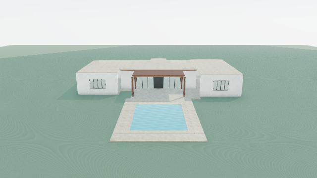

# Full same-house failure investigation — 2026-10-30

Continuation: [construction evidence at review selection](REVIEW-SELECTION.md) records the next integrated correction, replay and current same-house status. It does not claim a new model-produced result.

**The original Terra refinement remains rejected.** This continuation resolves a proven terrace-access recognition defect and a related inconsistency in spatial connection evidence. It follows every remaining known blocker through the complete existing transaction and parallel audits. The remaining blockers require model-authored architectural decisions or a larger evidence contract; they cannot be safely repaired by inferring a room boundary or silently assigning replacement meanings. No new physical house corrections, provider requests, credential access, retrieval, database changes, commits, deployments or project saves occurred.

**1. Continuity and separation of evidence**

The inputs remain the exact original 47-element family house, the original paid 17-operation response and the prior separately labelled 49-element developer diagnostic. This continues [continuous learning](../continuous-learning/REPORT.md), [design/construction](../design-construction/REPORT.md), [single-house diagnosis](../single-house/REPORT.md) and [semantic contract repair](../semantic-contract/REPORT.md). Their historical reports and original scenes/provider bytes were preserved. The original scene SHA-256 remains `b76ed99bad6f6bda1c1e6f233ef9d65e9b01b0c1c0687f97e488dc44feadf983`.

[Replay evidence](replay.json) hashes the original inputs and existing eight images, retains every full transaction result, numerical measurements and current programme findings. [Summary](replay-summary.json) exposes the progression without the complete audits. The earlier continuation runner was also executed: its derived `continuous-learning/replay.json` was refreshed with current validation. Its historical report's terrace rejection is superseded by this investigation.

The working tree already contained the programme-reference revision implementation, route/schema integration, tests and continuous-learning evidence when this task began. Those changes were preserved. This continuation adds the shared walking-route proof, integrates it into programme/spatial review, extends regression coverage and adds the offline investigation runner/evidence. It does not claim the earlier uncommitted work as a new implementation here.

**2. Chronological failure chain and complete replays**

| Stage | Authored intent, construction interpretation and root cause | Correction or preserved finding; full workflow result |
| --- | --- | --- |
| Original operation 16 | Terra describes a timber fascia but supplies semantic `material` with renderer `volume`. `material` denotes a resource, not a physical geometric component. The old provider schema permitted the inconsistent pair; runtime construction correctly rejects it. | The earlier semantic-schema repair remains. Original output still rejects at schema, unchanged. A fascia label does not uniquely identify a replacement semantic type. |
| Prior diagnostic assumption | Developer chooses `mass` solely to examine downstream geometry. This is not recovered Terra intent. | Retain the assumption only in the existing diagnostic. It never makes the original response valid. |
| Four post seatings | Terra moved posts onto the slab while keeping ground-origin heights. The new front-post penetration is real; rear contacts were inherited. Parent transforms were not lost. | Retain the prior four diagnostic seatings, bottom .15 m and top 3.13 m. They are developer corrections, not software exceptions. |
| Added threshold | The purported flush sill duplicates retained slab volume rather than bridging a missing floor. | Retain the prior diagnostic omission. No threshold is invented. |
| Fascia/main-roof intersection | The authored fascia penetrates the rendered roof underside by 6 cm. | Retain the prior diagnostic trim to top 3.27 m. The original geometry remains unchanged. |
| Stale programme roles | Rear walls and `garden-door` were removed while programme enclosure/access claims still cite them. The existing scoped executor preserves plan metadata. | The prior bounded programme proposal supplies explicit replacements, preserving requirements. Before this continuation it stopped at terrace access. |
| Recessed terrace access | The model moved the real door inward to Z=-3.1 m. The terrace starts at Z=-4 m. The main slab extends to Z=-4 m at the same .15 m walking datum. The old programme check required direct proximity within .25 m and could not recognize the intervening .9 m slab route. | **Application defect corrected.** Exact supported rectangular coverage and obstacle checks prove a straight passage. Full replay of the unchanged diagnostic plus explicit programme proposal now progresses to five audit findings, rather than rejecting access. |
| Spatial connection inconsistency | Programme access can use that proven route, but `connected-to` previously recognized only direct OBB contact. A valid explicitly referenced recessed doorway/floor pair would still be called disconnected. | **Application inconsistency corrected.** Doorway/floor connection evidence reuses the same route proof in either direction. It does not remap removed IDs. Full retained replay still rejects because the stored endpoint is the removed `garden-door`. |
| Protected spatial endpoint | The original relationship still cites the removed door. Recognizing a route cannot restore a missing ID. | A labelled diagnostic-only endpoint proposal demonstrates that the replacement passage is physically connected. Four findings remain. Supplying this plan through normal refinement correctly rejects metadata changes. |
| Two protected knowledge claims | Dining-transition and solid/glass-balance decisions cite removed door/wall IDs. Programme revisions intentionally do not authorize changing these records. | Explicit diagnostic-only reference proposals remove the two stale-reference findings in the evidence audit. The full transaction still rejects metadata replacement; no replacement claim is silently accepted. Two physical/evidence findings remain. |
| Occupied-space extent | Entry vestibule cites the entire 12×8 m main slab. Its front entry wall is not a constructed closed room boundary. The occupied-envelope check therefore conservatively reaches the rear canopy. | Preserve review uncertainty. A smaller vestibule or exterior rear strip cannot be inferred from a name. No region was fabricated and no finding was suppressed. |
| Canopy/main-roof junction | Independent flat primary roof solids overlap 4 cm vertically over a .65 m plan strip. This is actual authored penetration, not a camera or frame defect. | Existing flat-roof review correctly detects it. Preserve the finding. Lowering the canopy, trimming/splitting the roof or detailing a joint are distinct architectural decisions with dependent posts, fascia, soffits and weathering. None was chosen for Terra. |

The five post-programme findings are exactly two knowledge references, one spatial reference, the occupied-envelope review and the primitive roof junction. The diagnostic reference probes leave exactly the latter two. **No additional hidden gate was found after those probes:** schema/primitive staging, preservation, scoped operations, removal/addition limits and local extent are already exercised by the retained diagnostic; complete audits enumerate the outstanding findings. This is a bounded offline conclusion for this transaction, not certification of every building relationship.

Every checkpoint calls `stageGenerationRefinement`, including the reference-only proposals that correctly stop at metadata preservation. Separate evidence comparisons inspect their remaining physical findings without bypassing the transaction or saving a candidate. [Reference-probe scene](reference-probe.scene.json) is explicitly developer diagnostic evidence, has exactly the same elements as the prior rejected diagnostic, and is not an accepted Terra version.

**3. General application improvement and its limits**

`walkingAccess.ts` proves a straight, level route with a 0.6 m width and 2 m headroom. It transforms through parent frames and arbitrary common yaw. Exact rectangle subtraction checks support across the complete route, including space inside the passage and destination. Support comes only from actual rectangular plates at the walking datum, within .02 m numerical/level tolerance. Wall passages must be unglazed and fit the route's width, sill and head. Fixed glazing, walls, posts and low overhead solids obstruct the route. Profiles are not treated as solid floor rectangles; mixed-yaw support, gaps, steps and narrow ribbons remain unverified.

The route is measured evidence, not scene geometry, a room generator, a navigation solver or a code-compliance certificate. It uses no house IDs or coordinate exceptions. Existing direct-contact checks remain in place; this adds evidence for the previously unsupported intervening-slab case. No collision threshold, preservation policy or acceptance gate was relaxed.

`reviewProgramme` now reports the supporting slab IDs and walking datum in `accessRoutes`. Its shared use in Generate, review and refinement means future designs can benefit. `spatialCoordinationFindings` uses the same proof for doorway/floor `connected-to` claims. A missing endpoint still fails. No general roof union, arbitrary circulation inference or knowledge-reference rewrite was introduced.

**4. Programme revision and occupied-region stopping boundary**

The existing bounded revision contract can update an affected programme's `floorIds`, `enclosureIds`, `roofIds` or `accessIds` after scoped physical changes. Exact previous IDs, final replacements, supported kinds/geometry, immutable requirements and final evidence checks remain required. It cannot revise construction-role arrays, spatial endpoints, knowledge decisions, provenance or occupied regions. Tests still reject stale, duplicate, empty, wrong-kind, unrelated and remote replacement proposals. New tests show that naming a replacement doorway alone fails when its intervening slab is absent.

Extending that authority needs an explicit typed proposal and invalidation contract for each additional evidence category. Spatial endpoints must retain or explicitly change their physical relationship; knowledge claims need justified final geometry without changing retrieved provenance; occupied regions need authored extents in the floor's frame, proof of actual surface support and treatment of enclosure, overlap and subsequent edits. Blanket ID substitution or deriving a room from one wall would invent architectural meaning. These are missing capabilities requiring a substantial semantic change, not a demonstrated executor defect that can be patched safely here.

The retained house provides no unambiguous occupied boundary or roof-junction solution. It therefore meets the requested stopping condition: remaining failures are identified as model-authored contradictions, ambiguous architectural decisions or significant missing capabilities. Further manual geometry recovery would design the house for the model.

**5. Architectural quality and actual images**

The original generation expressly chooses a common roof datum while describing subordinate wings. The construction preserves that datum: a richer hierarchy was not discarded. The paid review notices flat roof composition, weak arrival, small openings and absent garden, then selects a rear-only intervention. The subsequent numerical post, sill and roof errors expose a failure to translate even that local intent into coordinated geometry. Existing refinement context already supplies dependencies and rendered datums; selection reasoning and comparison intent are already carried through the workflow. Adding another aesthetic instruction would not establish a new application correction.

Actual retained captures remain valid because this continuation makes **zero physical changes**. Their hashes are recorded in the replay. They were produced by the normal scene/render pipeline and are reused transparently, not presented as fresh improvement evidence.

| View | Original model-produced exterior | Rejected developer diagnostic, unchanged geometry |
| --- | --- | --- |
| Arrival | [Image](../single-house/before-arrival.png) | [Image](../single-house/after-arrival.png) |
| Garden | [Image](../single-house/before-garden.png) | [Image](../single-house/after-garden.png) |
| Aerial | [Image](../single-house/before-aerial.png) | [Image](../single-house/after-aerial.png) |
| Poolside | [Image](../single-house/before-poolside.png) | [Image](../single-house/after-poolside.png) |



Inspection of the garden image confirms a more ordered local glazed frontage and canopy. The aerial still shows one broad pale roof cap. Arrival remains modest; massing/vertical hierarchy, material depth, interiors and planting remain incomplete. The reference probes cannot improve these pixels. Editable planting, engineering, site grading, complete circulation and weatherproofing remain outside what this scene certifies. All inherited programme disclosures, including incomplete accommodation, garden and canopy coverage, remain in the full audit.

**6. Results and prerequisites for one controlled live refinement**

- **Original refinement passes unchanged:** no; its original unsupported fascia pairing remains the first rejection.
- **Prior developer diagnostic passes full refinement:** no. Programme proposals now reach the five subsequent findings. Diagnostic-only reference proposals isolate the two terminal issues but remain unauthorized metadata changes and do not pass.
- **Valid model-produced editable scene exists:** the original 47-element construction-accepted exterior exists and remains editable. There is **no accepted model-produced refined scene**, completed home or premium-quality success. The 49-element scene is a rejected developer diagnostic.
- **Terra-attributable failures:** unsupported fascia semantics, post/slab and sill coordination, fascia/roof penetration, canopy/main-roof overlap, removed identities without replacement evidence, unsupported subordinate-height language, and the limited rear-only design intervention. Unbounded vestibule evidence and wider reference revision are shared representation/contract limitations; terrace-route rejection was a software defect.
- **Fresh response requirements:** use a supported physical semantic type; coordinate real slab tops, rendered soffits and all dependent heights; avoid redundant threshold solids; author a physically coherent roof junction; preserve surviving identities or use supported explicit programme proposals; avoid deleting protected spatial/knowledge dependencies that the current contract cannot revise; and do not claim a bounded occupied area that was never authored. If a selected intervention requires unsupported evidence or occupied-region changes, return that limitation rather than claim completion.

Before a live request, choose a refinement scope representable by the current evidence contract, or implement and adversarially verify the broader typed evidence/occupied-region capability offline. The exact prompt should state these unresolved limits and demand coordinated architectural decisions with a visible comparison intention. Retain the immutable baseline, one-request/no-retry bound, original response and atomic rollback. A future accepted candidate still needs the four actual matching-camera views and independent architectural assessment. No paid request is authorized or made by this work, and no price/model estimate is asserted here.

**7. Verification**

**239 tests pass across 44 files**; typecheck, focused ESLint and `git diff --check` pass. The verification record is in [tests.json](tests.json), [typecheck.txt](typecheck.txt) and [eslint.txt](eslint.txt). Regression coverage includes nested/rotated routes, gaps, steps, fixed glazing, solid walls, shifted/raised/small/glazed openings, low headroom, narrow surfaces, profiles, protected original rejection and real-house terrace evidence. A separate developer fixture passes the **full normal refinement transaction** after adding an actual bridge slab; removing that bridge rejects atomically and leaves the input unchanged. This verifies software behavior, not Terra quality.

Reproduce without provider transport:

```sh
npx vite-node --config vitest.config.mts scripts/full-house-investigation-offline.ts
npx vitest run src/lib/villa/scene src/lib/semantic src/app/api/ai/scene/visual-review/route.test.ts src/store/__tests__/directScenePersistence.test.ts
npm run typecheck
```

The new runner writes only this continuation's derived evidence directory. No new browser rendering is needed for identical geometry. No user project or historical original is overwritten.
