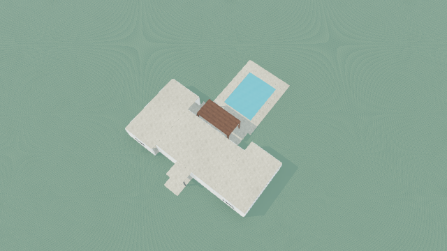

# Same-house continuation: construction evidence at intervention selection

2026-10-30. The original 47-element Terra family house remains the reference. No accepted model-produced refinement or architectural-quality success has been demonstrated. This continuation preserves the pre-existing uncommitted programme-revision and walking-access work.

## What changed in this continuation

The normal visual review/comparison payload previously reduced constructed elements to ID, kind, parent, local position, size and rotation. It omitted actual openings, roof forms, overhangs, profiles, panels, semantic roles and finishes. Images alone cannot reliably recover these properties, especially on occluded elevations. Refinement received the editable scene and numerical context only after the reviewer selected an intervention. This was a demonstrable information gap; it is not evidence that the gap caused Terra's particular rear-only choice.

`sceneVisualEvidence` now carries every validated element field, world transform and rendered vertical bounds. It also carries the existing reference-preservation contract before selection, including the distinction between supported programme revisions and protected spatial/knowledge claims. This uses the existing geometry authority; it creates no geometry or new evidence authority. Bounds remain bounds, not proof of contact, structural adequacy or circulation. More complete payloads increase input size; no live token/cost measurement was made.

The shared evidence function is used by the normal Generate visual-review loop, comparison and offline evidence inspection. Ordinary generation and editing schemas are unchanged. Focused regressions check nested rotated geometry, a real sill-zero opening, a pitched roof, finish/overhang preservation, immutable inputs and the actual mocked review-route payload. Existing full-transaction regressions continue to enforce atomic rejection and project history.

## Continuous reference-house status

| Question | Evidence-based answer |
| --- | --- |
| Why are houses weak? | The recorded generation chose common roof datums despite describing subordinate wings. The renderer preserved these decisions. Review recognized larger weaknesses but selected rear-facade work. Construction then introduced semantic, seating, sill, roof and stale-reference errors. See the earlier [design/construction investigation](../design-construction/REPORT.md). No hidden reasoning is inferred. |
| Which software weakness was corrected here? | The selection-stage geometry summary omitted design-critical authored fields and world datums. Those now reach the reviewer before it chooses targets. Existing programme-reference and walking-route corrections were already present when this continuation began. |
| Which relationship improved? | Review can distinguish authored opening/glazing and roof configurations, inspect numeric heights through parent frames, and see evidence-revision limits before selecting a coordinated intervention. These are capabilities of the information contract, not a verified improvement in model judgment. |
| What can the model now do? | It can base selection/comparison on the complete validated element description and transformed bounds instead of a box summary. Whether Terra uses that information successfully remains unverified. |
| Which remaining problems are model decisions? | The unsupported fascia semantics, post/sill coordination, roof penetration and weak compositional choice remain retained authored failures. The occupied-region representation and protected evidence revisions are also application limits. |
| Does the house render and remain editable? | The original construction-accepted 47-element scene and its actual four captures remain intact. There is no accepted refined version. No physical geometry or renderer changed here, so retained captures remain the relevant images. |
| Has Terra produced a visibly better result? | No new model response was requested. The rejected developer diagnostic must not be counted as a Terra improvement. |
| What remains visually weak? | Broad continuous pale roof cap, modest arrival, shallow facade hierarchy, unfinished interiors and landscape. The aerial still shows the weak vertical composition. |
| What is integrated into normal workflows? | Full construction evidence now reaches normal visual review and comparison. The existing refinement datums, programme revision and shared walking-route proof remain in place. No ordinary local-edit metadata permissions were expanded. |
| What advances this same house next? | A new model decision is necessary. Before a paid test, either choose a representable intervention preserving protected evidence identities, or separately design and adversarially verify typed spatial/knowledge/occupied-region revisions. The latter is a substantial semantic-contract change. No automatic remapping or further manual repair of the retained response is justified. |

## Replayed complete failure chain

Ran `scripts/full-house-investigation-offline.ts` with zero provider calls. [Replay summary](replay-summary.json) remains: original response rejected; prior developer diagnostic rejected; explicit programme proposal reaches five findings; diagnostic-only spatial probe leaves four; spatial plus knowledge probes leave two. The remaining two are the unbounded vestibule/envelope claim and a 4 cm positive roof-solid overlap. These probes remain rejected by normal metadata preservation and are not accepted candidate scenes. No acceptance gate changed.

The existing [main investigation](REPORT.md) records each construction failure, its cause, current correction and limits. Its original evidence and immutable provider bytes were preserved. The replay refreshes only derived evidence, as designed by the existing runner.

## Actual visual and editable evidence

These are retained captures of the original model-produced scene, not new renders or results of this change. The aerial was independently inspected again in this continuation. No changed geometry exists to warrant an after-render.

| Aerial | Arrival | Garden | Poolside |
| --- | --- | --- | --- |
| [Image](../single-house/before-aerial.png) | [Image](../single-house/before-arrival.png) | [Image](../single-house/before-garden.png) | [Image](../single-house/before-poolside.png) |

[Original editable scene](../retained-visual-review/original.scene.json). [Rejected developer diagnostic comparisons](REPORT.md#5-architectural-quality-and-actual-images) remain separately labelled. Villa Solana remains a quality benchmark rather than a geometry template.

## Verification and boundary

240 tests passed across 44 files in the scene, semantic, visual-route and direct-scene persistence suite; typecheck passed. Focused ESLint and whitespace checks passed. A final focused route regression also verifies the new provider payload. The first new test fixture omitted the required opening `x`; it was corrected before the passing suite. No product validation was altered for that fixture.

No paid calls, credential access, knowledge retrieval, database changes, project saves, commits or deployments occurred. Further progress in actual architectural quality requires fresh model-authored decisions or the substantial evidence-contract work described above. This is the requested stopping boundary, not completion of the product mission. Any paid proposal still requires an exact model, call count, current cost estimate, test objective and explicit authorization.

## Next controlled model test

[Fresh intelligence test preparation](FRESH-INTELLIGENCE.md) continues this same house with an offline-prepared bounded runner. The user approved execution; its one review transport attempt failed without a captured HTTP response. No model intervention was received, so refinement stopped at the checkpoint. The execution report records the network diagnosis and offline failure-reporting repair. No new model decision or architectural improvement is claimed.
