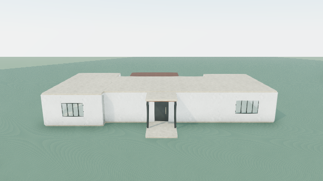
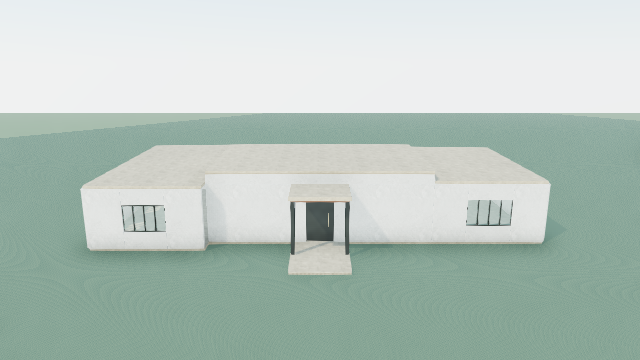

# Prepared single-house experiment — executed 2026-10-30

**Terra produced a valid, editable roof-height intervention with a modest visible improvement in central-versus-wing hierarchy. It did not produce a premium or completed house.** Both authorized paid calls are consumed. No retries, comparison call, manual architectural correction, commit or deployment occurred.

## What Terra decided

The review received the preserved original 47-element house and four historical screenshots through the normal visual-review route. The saved provider wire request verifies all 47 constructed element IDs, full sceneVisualEvidence context and the exact four original images. No new house or alternate architectural engine was used. Both processes ran outside the execution sandbox and passed their own non-generative DNS/TLS/authentication preflight before the provider POST. IPv4 TLS works; IPv6 remains unreachable. Models GET authenticates; the extra Responses GET reports its recorded read-scope restriction. Both actual POSTs subsequently succeeded with HTTP 200.

Terra identified an undifferentiated roof field and weak central hierarchy as the highest-impact supported issue. It also observed weak entrance hierarchy, largely planar facades, small repeated wing glazing, unfinished interiors and landscape, and unverified canopy/access evidence. It described the palette as coherent and the terrace/pool sequence as legible. These are model judgments; the architectural audit's unsupported relationships remain unresolved.

Terra selected a 0.55 m central roof lift with four solid ivory perimeter bands, preserving the wings, footprint, doors, terrace, pool and all other elements. Its explanation predicts a higher central crown in Aerial and Arrival while explicitly leaving other weaknesses unresolved. [Full observations and selection](review.result.json).

The [significance/feasibility checkpoint](decision-checkpoint.json) passed before the second call. This changes a primary mass/roof height relationship, rather than colour or surface finish. Band bottoms at 3.35 m align with retained wall heads; band tops at 3.90 m align with the lifted roof underside. There are no selected-roof children to move. The proposal fits the existing scope/extent limits without removals. This checkpoint established plausible representability and potential significance, not visual success or structural engineering certification.

## What AI Architect constructed

The normal editable construction workflow accepted Terra's exact five operations, unchanged:

| Operation | Element | Result |
|---|---|---|
| Move | main-roof | Centre Y 3.43 → 3.98 m; roof top 3.51 → 4.06 m; footprint 12 × 8 m retained |
| Add wall | main-clerestory-front-band | At [0, 3.625, 4], size [12, 0.55, 0.22] m |
| Add wall | main-clerestory-rear-band | At [0, 3.625, -4], size [12, 0.55, 0.22] m |
| Add wall | main-clerestory-west-band | At [-5.89, 3.625, 0], size [0.22, 0.55, 8] m |
| Add wall | main-clerestory-east-band | At [5.89, 3.625, 0], size [0.22, 0.55, 8] m |

The result has 51 editable primitives. All 46 unrelated original elements, scene metadata and architectural plan remain unchanged. No removals, replacements, evidence exemptions or preservation bypasses were needed. Although Terra labels these bands “clerestory,” they have no glazing or openings: they form an opaque wall-height extension, not a daylighting clerestory.

[Raw refinement response](refine.provider-response.txt), [operations](refine.result.json), [exact candidate](refined.scene.json), [construction diff and full audits](construction-diff.json).

## Actual visual result

All eight verified captures use the historical review camera positions and targets, normal OperationScene/VillaScene presentation, unchanged lighting/materials and unmodified original/candidate geometry. No decorative assets or landscape were injected.

| View | Before | After | Assessment |
|---|---|---|---|
| Aerial | [Original](render-verified/before-aerial.png) | [Candidate](render-verified/after-aerial.png) | Central/wing roof step is visible but subtle from this steep angle; the broad slab composition remains. |
| Arrival | [Original](render-verified/before-arrival.png) | [Candidate](render-verified/after-arrival.png) | Clearest local gain: a raised central silhouette organizes the wings. The larger blank central wall field and small entry canopy remain visually weak. |
| Garden | [Original](render-verified/before-garden.png) | [Candidate](render-verified/after-garden.png) | A modest central step appears above the unchanged timber canopy. Openings, facade depth and garden composition receive no improvement. |
| Poolside | [Original](render-verified/before-poolside.png) | [Candidate](render-verified/after-poolside.png) | The distant crown is discernible but has limited impact on the overall pool/garden composition. |




My visual assessment is **a small positive change in height hierarchy, with insufficient improvement in overall architectural quality**. The new height separation is real, but a taller blank central box is still architecturally basic. It supplies neither facade articulation, refined entrance hierarchy, climate-specific detail nor developed outdoor composition. I see no obvious new loss of the existing doors, windows, terrace or pool in these four views. These images cannot certify circulation, structure, waterproofing, roof junctions or code performance. No paid model comparison was requested, and this assessment is not represented as Terra's evaluation of its own after-renders.

The expected visible effect is partially achieved; the stronger implication that this would substantially transform the weak composition is not demonstrated. The checkpoint's feasibility judgment was supported by construction, while its prospective visual significance proved limited. Validator acceptance and unchanged warning counts are not aesthetic evidence.

## Validation, editability and limits

Exact raw-output replay through stageGenerationRefinement reproduces the saved candidate. Hard findings remain zero and no new architectural warnings are introduced, but **all 31 existing architectural findings remain**. The audit still reports an incomplete exterior design with unfinished interiors, unverified bedroom-wing/local deck access, incomplete canopy-coverage evidence and undeveloped garden. Those findings were neither waived nor relabelled.

The isolated local-store fixture verifies serialization, actual storage rehydration, Undo to the original, Redo to the exact candidate, and independent primitive finish-edit probes on every one of the 51 elements. Each probe changes only its target; the probes are discarded and never modify the evidence candidate. This demonstrates supported independent editing and persistence, not that every possible edit is safe. No production project or browser storage was used. [Offline verification](offline-verification.json).

46 tests pass across the existing review, refinement-construction, evidence-revision, network-preflight and normal visual-review-route suites. Typecheck, focused ESLint and git diff --check pass. [Browser verification](render-verified/browser-result.json) records eight captures, exact historical poses and zero page errors; the renderer checks exact element IDs/local transforms, WebGL health and nonblank pixels. All API and external browser requests are blocked.

The initial offline browser attempt saved four before views and then failed with `page.evaluate: Execution context was destroyed, most likely because of a navigation`. [Original capture exception](capture-attempt-1.failure.json) and partial PNGs remain. The precise navigation trigger is unproven. A separate offline rerender on localhost:3016, with model credentials and database URLs disabled and all browser APIs blocked, completed. This was a capture rerun, not a model retry. No provider, response-validation or construction exception occurred in this new cycle.

## Usage and preserved evidence

| Phase | Request ID | Input tokens | Output tokens | Repository estimate |
|---|---|---:|---:|---:|
| Review | req_f2e7fc3b713646f7bfb625ba0d6d3375 | 20,312 | 2,849 | $0.074812 |
| Refinement | req_7c2ab1f7b605431fa27b9feb6c348691 | 25,410 | 528 | $0.057156 |
| Total | Two POST attempts, zero retries | 45,722 | 3,377 | **$0.131968** |

Both provider responses report completed status, no provider error, and usage. Review used 1,031 reasoning tokens and refinement 100, already included in output totals. Cache-read tokens are zero. Raw usage also reports cache-write tokens (20,309 and 25,407); repository pricing does not model a separate cache-write tariff. These are repository estimates using $2/M input and $12/M output, not independently verified pricing or a provider invoice. **The earlier failed transport attempt's billing remains unknown and is not included as confirmed free.**

Exact requests, raw responses, HTTP/request IDs, local usage, phase markers, both live preflights, the checkpoint, candidate, replay evidence and captures are retained in this directory. [Execution summary](execution-summary.json) and [evidence hashes](evidence-sha256.json). Original/historical hashes remain unchanged. Existing uncommitted application work was preserved; no database mutations, production saves, migrations, commits or deployments were made.

## What this teaches the software work

This cycle demonstrates that the repaired execution path can deliver a model-selected change through the existing construction and persistence system without manual geometric repair. It does not establish reliable architectural intelligence: Terra chose a constructible but conservative intervention, and its broad “critical” roof finding yielded only a modest visual gain. Future evaluation must continue to distinguish representable geometric significance from a convincing rendered design improvement.

Two evidence limitations are visible without changing the house. The model's clerestory naming overstates the opaque geometry; preserved historical design-decision prose still refers to a “shared roof datum” after that relationship changes. That text is retained historical intent, not proof of the revised geometry. The current preservation/reference checks do not certify narrative consistency or aesthetic sophistication. These are recorded generalizable investigation targets; no new gate, prompt rewrite, semantic rule or architectural correction was invented after seeing this output.

The paid cycle is closed. Keep the original as the baseline and retain this candidate for comparison; do not automatically promote it as a completed or premium house. Continue the next authorized learning step from these exact observations and renders, not from a replacement house.

Offline reproduction (existing outputs are exclusive and must be preserved; choose a fresh evidence destination before rerunning writers):

```sh
npx vite-node --config vitest.config.mts scripts/reference-intelligence-offline.ts
npx vitest run src/lib/villa/scene/generationReview.test.ts src/lib/villa/scene/refinementConstruction.test.ts src/lib/villa/scene/evidenceRevision.test.ts src/lib/ai/connectivityPreflight.test.ts src/app/api/ai/scene/visual-review/route.test.ts
npm run typecheck
```

The capture script uses the credential-disabled local development renderer on port 3016 and local Chrome. No live command is part of offline reproduction. Both live started markers prevent repetition.
