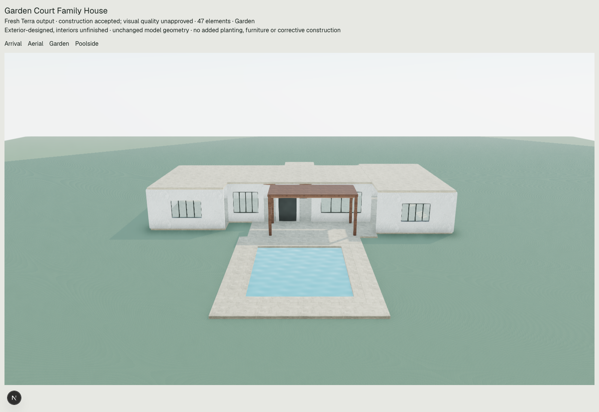

# Generation quality audit and improvements

Generation, construction evidence and presentation received targeted changes. Semantic editing expansion remained paused. **The product goal of reliably generating a complete, premium-looking home is not yet achieved.** Six fresh Terra responses across the five representative briefs were retained and rendered. They are construction-accepted exterior candidates with unresolved architectural findings, not completed houses. The final family response improves mass differentiation and constructs an actual garden passage; the other results show that stronger instructions alone do not reliably produce sophisticated architecture.

1. **The three biggest causes, identified before implementation**

   **Weak architectural decisions at authoring time.** The retained estate and latest accepted mansion selected repeated shells, nearly uniform heights, broad roofs and underdeveloped arrival/side elevations. Their geometry matches the authored operations: the renderer did not discard a richer house. The existing vocabulary already supports independent slabs, roofs, fitted facade bays, shading, varied materials and profiles. Missing differentiation and detail are principally design choices and omissions, not exhausted operation budgets. See the unchanged [retained diagnosis](../terra-estate-diagnosis/REPORT.md) and [architectural bottleneck evidence](../architectural-bottleneck/REPORT.md).

   **Construction reasoning and evidence were not coordinated consistently.** Roof edges, opening sills, routes, slab surfaces and pool boundaries were independently authored. A further defect became visible during this audit: the Generate provider schema offered a legacy detailed-plan branch that could omit programme evidence entirely. The first four live outputs selected that branch. The first family response then exposed fixed glazing cited as outdoor access. A plausible narrative was being mistaken for a construction decision.

   **Visual delivery and feedback were inadequate.** Schema acceptance did not include a rendered design review. The studio retained its old camera after generation, did not supply its pool ID to Poolside view, and used a conservative sphere fit that wasted the frame around long narrow properties. Arrival/Garden directions were generic rather than tied to authored entrances and pools. These defects hurt presentation, while absent planting and unfinished interiors further reduced visual completeness.

2. **What changed**

   Generate now receives explicit reasoning guidance for brief-specific footprint proportions, primary/subordinate masses, numeric slab-top and envelope datums, stair reservations and split roof sections. It asks for shared window head/sill datums, developed exposed elevations, restrained coordinated materials, realistic gross accommodation allowances and a connected arrival/terrace/pool/garden layout. A four-view self-check asks the model to inspect its intended arrival, garden, aerial and poolside construction before returning operations. This remains model reasoning, not an automated rendered assessment.

   New Generate requests use one concise architectural-intent schema with required programme evidence. Historical detailed plans remain readable at runtime; they are no longer offered as an alternative provider format for new generation. The existing safety, preservation and atomic execution gates remain in place. Programme access descriptions and Generate guidance now explicitly distinguish fixed glazing from a door in a real sill-zero opening.

   Two small review checks detect identical coincident rectangular parts across parent frames and an entrance applied against a solid or glazed wall without a fitting unglazed passage. They inspect world transforms and leave geometry untouched. They are findings, not aesthetic scores, automatic repairs or weaker acceptance gates. They do not certify arbitrary profile intersections or complete navigation.

   The studio refits after successful Generate/Redesign, supplies the entrance/pool IDs, and frames actual projected bounds instead of a surrounding sphere. Arrival follows the first authored entrance; Garden and Poolside follow the pool where available. Garden otherwise faces away from the entrance. Lower exterior viewpoints make facades easier to judge. Existing daylight, materials and lighting remain unchanged. This entrance-selection heuristic is not a complete semantic arrival solver.

3. **Fresh model output, unchanged in every render**

   The normal `/api/ai/scene` route ran with the configured `gpt-5.6-terra`, provider-default reasoning, the existing 30,000 output-token ceiling and zero retries. Normal architectural knowledge retrieval was used. Usage bookkeeping was redirected to local evidence; database statements were restricted to SELECT with read-only sessions. Credentials were loaded from the existing configuration and were not printed, created, rotated or modified.

   All six provider responses stopped normally and passed existing hard construction validation. Every current hard relationship audit has zero findings. Architectural warnings remain: the counts below include omissions, conservative evidence limits, unsupported disclosures and unresolved coordination claims. They are not beauty ratings.

   | Brief / retained attempt | Elements | Architectural findings | Visual assessment |
   |---|---:|---:|---|
   | Modern tropical villa | 38 | 48 | Connected pool and shaded terrace; a plain single-storey box with limited facade depth. |
   | Luxury Caribbean hillside home | 42 | 32 | Gable roof and shaded glazed frontage; blank arrival/side surfaces and no hillside construction. |
   | Contemporary family house, first response | 36 | 41 | Offset dining canopy and pool; blank arrival and fixed glass incorrectly cited as outdoor access. |
   | Romantic dream home | 24 | 20 | Hip roof, timber accents and terrace; generic bungalow, weak romantic identity and unplanted garden reserve. |
   | Compact narrow-lot house | 57 | 18 | Recessed upper bar, split lower roofs and an authored stair/void; small upper envelope and severe blank side walls. An unrequested pool also occupies the garden reserve. |
   | Family house, final response | 47 | 31 | Differentiated living/bedroom masses, thin roof sections and separate front/garden doors. Still visually basic, with unverified wing access and unfinished landscape. |

   The first four calls preceded the schema correction. The first family call used the corrected schema. Its fixed-glazing access error prompted the final access guidance and one final family test. Both family responses remain available. This is a small diagnostic sequence with stochastic outputs, not a controlled statistical demonstration that every instruction improved design quality. The final response's actual garden door is a concrete observed improvement; lower finding counts alone establish no aesthetic improvement.

   | Model output | Arrival | Aerial | Garden | Poolside |
   |---|---|---|---|---|
   | Tropical | [View](improved-tropical-network/arrival.png) | [View](improved-tropical-network/aerial.png) | [View](improved-tropical-network/garden.png) | [View](improved-tropical-network/poolside.png) |
   | Hillside | [View](improved-hillside/arrival.png) | [View](improved-hillside/aerial.png) | [View](improved-hillside/garden.png) | [View](improved-hillside/poolside.png) |
   | Family, first | [View](improved-family/arrival.png) | [View](improved-family/aerial.png) | [View](improved-family/garden.png) | [View](improved-family/poolside.png) |
   | Romantic | [View](improved-romantic/arrival.png) | [View](improved-romantic/aerial.png) | [View](improved-romantic/garden.png) | [View](improved-romantic/poolside.png) |
   | Narrow lot | [View](improved-narrow/arrival.png) | [View](improved-narrow/aerial.png) | [View](improved-narrow/garden.png) | [View](improved-narrow/poolside.png) |
   | Family, final | [View](final-family/arrival.png) | [View](final-family/aerial.png) | [View](final-family/garden.png) | [View](final-family/poolside.png) |

   

4. **What remains visibly or functionally incomplete**

   These outputs are still too restrained and generic for a premium product claim. Thin roof layers and a canopy do not by themselves establish accomplished architecture. Facade depth, entrance hierarchy, climate-specific detail, material richness, privacy and garden composition need stronger design decisions. The final family house's bedroom wings do not have independently verified access routes. The narrow home's profiled stair void and upper accommodation require actual-surface/headroom review; capacity labels do not verify three completed bedrooms. Some canopy coverage and spatial-relationship claims remain unsupported by the evidence checks. They were retained in each `current-audit.json` without exemptions or repairs.

   Direct-scene generation still has no editable planting/tree kind. The romantic garden is visibly a reserve with colored ground surfaces, not a developed garden. No decorative vegetation was injected into captures to disguise this limitation. Hillside generation still stages on flat ground and discloses that constraint. Interiors remain unfinished; engineering, hydraulics, site grading, code compliance and full circulation are not certified. Existing ground rendering has visible repetitive/aliasing patterns, and the material/lighting presentation remains stylized. This task did not claim to repair those rendering limitations.

5. **Verification and preservation**

   **270 tests pass across 43 files**, typecheck passes and focused ESLint passes. Tests cover the provider wire contract, required programme schema, retained legacy readability, root/nested/rotated door conflicts, duplicate geometry, projected corner visibility at portrait/square/landscape aspect ratios, and the existing scene/library/preservation/relationship tests. [Test results](tests.json).

   [Verification manifest](verification.json) records every attempt, source prompt, scene hash, exact serialized replay and current audits. The original rejected estate still has 14 hard relationship findings; the prior accepted scene and developer feasibility studies retain their previous hard-check results. No bad historical house was relabelled as successful.

   All 24 fresh-output captures verify exact rendered element IDs, local positions and yaw, no page errors and no WebGL context loss. Browser capture blocks all APIs and non-local resources. Every scene is rendered unchanged through `OperationScene` and normal `VillaScene` presentation. A separate [actual-studio camera test](camera.browser-result.json) uses clearly labelled developer fixtures, including a house shifted 50 m from the origin, to verify that a newly generated scene refits rather than leaving the camera behind. These offline fixtures are not AI quality evidence.

   Two retrieval failures occurred before any provider call and remain recorded. Automatic approval review initially blocked transmission of retrieved knowledge; live tests proceeded only after the user explicitly approved the normal payload. Total paid provider requests: **six**. There were no automatic retries, credential changes, database mutations, migrations, model-default changes, commits or deployments. Existing uncommitted work and historical evidence were preserved.

   Changes for this task: `designGuide.ts`, Generate provider selection in `terra.ts`, an access-field description in `programme.ts`, `generationQuality.ts` integrated into existing review, `presentation.ts`, camera wiring in `OperationStudio.tsx` and `VillaScene`, focused tests, local-only preview/capture/review scripts and this evidence directory. No new edit operations, scene element kinds, layout compiler or alternate generation engine were added.

   Offline reproduction:

   ```sh
   npx vite-node --config vitest.config.mts scripts/generation-quality-offline.ts
   npx vite-node --config vitest.config.mts scripts/generation-quality-review.ts
   npx vitest run src/lib/villa/scene src/lib/library/architecture src/app/api/ai/scene/route.test.ts src/app/api/ai/scene/route.providerSchema.test.ts
   npm run typecheck
   node scripts/generation-quality-camera.mjs
   node scripts/generation-quality-capture.mjs final-family
   ```

   Browser commands use the existing local development server on port 3015 and local Chrome/playwright-core. The separate `generation-quality-once.ts` script requires explicit `--live` and refuses to overwrite an existing attempt; it is not part of offline reproduction.
