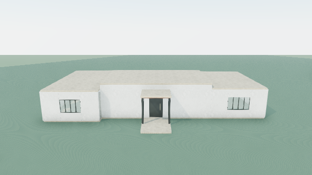

# Learning from the first Terra refinement — offline, 2026-10-30

**Application contracts improved; architectural improvement by fresh Terra output remains unverified.** No new house was generated or manually redesigned. The original 47-element house and exact 51-element Terra candidate are preserved. The candidate remains technically accepted historical evidence, with a modest visible roof step and all 31 architectural findings unresolved. No inference, provider retries, database access, commit or deployment occurred in this task.

## What the recorded decisions establish

The original brief requests a contemporary family house with four bedrooms, pool, private garden and covered outdoor dining. The later experiment asks for the highest-impact meaningful supported intervention on that same house. We read the complete saved review, checkpoint, refinement input, raw response, operations, execution/preservation results, architectural audits and both sets of four renders in [the experiment directory](../full-house-investigation/network-verified-intelligence/REPORT.md). New offline captures reproduce the unchanged original/candidate through normal presentation.

1. **Why 0.55 m?** Terra's recorded selection prioritizes the roof field at a common top datum of 3.51 m. The explicit instruction chooses a central roof centre of 3.98 m, with 0.55 m enclosure extensions from the existing wall heads. It predicts a higher central crown and stronger middle silhouette while preserving the wings and openings. The evidence contains no comparison of alternative heights or strategies and no explanation for precisely 0.55 m rather than another amount. We cannot infer hidden reasoning. Construction did not simplify an ambitious design: it executed this exact conservative instruction.
2. **Why solid bands?** The reviewer itself requested ivory perimeter “clerestory/fascia” bands to close the raised central enclosure, with exact positions and dimensions. The construction response contains one roof move and four wall additions. None has openings or glazing. This is an opaque extension; “clerestory crown” overstates its daylighting qualities. A wider architectural composition was never specified in this intervention.
3. **Were greater weaknesses recognized?** Yes. Arrival was major, glazing quality major, landscape major, massing major and unfinished/disconnected elements major. Facade depth was marked minor. Arrival and facade observations had no suggested change; window regrouping was declined because interior/privacy evidence was insufficient; landscape primitives were unavailable. Roof composition was labelled critical and selected. The recorded output does not demonstrate that this severity ranking corresponded to the greatest possible architectural benefit.
4. **Why did the checkpoint pass?** Its prose treated a primary/wing height relationship as potentially significant, confirmed a bounded no-removal construction and left rendered significance pending. It did not compare actual after-renders and no paid model comparison followed. The technical prediction was supported; the implied selection of a substantial intervention was not supported by the eventual visual result. This was a prospective feasibility checkpoint, not a demonstrated architectural success gate.
5. **Did constraints force this choice?** Preserving wings, doors and footprint made the selected intervention easy. The existing engine already supports additions, removals, replacements, profiles, openings, facade layers and supports. The request allowed 24 existing targets, 32 additions and 80 operations; five operations did not exhaust that scope. There is no evidence that a more coordinated proposal was attempted and rejected. However, the previous review contract restricted refinement targets to one finding's targets, discouraging cross-finding coordination. Privacy/interior evidence, unsupported planting and protected programme references are real limits. They justify explicit stops or scope escalation, not a claim that a roof lift completes the architecture.
6. **Did descriptions exceed geometry?** The solid “clerestory” does. Historical “shared roof datum” prose also ceases to describe the revised relationship; it remains historical intent, not current geometric evidence. The more modest predicted higher silhouette is discernible, particularly at Arrival. A major transformation is not demonstrated.

## Architectural problems: decision versus capability

| Problem | Model decision shown by evidence | Capability/evidence limit |
|---|---|---|
| Ordinary massing | Change central height only; retain broad footprint and repetitive wings | Existing editable primitives permit richer coordination; no evidence the engine forced this choice |
| Weak entrance | Recognized but left without a proposed intervention | Canopy, supports, wall hosts and door/access must be considered together; existing operations support these |
| Basic roof composition | One retained flat plate lifted; four opaque extensions | Roof sections and replacements already exist; rendered soffit/contact and adjacent envelopes require coordination |
| Sparse facades | Small repeated glazing retained; planar fields unchanged | Interior and privacy intent insufficient to justify arbitrary opening changes; opening-host checks remain necessary |
| Outdoor/landscape incompleteness | Terrace and pool retained; garden left unplanted | Editable planting absent; hydraulics, engineering and complete navigation are not certified |
| All 31 findings | Selected roof objective did not target these findings | Counts include omissions, unsupported disclosures and conservative evidence limits, not just repairable defects |

The [replay manifest](replay.json) contains the complete before/after audits, including all 31 issues. They cover wing/local deck access, canopy coverage, omitted fit-out and planting, pool construction/engineering disclosures, incomplete knowledge references and unsupported spatial claims. None was waived or silently resolved.

## Changes in the normal application

New visual-review provider output must include an intervention bundle and at least two strategy/tradeoff comparisons. The bundle records an observable architectural objective, required views, success evidence, every object action and declared dependencies. Guidance connects composition to roof/enclosure datums, opening hosts and access, support/cover relationships and programme commitments. This is a structured planning/construction contract, not an aesthetic score or an instruction to “make it beautiful.” Historical reviews remain parseable and exact historical operations remain replayable.

A bundle can include targets from multiple findings while still intersecting its selected finding. Previously all targets had to fit one finding. The majority-preservation, addition/removal, extent, primitive operation and atomic execution limits are unchanged. Every modified, replaced, removed, added and explicitly preserved object is checked against the final diff and operations. An omitted declared component rejects the whole bundle. World-transform changes are included so an attached dependent cannot disappear from the diff simply because its local coordinates are unchanged. Existing reference-preservation, programme evidence revision, structural/opening audits and no-new-findings gates remain authoritative. Stable IDs retain the same identities; no competing geometry system was added.

Bundle evidence includes declared objects/dependencies, changed IDs and preserved programme/knowledge/spatial reference paths. Optional dependency predicates check actual rendered vertical bounds for matching tops, top-to-bottom alignment or separation. They use existing scene spatial geometry. Profiled and pitched shapes are explicitly refused for these predicates because bounds cannot establish actual-surface contact. These predicates do not establish engineering, arbitrary mesh contact or the correctness of every textual dependency. Undeclared conceptual dependencies cannot be exhaustively inferred by software; explicit declarations and the existing geometry audits are complementary safeguards.

This revealed a useful evidence distinction: the retained checkpoint's roof “underside 3.90 m” describes the primary plate; existing rendered flat-roof geometry includes a soffit down to 3.82 m. Bands end at 3.90 m. No geometry was changed to force a neat contact claim. Datum checks use rendered bounds and reject claims they do not demonstrate. Equal wall-band heads and paired support heads are verified on the two different compositions; contradictory alignment assertions are rejected.

## Three separate outcomes and stopping

| Outcome | Required evidence | Historical Terra candidate |
|---|---|---|
| Technically valid | Existing atomic construction, preservation, reference and audit gates | Pass; exact replay, 51 editable elements |
| Visibly noticeable | Named observations in matching rendered views | Human review: yes, modest step; not a fresh model judgment |
| Architecturally meaningful | Explicit declared objective, observations in every required view, meaningful judgment, revised preference and no regressions | Not demonstrated; broader composition remains basic |

The review runner records technical validity separately. Comparison output separately records noticeability, architectural meaning, objective and view observations. A legacy “prefer revised” alone cannot promote a candidate; neither can warning reduction, a positive technical result, a noticeable-only result, missing views or an unrelated objective. The model's visual judgment is still fallible: the software validates its evidence structure and correspondence, not the truth of beauty claims. Mocked positive judgments test control flow only.

A review can explicitly stop for **not representable**, **broader redesign**, **preservation conflict** or **insufficient visual evidence**, recording a specific limitation and capability/workflow/new-decision next action. A stop and refinement cannot coexist. Comparison without demonstrated significance stops with insufficient visual evidence, retains the candidate record and preserves the current accepted scene. The existing maximum of two passes remains; no automatic workaround, widened limit or superficial substitute was added.

For this retained experiment the retrospective stopping condition is **insufficient visual evidence of the intended substantial architectural improvement**. The original candidate is retained as history. The future choice is a new model decision under the bundle contract, with broader redesign escalation if preservation or scope makes that objective unattainable. Actual planting objectives also reach the not-representable boundary. We did not invent a planted substitute or redesign either retained house.

## Offline generalization and verification

The additional fixture is the existing developer exterior study with a pitched gable roof, then a mocked hip replacement, removal of its small entrance canopy, a supported replacement portal and facade screens. Its IDs, roof form and architectural relationships differ from the flat central-and-wing reference. Its geometry predates this task; it is developer-authored test geometry, never Terra output or evidence of improved model architecture.

Both compositions exercise full action declarations, omitted-operation rejection, dependency identity checks, rendered datum predicates, all four stop outcomes, objective/view correspondence and noticeability-versus-meaningfulness. The different fixture additionally proves coordinated targets can span beyond the selected finding's IDs. Existing transaction tests cover stable identities, preservation, serialization and Undo/Redo; no changes to history/storage semantics were needed.

**343 tests pass across 51 files; typecheck, focused ESLint and `git diff --check` pass.**

[Exact Terra editable replay](retained-terra.scene.json), [developer fixture editable result](developer-gabled-fixture.scene.json), [offline replay and preserved evidence hashes](replay.json), [test results](tests.json), [fresh browser verification](render-verified/browser-result.json).

| View | Original | Exact Terra candidate |
|---|---|---|
| Arrival | [Before](render-verified/before-arrival.png) | [After](render-verified/after-arrival.png) |
| Aerial | [Before](render-verified/before-aerial.png) | [After](render-verified/after-aerial.png) |
| Garden | [Before](render-verified/before-garden.png) | [After](render-verified/after-garden.png) |
| Poolside | [Before](render-verified/before-poolside.png) | [After](render-verified/after-poolside.png) |



The eight new captures use exact retained model geometry, historical camera poses and normal OperationScene/VillaScene. Browser APIs and external resources were blocked. No planting, finish changes or developer geometry were injected into the reference images. Initial sandbox server startup was denied (EPERM); the credential-disabled localhost server ran with approved escalation. Initial sandbox Chrome launch aborted before capture; the escalated offline browser run completed. These were local rendering attempts, not inference retries. Renderer deprecation console notices remain; browser verification records zero page errors and checks IDs/transforms, nonblank pixels and WebGL health.

## Unverified behavior and next controlled experiment

Fresh Terra adherence to the bundle, strategy comparison and stopping contracts is unverified. Offline mocks cannot establish better selection, successful architectural composition or reliable after-render judgment. General textual dependency completeness and independent architectural significance remain review tasks. This work does not claim that Terra now produces beautiful houses.

A future explicitly authorized experiment should run **one normal review/refine/compare pass**, starting from the preserved original 47-element house, with the 51-element result retained alongside it. Ask Terra to select its own coherent intervention, compare strategies, declare scope and dependencies and set an observable objective before construction. Do not prescribe a style, roof arrangement or dimensions. If review stops, make no refinement request. Otherwise stage once, render four identical cameras, then compare the exact objective separately for technical validity, noticeability and architectural meaning. Keep a candidate only if all gates pass. Authorize at most three paid requests (review, conditional refinement, conditional rendered comparison), zero retries/fallbacks, normal model/token limits and normal payload; no database writes. This task makes none of those requests and requests no authorization now.

Reproduce offline with a fresh destination because evidence writers refuse overwrites:

```sh
mkdir -p /tmp/ai-intervention-replay
INTERVENTION_EVIDENCE_DIR=/tmp/ai-intervention-replay npx vite-node --config vitest.config.mts scripts/intervention-learning-offline.ts
npx vitest run src/lib/villa/scene src/lib/library/architecture src/app/api/ai/scene/route.test.ts src/app/api/ai/scene/route.providerSchema.test.ts src/app/api/ai/scene/visual-review/route.test.ts
npm run typecheck
# Credential-disabled localhost renderer on port 3016 required:
REFERENCE_CAPTURE_DIR=/tmp/ai-intervention-replay/render node scripts/reference-intelligence-capture.mjs
```
