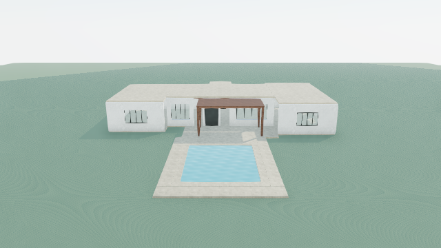

# Controlled Terra visual-refinement result — 2026-10-30

**No architectural improvement was demonstrated.** The authorized single pass stopped at structural-refinement validation after two paid calls. No candidate was accepted, no refined scene could be constructed unchanged, and no comparison call was made. The original remains retained. There were zero retries, fallback models, manual candidate repairs or second passes.

## Actual views

These are fresh original captures from this execution, inspected visually and checked by the normal ReviewPreview geometry, camera, WebGL and nonblank-image checks. Camera metadata is retained in `record.json` and `paid-experiment-evidence.json`. A matching-camera after capture was not possible because candidate staging failed. The original is not presented as an after result.

| View | Original | Refined |
| --- | --- | --- |
| Aerial | [PNG](before-aerial.png) | Unavailable: invalid candidate |
| Entrance / Arrival | [PNG](before-arrival.png) | Unavailable |
| Garden | [PNG](before-garden.png) | Unavailable |
| Poolside | [PNG](before-poolside.png) | Unavailable |

## What Terra attempted and why it stopped

The visual review correctly identified a nearly continuous pale roof cap, weak central mass hierarchy, small entrance, shallow rear facade, repetitive small windows and bare garden. It selected only the rear-facade finding for this one coordinated transaction. Its instruction proposed a 0.9 m setback, broad bronze glazing, a centered garden door, flush sill and widened canopy with relocated supports. This was a structural proposal rather than merely a recoloring, but a proposal does not demonstrate a successful transformation.

The returned candidate contains **17 operations**: four removals, seven additions, five moves and one resize. Ten existing IDs were selected, within the 23-for-this-house bound. Counts remain below the addition/removal/operation limits; that alone does not establish construction validity. The earlier progress update's count of 18 was incorrect; the retained operation array has 17 entries.

Staging failed with `Semantic type is incompatible with renderer kind`. The element `rear-loggia-canopy-edge` pairs `semanticType: "material"` with `kind: "volume"`. `material` is in the semantic vocabulary but has no supported direct-scene renderer mapping. `validateScene` rejects that pairing. The route returned a refinement failure; separate diagnostic staging of the exact same operations reproduced the explicit error. No field was removed or rewritten to make the scene render. Later preservation, extent, relationship and warning checks were not all reached; no clean audit is claimed.

Both provider responses completed normally. The usage log's `success: true` means the provider generation completed, not that the proposed architecture passed staging. The experiment record has `accepted: false`. The original house, backup and retained scene are unchanged. No project version was committed, so Undo/Redo behavior was not exercised or modified in this execution.

## Independent architectural conclusion

The visible house remains basic: its roof plates form a low, broad, nearly continuous silhouette; the entrance is a small portal against wide pale wall fields; the glazing is repetitive and shallow; and the garden is unplanted. Those observations come from the actual original images, not the model's favorable or unfavorable verdict.

The selected proposal might have produced greater rear-facade recess and a stronger covered outdoor room, but that remains unverified. It explicitly protected the roofs and unrelated arrival elements, so it did not attempt the broader massing, roofline or entrance transformation needed to address the house's principal compositional weaknesses. There was also no substantive material-palette transformation. The immediate execution failure was a semantic construction incompatibility, not exhausted operation limits or a failed Chrome launch. This run gives no rendered evidence that Terra achieved better architecture, and no valid after result on which to judge the proposed loggia's quality.

## Requests, usage and estimated actual cost

| Stage | Input tokens | Cached input | Output tokens | Estimated USD |
| --- | ---: | ---: | ---: | ---: |
| Review | 13,834 | 0 | 4,401 | $0.080480 |
| Refinement | 17,109 | 0 | 2,794 | $0.067746 |
| Comparison | Not called | — | — | $0 |
| Total | 30,943 | 0 | 7,195 | **$0.148226** |

38,138 total provider-reported tokens. Costs use the existing configured rates ($2/M input, $0.20/M cached input, $12/M output), including reasoning in output. Provider cache-write tokens are ordinary input, not discounted cache reads. These are token-based estimates for the actual calls, not an invoice. The existing model was `gpt-5.6-terra`, provider-default reasoning; output ceilings remained 5,000 and 12,000, with zero automatic retries.

Evidence: [raw review response](review.provider-response.txt), [raw refinement response](refine.provider-response.txt), [authored operations](raw-candidate.operations.json), [staging failure](raw-candidate-diagnostic.json), [route result](refine.result.json), [workflow record](record.json), [usage records](usage.jsonl), [execution summary](summary.json), [verification manifest](paid-experiment-evidence.json), [run log](authorized-run.log). Exact provider request bodies and phase inputs are retained alongside these files, without authorization headers.

Chrome launched outside the filesystem sandbox and closed successfully; no temporary capture Chrome process remains. The browser blocked the shared layout's `/api/assets` request as in the unchanged live runner; this is unrelated to the semantic failure and there were no page errors. The original and backup retain SHA-256 `b76ed99bad6f6bda1c1e6f233ef9d65e9b01b0c1c0687f97e488dc44feadf983`. Existing prepared screenshots and historical failure evidence remain intact. The consumed `started.json` prevents resubmission.

No application code, architectural instructions, validation gates, models, credentials or Undo/Redo implementation changed. No database changes, commits or deployments occurred. The authorized experiment is finished at its required stop condition.
