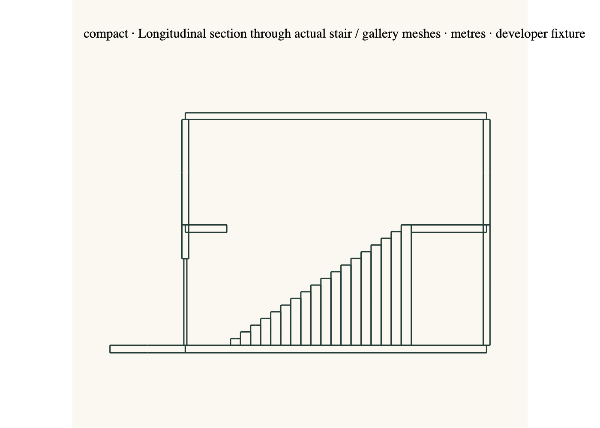

# Revisable semantic building model — offline proof

30 October 2026. **The method is better for the coordination dependencies tested here. Better AI architectural design is unproven.** An isolated executable compiler now turns chosen spatial relationships into ordinary editable scene elements. It constructs shared walls, matching cuts/panels, continuous thresholds, floor profiles and an explicit stair/landing/void arrangement. It also recompiles design revisions with stable IDs and refuses conflicting manual edits. It does not replace production Generate.

Both arrangements are **developer-authored design fixtures**, not repaired Terra/Sol responses, AI-generated successes, complete houses or architectural quality benchmarks. The estate is a substantial six-private-allocation study, not a complete six-suite luxury estate. Its absent bathrooms, services, daylight design and landscape remain absent in the evidence.

## 1. Audit findings: supported diagnosis, unproven destination

Read the complete [independent audit](</Users/dylandevaux/Documents/ChatGPT/Lovable Websites/audit-output/AI-Architect-Independent-Audit.md>), the retained Terra and Sol proposal texts and failure assessments, the older construction diagnosis, and current proposal/Generate, scene execution, assembly, profile, spatial and rendering implementations.

The audit correctly separates occupied space from physical solids, boundaries from walls, openings from panels and level datums from component centres. Current `designProposal.ts` still asks for exact anchor centres, dimensions, yaw and independent opening values. `validateDesignProposal` rejects inconsistent relationships and fidelity problems before construction; `designGeneration.ts` does not resolve their architectural causes. The production route's safety gates are useful. Freezing the early solid-shell/stair-reservation choices is the wrong architectural boundary.

Recalculation over the retained **unchanged** paired proposals reproduces **11/11 Terra** and **9/13 Sol** room-centre datum mismatches. [Verification](verification.json) retains source hashes, all datum calculations and original paths. The historical Sol rotated door/opening mismatch and both proposals' unsupported terrace links motivate the host-derived opening and explicit exterior-cell requirements. Neither rejected proposal was constructed or relabelled successful. See the [paired assessment](../design-first/sol-planning-comparison-2026-10-30/REPORT.md) and [planning-method audit](../planning-method-audit-2026-10-30/REPORT.md).

The audit's recommended general semantic model is a credible direction, not a demonstrated optimum. This proof needs direct derivation and conflict reporting, **not an optimizer**. Its source evidence does not establish that a global solver, persistent regeneration or multiple concept agents would improve taste or completion rates. External layout/object-placement studies cited in that audit are not evidence of premium-house design; their results were not independently reproduced here. Removing arithmetic may help models, but that causal claim still requires a controlled experiment. No evidence justifies discarding the existing renderer or switching models during the first method comparison.

## 2. Minimum model and construction boundary

The [compiler](../../../src/lib/villa/experimental/semantic-building/compiler.ts) lives under `experimental/semantic-building`, outside the normal Generate imports. Its intent contains:

| Entity | Independent architectural choice | Derived result |
|---|---|---|
| Building frame and masses | Site translation/yaw; mass roles and relationships; space membership | Consistent world transforms and provenance; masses are semantic groups, never occupied solids |
| Levels and spaces | Floor-top datum, chosen convex polygon, use, envelope height, interior/outdoor identity | Profile floor, net clear height and room-centre Y (subtracting overhead slab thickness), closed boundary loop and occupied allocation evidence |
| Shared boundary | Exact coincident full polygon edges on one level | One wall, not two independently placed walls; taller selected height governs a stepped shared enclosure |
| Portal | Host space/edge, target space, distance along edge, width/height and door/open/window choice | One wall-local cut, matching world panel, threshold and access graph evidence |
| Vertical circulation | Lower/upper spaces, straight flight start, run, width, risers, landing length, headroom and explicit right-side bypass | Existing stair helper's editable treads, upper slab void, retained landing surfaces, level endpoint and route queries |
| Roof/cover | Chosen roof presence, space outline, height and material | Separate profile roof at the selected clear-height datum; upper floor supplies lower cover in the compact study |

The designer still selects geometry. Adjacency alone cannot choose a footprint. Polygon coordinates are in one chosen building frame; they can contain diagonal edges and unequal volumes. Shared edges must currently match exactly. This is deliberately a bounded construction language, not an automatic room-layout system. Fixed pilot wall/slab/roof thicknesses are explicit software defaults, not architectural dimensions inferred from a brief.

Construction uses the existing `straightStairOperations`, `buildProfileGeometry`, element schemas and **`applySceneOperations` atomic executor**. No new renderer, element kind, operation, hidden assembly or production acceptance exemption was added. Every generated part has a semantic-source/rule binding. Derived room evidence is generated from the same model; no room or stair reservation is rendered as a solid.

## 3. Actual geometry and coordinated access

| Evidence | Estate | Compact |
|---|---:|---:|
| Semantic spaces, including outside spaces | 12 | 6 |
| Levels | 1 | 2 |
| Derived boundaries / hosted thresholds | 33 / 11 | 20 / 4 |
| Individually editable scene elements | 57 | 43 |
| Sampled physical queries | 12,177 | 5,085 |
| Failures in the tested route/surface samples | 0 | 0 |

The estate uses a shared gallery with six private allocations, unequal wing widths, an angled end allocation and a taller tapered social pavilion meeting an explicitly selected terrace. Access to each private allocation uses the gallery, without crossing another private allocation. The compact arrangement uses different IDs, translation, rotation and angled footprint, stacked living/sleeping cells and a real straight stair. These are different spatial arrangements using the same compiler; it contains no estate/compact ID tests or mansion template.

The compact stair rises **3.2 m in 18 risers** over **4.8 m**, with **1.1 m width and landing length**, a floor opening around the complete flight, and an explicit side bypass. The final tread reaches the upper walking datum at **3.4 m**. Landings are retained parts of the floor profile, not floating labelled boxes. The full-flight opening avoids an upper slab over the ascending headroom envelope. The upper roof underside leaves 2.8 m above the upper datum. The lower enclosure rises 3.2 m between floor tops; the upper 0.2 m slab leaves a derived 3.0 m clear height below it outside the void. Guards and structural support are unresolved.

[Estate physical evidence](estate.physical.json) and [compact physical evidence](compact.physical.json) query the **generated geometry**, not just the access graph: exact profile meshes from the renderer's geometry builder; box/opening realization matching `OperationScene`; existing recursive world transforms. They sample floor support and 2 m body/head clearance along threshold crossings, convex-cell approach paths, stair landing links and the selected bypass. Thresholds/flat routes use a 0.6 m diameter probe. Stair tread centres are checked separately. Door panels are assumed open for navigation and shown closed in the exterior renders; swing envelopes and operating hardware are not certified.

Samples are at approximately 5 cm spacing on approach paths; this is not continuous collision detection or a code-compliant stair traversal proof. A 1-micrometre seam fallback avoids numerical ray misses at coincident rotated triangle edges. The geometry is not moved to achieve that. Deliberately removing the arrival floor produces unsupported samples; replacing an opening with a solid wall produces body obstructions. A regression specifically detects a query starting inside a tall wall.

Ambiguity returns a `DesignConflict` with an explicit design decision. The retained [conflicts](conflicts.json) refuse a 2 m terrace gap, absent host and overlong stair. Other tests refuse inaccessible rooms, fixed glazing offered as sole access, overlapping occupied volumes, undersized headroom, oversized openings, partial shared edges, concave profiles and duplicate IDs. No bridge, door, resized room or alternative stair is silently inserted. The offline caller receives the decision request; this prototype has no product conversation UI for answering it.

## 4. Editable output, plans, sections and perspectives

[Estate compiled model, operations and bindings](estate.json) · [estate standalone scene](estate.scene.json) · [compact compiled model, operations and bindings](compact.json) · [compact standalone scene](compact.scene.json).

| Arrangement | Plan | Section | Arrival | Aerial | Garden | Fourth perspective |
|---|---|---|---|---|---|---|
| Estate | [Ground](estate.plan-garden-datum.png) | [Gallery section](estate.section.png) | [View](estate.arrival.png) | [View](estate.aerial.png) | [View](estate.garden.png) | [View](estate.poolside.png) |
| Compact | [Ground](compact.plan-street.png), [upper](compact.plan-sleep.png) | [Stair section](compact.section.png) | [View](compact.arrival.png) | [View](compact.aerial.png) | [View](compact.garden.png) | [View](compact.poolside.png) |

Drawings are intersections with the **actual generated triangle meshes**, not room-box diagrams. SVG originals accompany the PNGs. Plans cut 1.1 m above each level; sections cut through the gallery/stair axis in building-local coordinates. They are inspection drawings, without a complete architectural dimension/annotation system. The fourth view uses the existing Poolside camera preset; there is no pool in either study.



Development-only viewers: `/dev/semantic-building?case=estate` and `/dev/semantic-building?case=compact`; add `&revised=1` for the retained revised model. They reuse normal `OperationScene` and `VillaScene` presentation. [Browser evidence](browser-result.json) verifies exact element IDs, local positions and yaw for all eight original-scene renders, no page errors and no lost WebGL context. APIs and external resources are blocked during capture. The rendered evidence contains no decorative repair or added planting.

## 5. Revision and preservation results

Moving the estate's first private doorway **0.2 m along its chosen boundary** changes exactly two components: its host wall cut and matching door. All IDs survive and unrelated scene geometry is identical. [Transaction](estate.revision-transaction.json), [revised intent/output](estate.revised.json).

The compact revision moves the street door by 0.2 m and raises the upper level by **0.16 m**, with the lower envelope-height decision changed correspondingly. Treads, upper floor/roof and dependent enclosures update coherently, preserving every component ID. The stair endpoint becomes **3.56 m**. [Transaction](compact.revision-transaction.json), [revised intent/output](compact.revised.json). Independent surface checks pass for this revision in the tests.

`reviseBuilding` computes an explicit atomic transaction against the current scene. A manually recolored unrelated roof survives. A manually displaced door that the revision would overwrite causes a conflict; the input scene stays unchanged. Ordinary component finish edits also pass through the existing executor. This is a small, tested preservation policy, not a full override/detachment/history UI. Boundary IDs depend on the first owning space and edge index; topology changes and vertex reordering still need an identity migration policy. The proof must not be integrated as unattended regeneration.

## 6. Comparison with the existing method

| Question | Observed result | Practical limit |
|---|---|---|
| Fewer independently authored geometric values? | Estate: 156 numeric intent values produce at least 399 component placement/dimension/yaw values. Compact: 82 produce 301. Approximately 61% and 73% fewer values by this proxy. | Counts include repeated polygon vertices, edge indices and all numeric intent fields. Output count uses seven placement/dimension/yaw values per part, excluding further opening/profile numbers. Not token usage, AI success rate or a paired same-house benchmark. |
| Door/wall coordination? | Panel placement comes from the actual host cut; transform tests cover four different building rotations. | No door swing, multiple openings per edge or arbitrary curved-host openings. |
| Floor/circulation defects? | Exact shared-edge floors and proven thresholds replace independently guessed links. Gaps are refused. | Same-level convex cells and explicit straight-stair arrangement; no general navigation solver. |
| Preserve architectural choices? | Chosen polygons, angles, unequal heights, levels, roof membership and materials remain authoritative. | No automatic architecture invention; unsupported forms return conflicts. |
| Editable? | Ordinary scene elements and existing operations; explicit revision transactions with manual-edit conflict checks. | No production semantic editor, general override merge or topology identity migration. |
| More than validating broken output? | The compiler creates walls, cuts, panels, floors and treads from intent, eliminating their repeated coordinate inputs. | It cannot rescue inadequate room organization or exterior design choices. |

The 32/62 retained Terra/Sol anchors have 224/434 independently authored placement scalars before openings, profiles and room boxes. They are different houses with different scope; comparing those totals directly to the fixtures would be misleading. Their retained datum errors support the dependency diagnosis, not a numerical estimate of future AI improvement.

## 7. Architectural review and restrictions

**Spatial correctness:** the supported relationships have executable geometry and bounded physical evidence. **Construction completeness:** incomplete envelope/spatial studies, with unresolved guards, service/bath layouts, daylight/privacy design, roof junction detailing, drainage, structure and site grading. **Composition:** neither fixture meets a premium architecture standard.

Actual views show a clearer tall/tapered estate salon and unequal wings, but the long arrival front is almost blank, the entry lacks hierarchy, the private wing reads as one broad roof and the terrace lacks shelter or landscape enclosure. The compact mass has a readable base/upper material division and a real stair section, but blank side/upper facades, shallow entry treatment and weak architectural identity. These are design omissions. Alignment and nonrectangular geometry did not make either study beautiful. This was an informed developer review with known labels, not independent architect approval or blind preference testing.

Restrictions introduced by this minimum compiler are substantial: strictly convex straight-edge space polygons; exact full-edge matching; one sill-zero opening per edge; flat polygon roofs with no eaves or roof-junction resolver; fixed thicknesses; one straight +local-Z stair configuration with selected right bypass and one void per upper cell. Windows need a represented neighboring cell and share the sill-zero opening model. No general exterior-window/facade language, curved boundary, concave court, split-level transition, arbitrary stair orientation, terrain fitting, detached-path search, range optimization or automatic segmentation is implemented. Collinear polygon vertices are refused, so the current instruction to segment a partial edge needs a future boundary-segmentation extension or an explicit decomposition into separate cells. It must not be advertised as already supported.

The renderer can express more than this pilot compiler. Unsupported semantic construction must remain a reported limitation, rather than be reduced to rectangular geometry or declared invalid architecture. More general boundary/portal semantics are the next representation work. Root frame rotation is supported; independently oriented masses must currently be drawn as chosen polygons in that frame. `relatesTo` records mass intent but does not automatically place masses or prove their compositional relationship.

## 8. Verdict and smallest next step

**Credible improvement: yes, for turning explicit supported design intent into coordinated editable geometry and revising its dependencies. Architectural quality improvement: not demonstrated. Reliable complete luxury-home generation: not achieved.** The result supports a small integration experiment, not a production rebuild.

The smallest next implementation step is a development-only semantic design checkpoint for one room–gallery–terrace cluster. Persist the versioned intent and compiler bindings beside the existing scene/history; preview the explicit transaction; preserve unrelated edits and surface conflicts. Add shared vertices/segmented boundary identities and ordinary facade openings before broadening the contract. Continue using the existing executor and renderer. Keep current Generate available and do not migrate legacy scenes by inventing room semantics.

After that, extend the already-tested stair slice and introduce explicit override/detachment and topology identity handling. Only then consider bounded door/stair placement ranges. Global room packing and a complete BIM system remain unjustified.

A later **separately authorized** live experiment should hold model, brief, knowledge, inference budget and capture settings constant. Compare the old frozen-component method with the semantic contract on the original estate and a held-out compact/multilevel brief, initially three paired attempts each, retaining every failure. Count complete requested spaces, actual routes, construction conflicts, human design interventions, coordinate burden, edit fidelity, latency and cost separately. Blindly assess plans, stair sections and several exterior views for proportions, arrival, facade depth and identity; permit “neither succeeds.” Mechanical improvement without preference improvement is a partial result. With the compiler fixed, a subsequent one-shot versus actual rendered-revision comparison can isolate whether visual design development improves architecture. No such live experiment was run here.

## 9. Verification and reproduction

**23 tests pass across three files**: new compiler/physical/revision checks plus existing scene-model and assembly-evidence checks. [Test output](tests.json). Focused ESLint passes. Full TypeScript checking remains blocked by pre-existing archived-script imports/types in `docs/architecture/design-first/live-2026-10-30/experiment-script.as-run.ts` and a duplicate property in `scripts/sol-planning-comparison-review.ts`; [exact diagnostics](typecheck.txt). No diagnostics point to this prototype. Those historical files were preserved.

```sh
npx vite-node --config vitest.config.mts scripts/semantic-building-proof.ts
npx vite-node --config vitest.config.mts scripts/semantic-building-drawings.ts
npx vitest run src/lib/villa/experimental/semantic-building/compiler.test.ts src/lib/villa/scene/model.test.ts src/lib/villa/scene/assemblyEvidence.test.ts
node scripts/semantic-building-capture.mjs
```

Capture requires the existing local development server on port 3015, local Chrome and the recorded local playwright-core installation. `fetch` is denied in the offline proof; the capture script blocks all APIs and non-local resources. Evidence includes serialized intent/output, add/revision operations, bindings, scene hashes, exact replay comparisons, conflicts, physical queries and rendered-identity verification.

No paid AI calls, credential access/change, database access/change, production Generate changes, migrations, commits or deployments. Existing uncommitted application work and historical evidence remain intact. All new implementation is confined to the experimental compiler/tests, development viewer, three offline scripts and this evidence directory.
