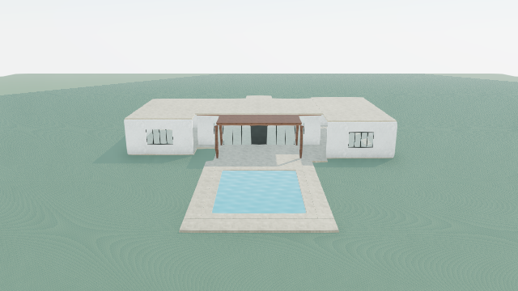

# Continuous family-house diagnostic — 2026-10-30

The same preserved 47-element family house now has a **49-element, renderable and editable diagnostic construction**, with eight actual before/after captures. **The original paid refinement is still rejected, and the diagnostic construction is also rejected by full refinement acceptance.** It must not be represented as an accepted Terra result or imported as an approved project version. We reached a genuine contract/design blocker, rather than a successful premium house.

No new house, provider request, retrieval, database operation, commit or deployment occurred. Existing production code and validation gates were not changed. Original provider files, scenes and screenshots were not overwritten. The new test and runners are offline regression tools. The diagnostic's semantic label is an explicit developer assumption; it does not recover unrecorded model intent.

## Recorded intent and evidence examined

Inputs are the exact `retained-visual-review/original.scene.json`, `raw-candidate.operations.json`, `refine.input.json`, review/refinement results and provider payloads, the generation-quality family evidence, and semantic-contract's prior failed replay. [Input hashes](input-hashes.json) make the inputs reviewable. The original scene and generation-quality source still have SHA-256 `b76ed99bad6f6bda1c1e6f233ef9d65e9b01b0c1c0687f97e488dc44feadf983`. Earlier preparation reports saying no paid response exists are superseded by the retained response bytes; they were left untouched.

The original recorded concept calls the central 12×8 m living volume primary, with 6×12 m and 6×10 m private wings. It explicitly chooses enclosure heads at 3.35 m and a common 3.51 m roof datum. Thus the claimed hierarchy is predominantly in plan; its description of lower-profile wings is not supported by a lower roof datum. It describes a 220 m² accommodation reserve, not four finished bedrooms. Knowledge references include pool-garden-view, dining-transition, asymmetric-balance, covered-threshold and solid-glass-balance; outdoor-reading-nook was considered rather than constructed, and the legacy garden knowledge was disclosed as unsupported. These are recorded selections and decisions, not access to hidden reasoning.

The paid visual review itself identifies the uniform roof cap, weak entrance, underscaled wing openings, pale material similarity and unbuilt garden. It selects only the rear-facade finding for this transaction: recess the facade 0.9 m, add broad paired glazing and a centered operable door, recenter/widen the canopy and move four posts to its corners. The refinement authors 17 operations, removes four original elements and adds seven. It leaves the roof hierarchy and entrance untouched. Its claim that the terrace connection is coordinated does not establish physical validity.

## Chronological diagnose–correct–full-replay record

Every replay below executes the complete transaction through `stageGenerationRefinement`, including schema, scope, preservation, construction relationships, local extent and evidence differences. [Machine record](evidence.json) retains exact outcomes. All changes below affect only the separately labelled diagnostic operations.

| Step | Failing element / intent | Root cause and ownership | Action and complete replay outcome |
| --- | --- | --- | --- |
| 0 | Original operation 16, `rear-loggia-canopy-edge`: a timber front fascia | Terra supplied semantic `material` with renderer `volume`. The previous semantic-contract task fixed the schema that permitted this unsupported pairing. Runtime rejection remains correct. | Original replay rejects unchanged. No automatic conversion. |
| 1 | Expose downstream construction | A fascia's supported semantic meaning cannot be uniquely recovered from the original value. | Explicit developer **assumption** `mass` for diagnostic exploration only; full replay now fails on west-front post/main-floor. This is not a resolved original semantic blocker. |
| 2 | Operation 12, `dining-post-west-front`, moved to [-3.7, 1.65, -3.35] | Its 3.3 m height gives Y=0..3.3, while main-floor occupies Y=0..0.15. Its full 0.22×0.22 footprint is inside the slab. The new 15 cm penetration is real; no parent/rotation error. Terra retained a ground-origin post height while moving it onto a slab. Embedded structural bases could be designed, but no such detail is recorded. The rejection is not demonstrated to be an application defect. | Diagnostic seat bottom at .15 and top at rendered canopy underside 3.13: center Y=1.64, height=2.98. X/Z and section unchanged. Replay next fails on east-front post/main-floor. |
| 3 | Operation 13, `dining-post-east-front` | Same new slab penetration at X=3.7. | Same seating correction. Full replay next fails on sill/main-floor. |
| 4 | Operations 14/15, rear dining posts | Both retain ground-level bottoms through the existing terrace and tops through the canopy. These are historical contacts, so the no-new-collision gate preserves them rather than reporting a new blocker. | Seat each on the same .15 walking datum with top 3.13. Full replay after **each** correction still fails on sill/main-floor. These are diagnostic physical-coordination corrections, not newly discovered gate failures. |
| 5 | Operation 9, `rear-loggia-sill`, intended flush threshold | Its box X=[-.8,.8], Z=[-4,-3.1], Y=[0,.15] lies wholly inside main-floor with identical limestone finish. This is a new redundant overlapping solid, not an absent bridge between door and terrace. Terra error. | Omit this added solid; keep the original slab unchanged. Full replay exposes canopy-edge/main-roof. |
| 6 | Operation 16, diagnostic `rear-loggia-canopy-edge` | Original fascia Y=[3.09,3.33] intersects main-roof's rendered underside at 3.27 by 6 cm. Both are root-frame elements, rotation zero. Terra's dimensions are not a coordinate conversion error. | Trim only fascia top to 3.27, retaining bottom 3.09, plan position and section width/depth: center 3.18, height .18. Full replay clears preservation collision checks, then fails `Refinement introduced construction findings`. |
| 7 | Removed wall/door references and new canopy overlap with occupied evidence | Full evidence comparison introduces **22 audit strings**: 21 concern removed IDs and their downstream missing access/enclosure/knowledge/spatial evidence; one concerns the canopy crossing the Entry vestibule's slab-derived occupied envelope. These are not 22 independent geometry defects. | No evidence strings removed, exemptions added or metadata rewritten. Final full replay remains rejected. This is the current stopping point. |

Diagnostic correction count: **six physical coordination edits** (four post seatings, one redundant-sill omission, one fascia trim), across four issue groups. **Zero newly demonstrated production application defects were patched.** The semantic schema defect was already repaired before this task. The post/slab diagnosis does not justify a global structural-contact exemption.

## Remaining blockers and construction limits

There are **four unresolved refinement blocker/review groups**, plus inherited house incompleteness:

1. **Original fascia semantic ambiguity.** `mass` is a developer choice permitted only in this labelled exploration. The original remains invalid. A supported semantic value from a new model response is needed to attribute success to Terra.
2. **Stale architectural evidence.** The programme, spatial relationships and knowledge decisions still cite `garden-door` and the removed rear walls. The scoped refinement contract preserves plan metadata and offers no explicit evidence-replacement mapping. The added objects are real geometry, but the unchanged plan no longer evidences them. Silently relabelling IDs, rewriting narrative or editing a baseline to pre-seed warnings would evade preservation/evidence checks. A bounded, explicit old-to-new evidence mapping contract needs design before changing production behavior; the associations and extent of each programme enclosure must be reviewed. This is a known contract limitation, not a reason to suppress the existing gate.
3. **Occupied-envelope review.** Entry vestibule references the whole main-floor slab; its local entry wall does not describe a closed room footprint. `occupiedRoofConflicts` conservatively extends that slab to the enclosure head, so the shifted rear canopy is reported against the vestibule. This is review-only, not certified collision with the front entrance. The actual rear strip has a lower canopy over the same slab after the facade recedes. Whether that strip is intended as exterior loggia or occupied interior must be explicitly represented. Inferring a smaller vestibule from one wall, or suppressing the warning for this house, would invent spatial evidence.
4. **Canopy/main-roof junction remains unverified.** Independent geometric inspection finds the canopy's primary solid Y=[3.21,3.39] and Z=[-7.35,-3.35] overlaps the main roof's primary solid Y=[3.35,3.51], Z=[-4,4]: 4 cm in height over a .65 m strip (with additional rendered underside trim). The relationship audit's roof-junction check is assembly-based; these are independent primitive roofs, so **zero hard findings does not certify their junction**. A lower canopy, trimmed roof or explicitly detailed connection are different design choices. No automatic roof union or speculative footprint change was applied. This is a validation coverage limit and unresolved model-authored junction, not proof that the roofs are clean.

Inherited limits remain: bedroom-wing access is unverified, interior partitions/fit-out are absent, garden is an unplanted reserve, canopy coverage of the entire dining terrace was never established, and engineering/weatherproofing/code compliance are not certified. Canopy corner-post connectivity alone does not certify structural design. Root and nested transforms are exercised by existing regression suites; this actual transaction has root-frame moved/added elements and no authored parent change. Its removed door was a child and is removed with its host, so no orphan is silently repaired.

## Original versus diagnostic results

| Check | Original paid response | Diagnostic construction |
| --- | --- | --- |
| Exact provider evidence | Preserved | Separate developer-corrected operations |
| Schema/semantic compatibility | Fails | Passes, with assumed fascia `mass` |
| Primitive construction | Not valid as authored | Passes `stageSceneOperations` and `validateScene`; 49 elements |
| Scope/preservation and new collision check | Not reached | Passes without changing scene metadata or unrelated elements |
| Current hard relationship audit | Not an accepted candidate | Zero findings; roof-junction coverage limit disclosed above |
| Full refinement acceptance | Rejected | **Rejected**: 22 introduced audit strings |
| Actual render | Original 47-element baseline | All 49 diagnostic elements rendered unchanged |
| Edit/save/history checks | Existing source remains intact | All 49 material edits, serialization/reload and Undo/Redo pass in isolated test store |
| Approved project scene | None created | None created |

[Editable diagnostic scene](construction.scene.json) and [exact diagnostic operations](diagnostic.operations.json) are available for inspection and regression testing. Their filename and presence do not authorize acceptance. Tests use an isolated in-memory localStorage adapter and a project explicitly labelled REJECTED/TEST ONLY; no user's saved project was changed. This demonstrates store and executor editability, not a manual browser click-through of every edit control.

## Actual before/after views

Every pair uses the same camera position and target within 1e-7; no reframing after the edit. These are fresh paired captures, not substituted historical screenshots. The normal `ReviewPreview` → `OperationScene` → `VillaScene` pipeline verifies every rendered element ID, local position and yaw, nonblank output and live WebGL context. All APIs and external resources were blocked. [Browser evidence](browser-result.json) records eight 640×360 captures and zero page errors. After images depict **rejected diagnostic geometry**, not successful Terra output.

| View | Original baseline | Rejected diagnostic |
| --- | --- | --- |
| Aerial | [Before](before-aerial.png) | [After](after-aerial.png) |
| Main entrance / Arrival | [Before](before-arrival.png) | [After](after-arrival.png) |
| Garden | [Before](before-garden.png) | [After](after-garden.png) |
| Poolside | [Before](before-poolside.png) | [After](after-poolside.png) |



## Architectural assessment

The garden revision is visibly more coherent locally: two broad glazed fields flank a centered dark door, and the wider centered timber canopy gives the terrace a clearer horizontal frame. It replaces the original irregular window/door band. The improvement is modest at the actual viewing scale. It does not reorganize the whole house, and no paid model comparison was run.

The aerial still reads as a single broad pale cap. The three masses have unequal plan extents but no convincing vertical hierarchy. Arrival still has broad blank wall fields, a small recessed door and a slight canopy; it is effectively unchanged by this rear-only transaction. Wing windows remain small and repetitive. Pale wall and roof finishes visually merge, while timber provides one localized accent rather than an integrated material hierarchy. The centered pool is connected to hardscape, but the surrounding bare ground gives no garden rooms, privacy layering or composed outlook. Garden and Poolside presets are both frontal and visually similar; that limits independent evidence of side-facade depth. Ground aliasing remains conspicuous.

Compared with the inspected [Villa Solana aerial](../../villa-playground/solana-above.jpg), this case lacks staggered heights, a substantial vertical stone portal, deeper glazing layers, terraces at different levels, rails and fine shade elements. Solana also has developed planting and furniture, different scale and golden-hour presentation. Those differences prevent a controlled beauty comparison; they do not explain away the family house's flat composition, visible even in daylight geometry.

**Terra choices:** common roof datum, long blank walls, underscaled entrance/windows, concentrated rear-only refinement and omissions of larger compositional decisions. Existing primitives already support independently positioned roof sections, walls, glazing, portals, screens and materials. There is no evidence that a richer authored building was discarded by the renderer. The model identified broader weaknesses but selected one finding and failed several numerical details in that local repair.

**System limits:** no direct-scene editable planting/tree primitive; stylized materials/lighting and repetitive ground presentation; immutable evidence metadata during structural refinement; incomplete primitive roof-junction and occupied-footprint certification. These materially constrain completeness and reliable acceptance. Neither more warnings nor more passing tests measure beauty.

## Next highest-impact work and verification

First define a bounded evidence-replacement contract for structural refinement, including explicit enclosure/access references and occupied exterior versus interior footprints. Use this same retained transaction and unchanged originals to test it; do not silently transfer old claims onto arbitrary new geometry. Resolve the canopy/main-roof junction with an explicit architectural decision. This is more useful than cosmetic additions or making the acceptance gate ignore new findings.

Meaningful aesthetic progress then needs a coordinated roof/entrance/facade hierarchy rather than another narrow rear edit. If new model output is authorized later, propose **one paid refinement request maximum, zero retries, no Generate call**, with a supported fascia semantic type and explicit junction/evidence contract. No such request is authorized or executed here; current paid-call count is **zero**.

**210 tests pass across 40 files**, including six new real-house regression tests, existing scene construction/semantic/preservation/relationship suites and direct-scene persistence. Typecheck and focused ESLint pass. See [tests](tests.txt), [typecheck](typecheck.txt), and [ESLint](eslint.txt). The golden tests keep the original semantic rejection, reproduce the original front-post collision, verify exact corrected datums, preserve all unrelated objects/metadata, retain final full-pipeline rejection and exercise every diagnostic primitive plus project history. They intentionally do not call this an accepted or beautiful house.

Reproduce offline:

```sh
npx vite-node --config vitest.config.mts scripts/single-house-offline.ts
npx vitest run src/lib/villa/scene/singleHouse.test.ts
node scripts/single-house-capture.mjs
```

The capture runner uses the existing local server on 3015 and local Chrome/playwright-core. It cannot call a provider or write a project. Rerunning overwrites only this task's derived diagnostic evidence, never retained source evidence. Browser/server sandbox restrictions required local execution outside the sandbox; automatic review permitted the capture. A server launch found port 3015 already in use, and capture used that existing server. No running user server was stopped.
