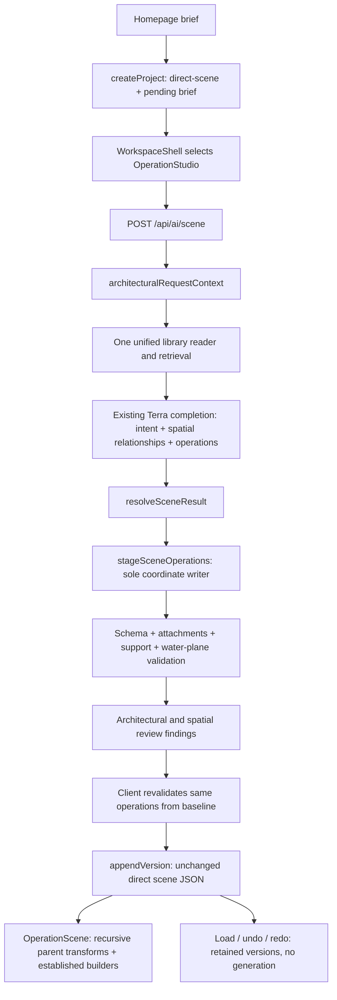

# Architecture and spatial coordination audit

Normal homepage Generate already has **one architectural author and one construction executor**. The retained results are underdeveloped at authorship: a richer design is not being lost in a legacy compiler. This change closes a demonstrated floor/water validation hole and gives the existing design intent a shared element-referenced spatial contract. It does **not** establish that Terra will now produce a beautiful mansion. No new model generation was permitted or performed.

## Direct answers

1. **How many systems decide architecture?** Six retained authoring contract families: procedural HouseConfig, V2 ArchitecturalDesignDocument, V3 scene/blueprint, VillaConfig, VillaComposition, and direct ArchitecturalScene. These are a count of independently authored representations, not agents, endpoints, helpers or experimental fixtures. **Only direct ArchitecturalScene authors new homepage houses.** Image-first interpretation feeds the villa contracts; reference-aware direct authoring feeds the direct contract. Neither is an additional active homepage architect.
2. **How many write geometry?** Five construction families: procedural house primitives, V2 architecture compiler, V3 compiler, villa builders (config and composition), and direct element execution/rendering. Each has editing utilities; these are not additional independent architects. For normal Generate there is **one scene writer**, `stageSceneOperations` through `applySceneOperations`; the browser re-executes the same transaction from the same baseline, rather than applying it twice to the server result. Persistence/import/undo can also replace the active JSON version without designing geometry.
3. **Are they competing?** No competing construction authority was found on the homepage path. Direct projects dispatch to OperationStudio; the old client refuses them, the old house endpoint refuses their root, and project commit validation prevents changing root format. Coexisting legacy code is not evidence of concurrent writers. Both scene URLs share the same handler. No legacy code was deleted or rerouted unnecessarily.
4. **Why poor coordination?** The model returned the inadequate coordinates. Existing validation mainly proved schema, attachments, support and selected facade conventions; it did not reserve open pool space or verify prose relationships. The $25m pool is shallow, its pavilion entrance is on the opposite side from the deck, and the claimed terrace connection is through fixed glazing. The newer $10m response includes a literal terrace/water intersection. These are distinct defects, not one presumed universal collision.
5. **Why basic compositions?** The visible $25m plan explicitly chooses a single-storey estate and treats bedroom/service wings as unpartitioned shells. All 47 elements survive execution. Five broad flat roofs, one door and no interior partitions are already the provider's design. Why the model prefers this shortcut internally is **unproven**; no retained private reasoning transcript exists. Historical instructions for this $25m response were not retained. The newer response's actual system already asks for developed composition and permits 400 elements; it still emits only 42. Adding more luxury adjectives or raising limits is unsupported.
6. **Existing capabilities unused?** Substantial upper floors, setbacks, differentiated smaller roof sections, manually assembled stairs/landings, facade bays, recessed door assemblies, independently editable windows, projecting supported balconies, beams/columns/reveals, rotated wings and parent relationships. Gable/hip roofs are supported but optional. Only the newer result uses one hip roof. Legacy curves and specialized roofs are not all exposed in the direct contract.
7. **Does knowledge help?** It reaches the model: the $25m trace selects estate composition, tropical envelope, view, arrival, overhang and facade guidance from 334 approved/current records. Output cites those IDs and builds some corresponding parts. That establishes use, **not architectural benefit**. Its own limitations concede missing rooms; purported view access is fixed glazing. No controlled with/without-knowledge design comparison exists.
8. **Would references help?** Plausibly, particularly paired images and verified editable scenes showing how composition becomes operations. Existing evidence proves image transport and limited reconstruction, not reliably improved autonomous design. Use a small reviewed collection and compare results before adding any image-generation stage. Normal homepage currently submits text; its workspace can subsequently upload an image into the same direct request.
9. **What was fixed?** Missing detection of floor plates through water; missing structured relationships in the existing intent; missing operation provenance on construction rejection; and an incremental-validation hole where moving one conflicting obstacle could be missed because the water ID stayed unchanged. Redundant prompt guidance was removed while adding the focused contract; the existing system-size test still passes. No saved scene was repaired.
10. **Most important remaining limitation?** Terra still has to turn a semantic brief into a complete, convincing residence in one completion, with no automatic rendered feedback in normal Generate. Spatial consistency alone cannot establish composition, programme completeness or beauty. **A visibly better autonomous house remains unverified**, under the zero-call constraint.

## Authoritative flow and ownership



Architectural decisions belong to Terra's intent and operations. Coordinates belong exclusively to the element graph. The new relationships reference those same IDs; they contain no duplicate boxes, coordinates, recipe dimensions or alternate construction instructions. Construction resolves operations, validation reports contradictions, rendering converts elements to meshes, and persistence preserves versions. None of these stages is authorized to invent a layout or silently relocate geometry.

## Exact component audit

Paths are repository-relative. “Home” means normal homepage Generate, not a manually selected legacy project or development experiment.

| File : function/component | Reads → writes | Home? / overlap and boundary |
|---|---|---|
| `src/app/page.tsx` : `Home.handleGenerate` | Brief → direct project, pending brief, workspace navigation | Yes; no design or geometry decision |
| `src/store/useProjectStore.ts` : `createProject`, `verifyPersistedProjectMode` | Name/mode → blank durable root | Yes; verifies direct mode before dispatch |
| `src/components/workspace/WorkspaceShell.tsx` : `WorkspaceShell` | Resolved project mode → editor selection | Yes; direct branch returns OperationStudio before legacy workspace |
| `src/components/scene/OperationStudio.tsx` : `generateInitial`, `askTerra` | Pending brief/reference/current baseline → API request; returned ops → candidate | Yes; generation sends no current geometry; checks baseline before commit |
| `src/app/api/ai/scene/route.ts` : `POST` | Validated request → context, existing provider invocation, resolved response, retained artifact | Yes; sole scene handler |
| `src/app/api/ai/villa/scene/route.ts` : re-exported `POST` | Same input/output | Compatibility URL, not second implementation |
| `src/lib/villa/scene/knowledgeContext.ts` : `architecturalRequestContext` | Brief or broad edit+intent → guide + selected knowledge + eligible lessons | Yes; one context assembly |
| `src/lib/library/architecture/service.ts` : `generationKnowledge`, `latestKnowledge`, `knowledgeRecords` | Existing library snapshot + seed revisions → unified current entries | Yes; stored revisions override seed IDs, no migration |
| `src/lib/library/architecture/legacyRecipes.ts` : `legacyRecipeKnowledge` | Existing recipe records → in-memory knowledge entries | Yes; 24 legacy recipes can enter same retrieval; no geometry execution |
| `src/lib/library/architecture/retrieval.ts` : `projectKnowledgeContext`, `knowledgeBudget`, `retrieveArchitecturalKnowledge` | Brief/current approved entries → bounded selection/text/evidence | Yes; relevance and diversity, not room coordinates |
| `src/lib/library/architecture/propertyValue.ts` : `propertyValueContext` | Explicit currency → one qualitative band | Yes; neither fixed house size nor valuation |
| `src/lib/villa/design-learning.ts` : `learningContext` | Reviewed summaries → relevant guidance | Yes; current trace has no lesson text; mocks excluded |
| `src/lib/villa/scene/terra.ts` : `sceneSystemPrompt`, `sceneMessages`, `sceneResponseFormatSchema` | Contract/request/reference pixels → provider instructions/schema | Yes; image is optional and untrusted; strict-null normalization does not place geometry |
| Same : `resolveSceneResult` | Returned operations, intent and evidence → validated scene and audit | Yes; fresh empty baseline for generation; filters generated terrain only |
| `src/lib/villa/scene/model.ts` : `stageSceneOperations` | Current elements + atomic operations → new element graph | Yes; add/replace/move/resize/attach/place-on; place-on derives local Y, not a house layout |
| Same : `validateScene`, `applySceneOperations` | Candidate → schema/attachment/relationship validation | Yes; load remains lossless, transactions cannot introduce new faults |
| `src/lib/villa/scene/relationships.ts` : `sceneRelationshipIssues`, `assertSceneRelationships` | Transformed elements → issues or atomic rejection | Yes; includes new water obstruction; no geometry repair |
| `src/lib/villa/scene/planning.ts` : `reviewSceneArchitecture`, `auditArchitecturalPlan` | Geometry, retained intent, knowledge refs → findings/inventory | Yes; old detailed plans remain supported; prose/intent discrepancies remain warnings |
| `src/lib/villa/scene/completion.ts` : `circulationFindings`; `focusedConstruction.ts` : `focusedConstructionFindings` | Same geometry → route, opening, stair and pool evidence warnings | Yes; review heuristics, not navigability certification |
| `src/lib/villa/scene/spatial.ts` : `sceneSpatialGeometry`, `spatialCoordinationFindings`, `waterObstructions` | Same graph + declared relations → transformed boxes/findings | Yes; no extra authoring engine or coordinate store |
| `src/components/scene/OperationScene.tsx` : `OperationScene`, `Element` | Elements/materials → recursive Three groups/meshes | Yes; passes at/rotation unchanged; openings become wall pieces |
| `src/lib/villa/scene/roofs.ts` : `buildSceneRoof`; `components/scene/architecture.tsx` : `Roof`, `Glazing`, `Sofa` | Kind-specific dimensions → mesh details | Yes; roof soffit/cap and sofa conventions extend beyond nominal raw boxes; see limitations below |
| `src/lib/villa/scene/model.ts` : `scenePavilionPlacement`; `components/scene/curved-pavilion.tsx` : `CurvedPavilion` | Pavilion shell size + approved pinned builder → open elliptical lounge | Yes only when selected; owns internal component geometry, not site placement |
| `src/components/scene/OperationStudio.tsx` : `commit`, `edit`; `useProjectStore.ts` : `appendVersion`, `undo`, `redo`, `normalizePersistedProject` | Valid scene/import/version → JSON/history/active version | Yes; direct root skips V3 architectural acceptance/normalization |
| `src/lib/ai/client.ts` : `requestHouseEdit` | Legacy request/root → `/api/ai/house` result | No; explicitly refuses direct projects |
| `src/app/api/ai/house/route.ts` : `POST`, `generateV3Scene` | Mode/root/brief → legacy or V3 authoring | No; rejects architectural-scene-1 roots with 409 |
| `src/lib/architecture/stages/pipeline.ts` : `runArchitecturePipeline`; `architectStage.ts` : `runArchitectStage`; `designEngine.ts` : `designArchitecture` | Legacy brief, strategies, site, masses → V2 document/stages | No; independent design decisions retained for V2 compatibility |
| `src/lib/ai/stagedClient.ts` : `requestStagedGeneration`; architecture stages `runFoundationStage`, `runMassExpansionStage`, `runGeometryStage`, `runRoofCompositionStage` | Stage documents/brief → successive authored V2 decisions | No; several staged decision makers inside one V2 family, not homepage writers |
| `src/lib/architecture/stages/spatialReflow.ts` : `spatialReflowErrors`; `reconcileSitePlanExecution.ts` : `reconcileSitePlanExecution`; `numericNormalization.ts` | V2 plan/patches → integrity findings or legacy normalization | No; cannot move direct elements |
| `src/lib/architecture/compiler.ts` : `resolveMasses`, `compileArchitecture`, `projectArchitectureToLegacy`; `sceneOperations.ts` : `executeSceneEditPlan` | V2 document/patch → primitive model or edited document | No; legacy writer/compiler, not direct conversion |
| `src/lib/v3/architecturalBlueprintGeneration.ts` : `generateV3FromArchitecturalBlueprint`; `architecturalBlueprint.ts` : `lowerV3ArchitecturalBlueprint`, `constructV3ArchitecturalBlueprint` | V3 authoring/blueprint → V3 scene | No; distinct V3 plan/build contract |
| `src/lib/v3/operations.ts` : `executeV3SceneOperations`; `scene.ts` : `compileV3Scene`; `composition.ts` : `compileV3Composition` | V3 scene/edits → updated V3 objects/house model | No; specialized compiler can make legacy construction choices, not invoked for direct houses |
| `src/lib/house/generateHouse.ts` : `generateHouseFromJson`, `generateHouseModel`; `normalizeRooms.ts` : `normalizeRoomLayout` | Legacy house parameters → primitives/room normalization | No; procedural configuration construction retained |
| `src/lib/villa/terra.ts` : `resolveVillaResult`, `villaSystemPrompt`, `compositionSystemPrompt`; `src/app/api/ai/villa/route.ts` : `POST` | Villa config/composition proposal → validated result | No; playground authoring, not homepage scene handler |
| `src/lib/villa/composition.ts` : `buildComposition`, `executeCompositionPatch`, `deriveGarden`; `src/app/dev/villa-playground/wing-composition.ts` : `operateWings`, `gallery` | Villa composition/patch → derived wings/garden/connections | No; legitimate deterministic layout decisions inside villa contracts |
| `src/app/dev/villa-playground/composed-villa.tsx` : `ComposedVilla`; `architecture.tsx`, `footprint-building.tsx`, `stacked-building.tsx` | Villa config/derived composition → meshes | No; direct renderer reuses individual components, not whole-house composition |
| `src/lib/villa/image-first.ts` : `constructImageSpec`; `image-vision.ts` : `constructVision`, `interpretSavedImage` | Image interpretation + mappings → villa construction | No; analysis/translation experiment, not a second direct-house writer |
| `src/components/scene/SceneReview.tsx` : `evaluate`, `decide`; `src/lib/villa/visual-review.ts` : `stageSceneReviewEdit`, `requestReviewProposal` | Three captures/reference/current scene → scoped candidate and human review | Opt-in dev only; never runs automatically in normal Generate |
| `src/lib/villa/scene/twoStage.ts` : `compositionRequest`, `developmentRequest`; `terra.ts` : `prepareArchitectureCompletion` | Brief/current scene → request preparation | Not independent construction; same endpoint/operations, explicit additional actions |

This inventory groups variants by authored contract and compiler. Counting every stage, renderer helper, local study and fixture as a separate “system” would obscure ownership rather than explain a race. Static development examples are not automatic generators.

## Retained response provenance

The exact current artifacts are linked in [evidence.json](evidence.json), including SHA-256 hashes, operation indexes, each element's world coordinates, nominal bounds, original intent, selected knowledge, usage and review findings. Reconstructed scene files contain **only original operations plus retained plan**, not repairs.

- `$25m`: `.data/scene-responses/eb6a91b2-dc5d-497b-9296-8fa53f612978.json`, accepted, **Maison des Alizés**, 47 add operations. Retained plan explicitly says “$25 million”; the original brief is `[REDACTED]`. No `requestSystem` field. 7,789 input / 6,137 output tokens, including 1,328 reasoning tokens; no reasoning content is retained.
- Newer `$10m` context: `.data/scene-responses/7702f28d-6098-4bf4-b08a-b12fc68ae93b.json`, accepted, **Casa Brisa Caribe**, 42 add operations. Knowledge trace parses $10,000,000. Its exact system is retained: 37,486 characters = 19,880 base + 17,606 retrieved context, zero lesson characters. It already permits 400 elements/800 operations and says there is no preference for fewer parts. Output uses 6,436 tokens, including 1,735 reasoning tokens, far below 30,000.

The original saved project from the user's original browser profile was not independently recovered. In the inspected Chrome profile the homepage showed no recent projects. The browser proof here imports the unmodified retained result into the isolated existing playground. It is not falsely identified as the original saved project. Previous reports calling the October 27 Horizon House “latest” are superseded by these October 28 artifacts.

## Coordinates and responsibility

World units are metres, Y up. All listed generation placements are world-authored except `entry-door` in the $25m scene, whose local placement inherits its wall. Full element-by-element coordinates/indexes are in the evidence file.

| $25m element IDs / operation indexes | Actual geometry | Finding / cause |
|---|---|---|
| `salon-floor` / 0 | X −8..8, Z −6..6; slab Y 0..0.2; 192 m² | Main residence floor, not a missing upper-floor conversion |
| `west-wing-floor` / 1; `east-wing-floor` / 2 | X −18..−8 and 8..18; Z −6..4; each 100 m² | Floor edges meet salon at X ±8. They are **not disconnected footprints**. Model leaves suites/service rooms unpartitioned. Nominal principal slabs total 392 m², not certified net area. |
| `salon-roof` / 22 | 17.2 × .35 × 13.2 at (0,4.78,0); nominal Y 4.605..4.955 | Only .6 m overhang relative to floor, not an oversized conversion. Broad visual expanse follows the 16 × 12 unarticulated room. Timber soffit extends to Y 4.525. |
| `west-wing-roof`, `east-wing-roof` / 23,24 | 10.8 × .35 × 10.8 at X ±13, Y 3.58, Z −1 | .4 m overhang; roof underside 3.405 while wing walls top at 3.6: .195 m nominal intersection (.275 including soffit). Model datum mismatch; no transform changed it. Roof/wall contact itself is legitimate, so no blanket collision rejection. |
| `entry-wall-door`, `entry-door` / 9,10 | Wall centre (0,1.9,−6), height3.4; child (0,−.3,0), height2.8 → world centre Y1.6, bottom .2 | Door centre formula is correct. Approach `arrival-court` /3 reaches Z−6. No attachment-origin bug here. |
| `entry-wall-left`, `entry-wall-door`, `entry-wall-right` /8,9,11 | Rear wall tops Y3.6, salon roof underside4.605 | About1.005 m unclosed rear strip below high salon roof; roof is not automatically filling missing enclosure. This is authored missing wall geometry. |
| `ocean-terrace` /4; `terrace-canopy` /32 | Deck X−8..8, Z6..14, walking Y.2; roof X−8.6..8.6,Z6..14, underside3.405 | Intentional roof/deck coverage, not a collision. Posts /28..31 topY3.5 intersect roof .095 m. No need to separate shade from terrace. |
| `salon-view-left/center/right` /5..7 | Glazed openings, sill .35 above wall base .2; window bottomY.55 | All are `opening.glazed=true`, rendered fixed glass; these three bays do not establish a traversable salon-to-terrace route. Plan's claimed direct connection is incomplete. |
| `pool-basin-floor`, `pool-water` /35,36 | Both X−7..7,Z15.5..20.5; bottom topY.06; waterY.2 | **Depth .14 m.** Could be a reflecting pool; not evidence of a swimming pool. No house floor crosses it. Existing focused audit correctly warns. |
| `pool-coping-south`, `ocean-terrace` /39,4 | Coping Z14.6..15.5 vs terrace ending14 | .6 m gap. West/east coping begins14.6 too: no slab route bridges terrace to pool surround. This is a missing dry construction link, not a collision. |
| `ocean-pavilion`, `poolside-lounge-deck` /45,46 | Pavilion floor datum .2, shell12×8 at Z26, yaw0; deck X−7.5..7.5,Z21.5..24.5, walkingY.2 | Deck overlaps rear portion of elliptical floor (floor reaches Z21.75), not the entrance. Entrance is +Z; entry anchor approxZ29.919, approach extends farther +Z. No corresponding front approach is modelled. Direction/connection error authored by model. Roof ellipse extends toZ21.35; roof/deck plan overlap is legitimate. |
| Pavilion internal sofa | No independent scene ID; belongs to pinned component /45 | No outdoor sofa add operation exists in this response. Do not invent a furniture collision from the screenshot. Pavilion includes its furniture deliberately. |

Pavilion actual origin/extents come from `scenePavilionPlacement`, `CurvedPavilion`, `pavilionEntry` and `ellipsePlate`, rather than treating the floor-origin ellipse as a centre-origin rectangular box. The builder's open side is documented as +Z; the scene prompt previously did not convey it. The focused contract now does.

| Newer $10m defect | Source evidence | Disposition |
|---|---|---|
| Terrace through pool | `pool-terrace` /4: X−9..9,Z−13..−5,Y0...2. `pool-water` /39: X−6.5..5.5,Z−15..−10,Y.02. Intersection X12 m × Z3 m = **36 m²** at the water plane. | Confirmed contradiction present in provider operations. New generation rejects atomically, retains exact draft and reports indexes4/39. No arbitrary move or concealed element. |
| Basin relationship | `pool-bottom` /34 topY−.8; waterY.02 → depth.82 m | Unlike $25m reflecting depth, this has a submerged basin but its terrace covers most water footprint. |
| Pavilion/furniture | `beach-lounge-pavilion` /40 centre(10.5,0,−13),shell7×6,yaw0; `pool-edge-seat` /41 centre(7.5,.55,−12.5),size2.4×.7×1,yawPI/2 | Nominal seat box overlaps shell/floor bounds; exact shell/furniture mesh collision is unverified. Sofa renderer honors width but has fixed height/depth/floor-origin details, so nominal element boxes are not sufficient collision evidence. This renderer inconsistency is disclosed, not misidentified as the cause of the house composition. |

### Cause classification

Confirmed: **(1)** incompatible/missing authored placement and **(2)** insufficient executable shared spatial intent. The support validator did what its existing contract required; its acceptance was not proof of usable circulation or complete architecture. No evidence of **(3)** erroneous move/attach/place-on positioning, **(4)** main-house coordinate conversion, or **(6)** multiple systems overwriting the same area in these all-add responses. **(5)** pavilion's component entrance/origin contract was incompletely communicated to the model. **(7)** roof material/soffit and camera influence appearance, and sofa dimensions have a real rendering convention mismatch; neither explains missing floors or rooms. Rendered screenshots corroborate the authored geometry but do not supply these causes by themselves.

## Changes and verification

| Root cause | Focused correction | Evidence / practical limit |
|---|---|---|
| Support validation accepts a continuous terrace through open water | `spatial.ts: waterObstructions` tests positive plan overlap against inset water footprint and actual water elevation; `relationships.ts` integrates into existing atomic validation | Real retained $10m API replay now422 with original recoverable draft. Basin bottoms, coping, piers, overhead bridges and roofs are preserved. No all-pairs solid collision ban. |
| Prose relationships lack stable construction references | `planning.ts: architecturalIntentSchema` now supports `spatialRelationships`; planning instructions coordinate the same graph; `spatialCoordinationFindings` checks declared relations | Rotated parents and declared roof coverage/facing regression tested. New metadata is optional for legacy compatibility; mismatches remain review findings. These are conservative rectangle checks, not a route solver or a quality score. |
| Pinned pavilion's entry direction absent from scene instructions | Shared contract states +Z entrance, floor datum and floor/roof extensions | Fix prevents ambiguous component-axis instructions; no new pavilion or house builder. Future model compliance not proven offline. |
| Existing-issue exemption compares only water geometry | Relationship issues now carry related obstacle IDs and exemption compares both participants plus ancestors | Finish-only edits to unchanged legacy faults remain allowed; moving conflicting deck while water stays fixed is rejected; moving it clear succeeds. |
| Construction rejection does not trace responsible operations | `terra.ts: resolveSceneResult` appends zero-based indexes, including ancestor edits | Regression asserts original operations4 and39; no provider retry. General issue IDs and draft remain visible. |
| Repeating architectural guide consumes context without adding execution semantics | Removed redundant “Apply within this response” paragraph when adding the relationship contract | Existing guide/system-size regression passes; not a claim of measured design improvement. |

The hard check deliberately focuses on floor plates at open water, not every object intersecting a pool. The first regression run caught a legitimate pergola pier in the existing Ladera fixture; the implementation was narrowed before completion. Roof shelter and cantilevers are not rejected. Pool depth, duplicate floor plates, claimed accessibility, intended connectivity and roof coverage remain review findings where universal rejection would prohibit legitimate architecture. There is no automatic geometry repair.

Run offline:

```sh
npx vite-node --config vitest.config.mts scripts/spatial-root-cause-audit.ts
npx vitest run src/lib/villa/scene src/app/api/ai/scene src/store/__tests__/directScenePersistence.test.ts
npx tsc --noEmit
```

Results: **132 tests pass across 20 files**; TypeScript and targeted ESLint pass. The canonical handler tests mock the SDK/provider boundary, including the real four requested brief strings and knowledge assembly; no paid calls occur. Retained responses are replayed through the real executor. The new API regression verifies exact retained bad operations are rejected rather than silently amended. Existing persistence tests exercise edit/undo/redo/reload.

### Four-brief evidence boundaries

`evidence.json` records four **existing developer-authored studies** (compact, Mediterranean, tropical, mansion) replayed through `resolveSceneResult` and unified retrieval with exact geometry equality. They have distinct element/dimension/roof signatures and different selected knowledge/value bands. They are not four newly generated Terra houses and are not production templates. Separate route tests prove the four briefs use the canonical handler and stored library assembly. These tests cannot prove brief-sensitive autonomous architectural decisions: a mock or authored fixture cannot establish model quality. No retained four-case model experiment with all exact original briefs was found.

### Browser evidence

Fresh browser screenshots are included in the task conversation: the original 47-element Maison des Alizés imported into the existing direct-scene playground, in poolside and aerial views. The screen shows the same editable slab dimensions and unchanged broad flat roofs; it also exposes the existing shallow-pool warning. No Generate, Redesign, Refine, Evaluate or image-generation action was invoked. The import modifies only the playground's local test scene, not the user's saved mansion/project versions. The viewer exposes 47 elements and one local import history entry. Screenshots are corroboration, not a claimed before/after improvement or original-project provenance. They are not silently replaced with old developer-study screenshots in this folder.

## Existing knowledge versus missing knowledge

The shared inventory is310 seed/current architectural records plus24 approved legacy recipes, not334 distinct construction capabilities. The retained trace confirms334 approved active records. Existing guidance already covers:

| Need | Existing coverage examples |
|---|---|
| Composition / luxury hierarchy | `estate-composition`, `composition-hierarchy`, `asymmetric-balance`, `property-value-25m-50m` |
| Site organization / reservations | `site-orientation`, `waterfront-estate`, `site-waterfront-setback-limit`; universal planning/guide instructions |
| Roof relationships | `deep-overhang`, `layered-roofline`, `flat-roof-parapet`, `hip-shelter` |
| Indoor/outdoor connections | `living-view`, `veranda-edge`, `covered-threshold`, `outdoor-entertaining` |
| Pools / pavilions | Existing pool fragments/recipes and approved pavilion builder; actual library specialist retrieval requires relevant brief terms |
| Facades | `window-rhythm`, `solid-glass-balance`, `deep-reveals`, `vertical-screens`, `facade-materials` |
| Sequencing / completeness | `room-enclosure`, `vertical-access`, `structural-continuity`, guide/checklist and existing construction assembly instructions |

No new recipe was added. Textual subject coverage is not the demonstrated gap. The useful missing evidence is **verified constructed examples** showing successful application, with supported geometry, coordinated rooms/routes, source images and known limitations. Prior inventory documents report zero verified reviewed-design source entries and only mock feedback summaries; the inspected recent request has zero lesson text. Do not label approved repository guidance “proven architecture” merely because approval exists.

## References and visual feedback

`OperationStudio` has an image upload; `sceneMessages` sends its pixels in the same user request to the same scene operation contract. Homepage inspiration cards only prefill text and homepage Generate has no image upload. Thus normal direct architecture can be reference-aware once an image is selected in its editor, but homepage first submission is text-only. This is not automatic image-first concept generation.

The legacy `constructImageSpec`/`constructVision` paths map observations and supported feature targets into VillaComposition and existing builders. Their known limitation is translating image features into constrained configuration defaults. The retained image-first report explicitly labels its fixture manual/offline. Reference-review evidence records a failed DNS attempt and a separate manually corrected patio, not a successful AI visual improvement. Prior vision correction evidence exists, but it does not establish reliable, complete mansion generation. There is no controlled small-reference-library evaluation proving better direct scenes.

`SceneReview.evaluate` can capture three render views and send them plus a reference to the existing visual reviewer; its scoped edit is a separate explicit action followed by human approval. It is development-only and never automatic during Generate. No rendered feedback reaches Terra in the ordinary first completion.

Practical recommendation: upload approximately 6–12 carefully reviewed examples through an extension of the **existing architecture library admin flow**, with source/licence, style/climate, scale, composition/roof/arrival/pool tags and applicability notes. Keep three clear provenance types: inspirational image (unverified construction), construction guidance (supported operations/relationships), and verified editable 3D example (immutable scene/version + reviewed matched views + unresolved limitations). Existing `sources` supports links and verified source provenance, but there is currently no image-byte attachment/retrieval mechanism in `generationKnowledge`; adding links alone will not send pixels. Reuse current reference-image transport when retrieval selects a reviewed image; do not pretend an admin link is multimodal input. Retrieve a small compatible set under the existing context budget rather than appending hundreds of images.

First evaluate fixed briefs against reference/no-reference using the same existing endpoint, retained raw outputs, matched camera views and independent assessment of programme, hierarchy and pool/access relationships. This requires separately authorized future provider calls; none were made here. Do not enable automatic concept-image generation or a paid improvement loop on the present evidence. No current price claims are made.

## Confirmed versus unresolved

Confirmed: one homepage authority; unified knowledge actually delivered; original model chooses shell-level architecture; executor preserves dimensions; $25m shallow pool and missing links; newer terrace/water intersection; incomplete pavilion-axis communication; no automatic visual feedback. Focused corrections and offline regression behavior are verified.

Unresolved: exact original user brief and system for the $25m artifact; identity of its historical saved project; all exact mesh-level furniture collisions; whether a reference collection or this new contract changes Terra's design choices; which particular model preference causes underdevelopment; code-compliant access or structural adequacy. No claim is made that 132 passing tests establish architectural beauty.

No OpenAI calls, migrations, commits, deployments, recipe proliferation, new agents, engines, house templates or primary repairs to the current mansion were performed. Existing unrelated working-tree changes and saved-project formats were preserved.
