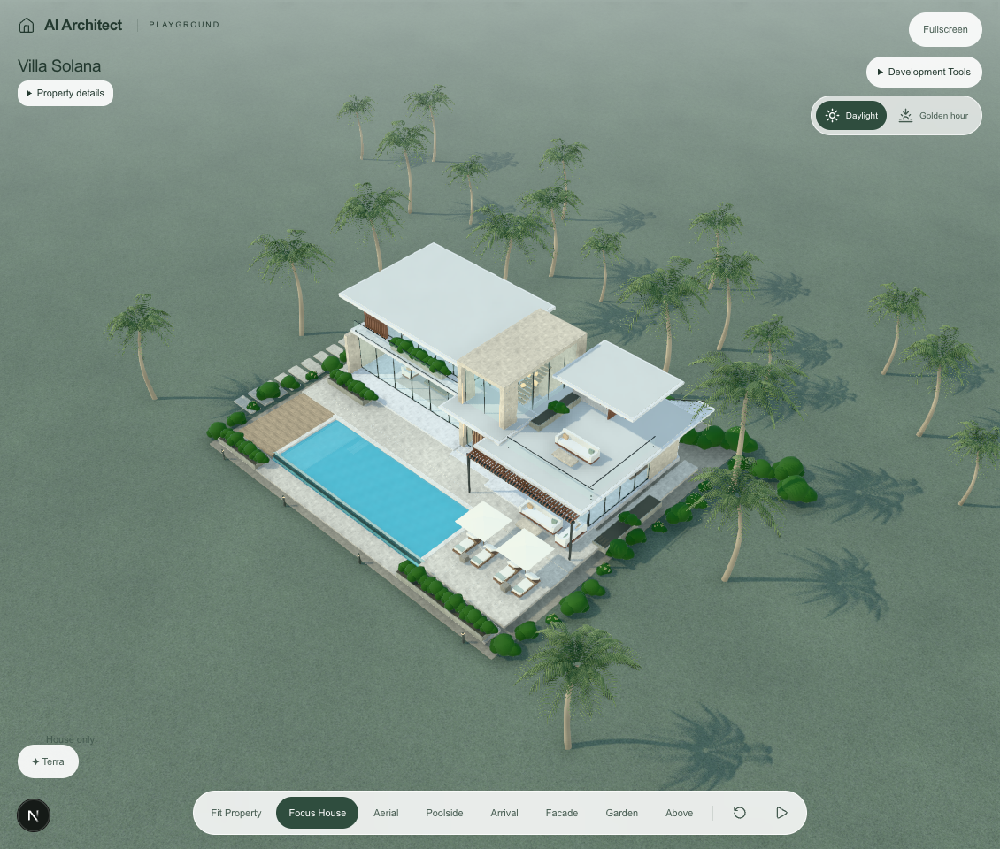
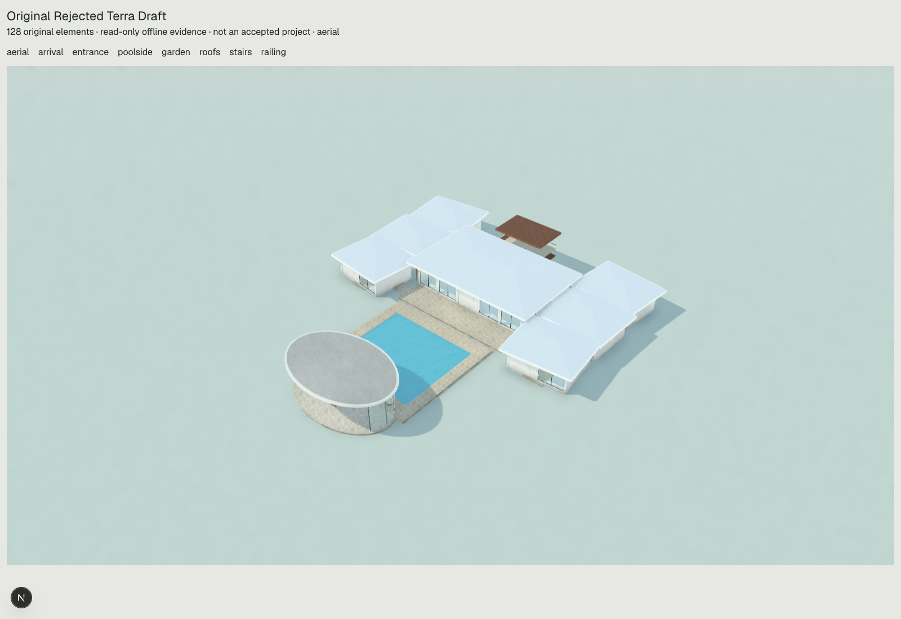

# Architectural generation pipeline: source trace and demonstrated repairs

The existing system can express much of Villa Solana's architectural composition. The retained Terra estate fails earlier than rendering: its selected programme explicitly settles for suite shells and an allocated kitchen, then its operations contradict the promised access and geometric relationships. No executor that fills in those missing rooms exists, and introducing one would be a second construction system. This investigation corrects four demonstrated software defects around money classification, retrieval, requirement metadata and saved briefs. It does **not** establish that Terra will now design an exceptional house.

Zero provider calls, external searches, production database reads/writes, migrations, model changes, commits or deployments. The original provider response and 128-element estate remain unchanged and rejected. The prior roof narrow phase and pool-accounting correction were already in the working tree; they are verified here, not claimed as new work.

## Debugging table

| Stage | Actual problem | Root cause | Fix implemented | Verified |
|---|---|---|---|---|
| Request transport | No loss demonstrated in the original Generate message | `generationSceneRequest` and `sceneMessages` send the full prompt as JSON, not keyword-only input | No change needed | Eleven exact-message fixtures, including named countries, terrain, orientation, levels, room counts and exclusions |
| Money interpretation | “construction budget of about $25 million” became an unspecified price and selected the $25m property-value record | `monetaryBriefContext` accepted only one connecting phrase. `land` also matched the end of `island` | Accept consecutive label modifiers and require a label word boundary | Failing regression reproduced first, then passed; construction/land-only fixtures select no property-value record |
| Retrieval | “$100 million private tropical compound” received no baseline composition/programme/arrival guidance with the seed catalogue | Residential eligibility omitted `compound` | Include residential compounds in the existing baseline relevance test | Seed and full retained catalogue regressions; no automatic pool, garage, gym or cinema |
| Requirement metadata | “4 bedrooms and 3 bathrooms, without pool or gym” recorded only pool/gym | Singular-bedroom pattern, no bathrooms, exclusions not filtered at extraction | Match singular/plural bedroom suites and bathrooms with explicit number tokens; apply existing exclusion matcher | Exact positive metadata and negative-room regressions. This corrects metadata/budgeting, not the already intact provider message |
| Concept and programme | Six “suites” were selected as shells; kitchen only allocated to the salon | The response's own programme limitations omit bathroom/wardrobe partitions, cabinetry and service door | No invented software repair; existing primitives already support partitions, openings and counter solids | Exact normalized output and `reviewProgramme` in offline evidence |
| Provider contract | No dropped operation or truncation demonstrated | Response completed; strict adapter preserves operations | Preserve existing contract | Exact original strict response reparsed and compared to normalized output |
| Assembly/execution | No retained-generation expansion defect demonstrated | Seven wing assemblies plus pool and direct adds produce the authored coordinates | No new assembly or renderer | 36 authored operations replay to all 128 original elements exactly |
| Relationships | Prior coarse roof bounds falsely rejected six salon/suite pairs; other faults are real | Empty bounding space versus actual slopes/fascia; model-authored coordination errors | Existing roof narrow phase retained; correct gates unchanged | Four real roof pairs still yield eight directional findings; fourteen total hard findings remain |
| Rendering | No hidden conversion of a finished mansion into shells | `OperationScene` renders the actual parts, reusing Solana helpers | No change; no new screenshot implied | Existing labelled original captures and their hashes retained |
| Saving and later edits | The original brief disappeared from saved scene context; later edits could only see Terra's summarized plan | `sceneSchema` had no generation brief; Generate built a base with only name/elements; broad retrieval used only retained plan | Optional `generationBrief` metadata set by Generate, preserved in edits/history/reload; broad retrieval includes it as historical context. Current edit takes precedence | Generate, rejected draft, JSON reload, targeted edit, actual project store Undo/Redo and historical-scene compatibility |

## Exact production path examined

1. `src/app/page.tsx` creates a `direct-scene` project and queues the original brief. `WorkspaceShell.tsx` selects `OperationStudio`, not the legacy house or V3 blueprint executor.
2. `OperationStudio.askTerra` uses `generationSceneRequest` for ordinary Generate; the two-stage composition helper is not used. It sends `/api/ai/scene`. `/api/ai/villa/scene` delegates to that same handler.
3. `sceneRequestSchema` validates the full text. `architecturalRequestContext` calls `generationKnowledge`, which combines latest approved seed/stored revisions and legacy recipes through `retrieveArchitecturalKnowledge`. Approved lessons are added through the existing learning path. No research is automatically executed.
4. `sceneSystemPrompt`, the retrieved text, conceptual guidance and qualitative value guidance form the system message. `sceneMessages` sends the complete user input independently of retrieval metadata. Deterministic keywords steer retrieval; the model remains responsible for semantic architectural interpretation.
5. One provider response supplies concept, programme and operations together. There is no deterministic room planner between them. `sceneResponseFormatSchema` handles strict optional-null fields without inventing coordinates.
6. `resolveSceneResult` checks construction-loop safety, then `stageSceneOperations` expands `assemble` into ordinary editable parts, applies local/world transforms and validates IDs/parents/schema. `assertSceneRelationships` checks actual geometric relationships. Architecture/programme reviews remain evidence warnings, not a completeness certificate.
7. `OperationScene` renders stable IDs under parent groups with local translation/yaw. `OperationStudio` revalidates responses, checks for intervening project/scene changes and commits through `appendVersion`. Rejected drafts are retained separately. Project history stores the scene JSON; Undo/Redo restores those versions.

The new brief field carries input evidence through this same path. It adds no operations, provider call, plan schema, geometry gate or second engine. Existing scenes without it continue to load. Original historical projects cannot recover missing briefs automatically; their retained server artifacts remain separate evidence.

## What Solana's code actually does

The reference is `src/components/scene/architecture.tsx`, principally `TropicalVilla`, `UpperSuite`, `Entrance`, `Roof`, `Glazing` and `Slats`; outdoor composition is in `grounds.tsx`. `OperationScene.tsx` already imports `FinishBox`, `Box`, `Roof`, `Glazing`, `Slats` and `Sofa` directly from that file. This is a real shared renderer connection, not a visual analogy.

| Source technique and coordinate logic | Architectural effect | Editable direct-scene equivalent |
|---|---|---|
| `TropicalVilla`: salon plinth centred roughly X=-7.4; dining X=9.2; `UpperSuite` floor Y=4.75, roof Y=8.53; dining roof Y=4.63 | Asymmetric primary/secondary hierarchy and a recessed upper residence, rather than equal satellites | Independent plates, walls and roof sections with parent frames. Occupied upper levels require explicit support, openings and roof removal/splitting; stacking complete wing assemblies does not do this |
| `Roof`: main slab plus soffit centre at `at.y-height/2-.045` and smaller top layer at `at.y+height/2+.025` | Readable edge thickness, warm underside and layered silhouette | Flat ivory `roof` already calls this exact helper; other roof materials retain an underside. Extra parapets/fascia use independent volumes |
| `Glazing`: thin glass, horizontal rails and evenly spaced vertical mullions; salon fronts remain largely open between selected piers | Glazing sits in deliberately composed solid/open boundaries, rather than over an uncut solid wall | Wall openings plus separately editable glazing children; local centre `-wallHeight/2+sill+openingHeight/2`. Segmented walls allow varied bays |
| `UpperSuite`: rear sill centre 5.65/height 1.45 and header centre 7.98/height .85 frame a shallow rear window; long garden glazing lies below the roof, with projecting floor and transparent guard | Different privacy and exposure on different faces; terrace depth and setbacks | Individually positioned wall segments, glazing, slab and railing; no fixed programme or façade template required |
| `Entrance`: two slender stone blades, rear piers, spanning lintel, separate pivot door/sidelights/transom and projecting canopy | Arrival mediates the height difference and has threshold depth | Volumes/walls, an actual unglazed opening, door and fitted glass, separate supported approach and roof. Existing `codeArchitectureProof.ts` tests fitted portal pieces rather than a door falsely filling an entire double-height opening |
| `Slats`: repeated matrices with caller-selected axis; dining pergola explicitly spans to edge beams/posts | Local shading and rhythm, selected for each place | `screen` provides vertical slats. Individually editable horizontal pergola members are volumes; do not claim the screen API supports every Solana slat orientation |
| `TropicalGrounds`: front terrace, two side decks and end strip are distinct slabs around the basin; pool/coping use shared width/depth edge calculations | Water remains an intentional void within an outdoor room | Existing rectangular-pool expansion and explicit dry plates. Freeboard, support and door-to-deck connection still require coordination |

Solana's visual advantage comes from **choosing and coordinating these relationships**. The implementation does not discover them from a brief. Its bespoke JSX also includes decorative spheres, glow, arbitrary rotations, planting and furniture that the current scene schema cannot faithfully reproduce as independently editable parts. Fixed furniture/glazing internals are composites unless rebuilt from ordinary parts. The pinned curved pavilion remains a single composite. The schema permits yaw only, so Solana's sloping stair handrail and pitched chaise back cannot simply be copied as rotated boxes.

Solana is a visual construction reference, not a validated complete house specification. Its thin repeated stairs and visually named infinity edge do not prove structural support, a full residential programme, safe access or hydraulic operation. Porting that JSX verbatim would import assumptions and opaque components; no such port was made. Existing `codeArchitectureStudies` already demonstrates two different editable compositions, root movement, fitted glazing, roof replacement and history. It is a developer study with incomplete accommodation/access, not model-generated evidence or a complete estate.

## Where the retained mansion first diverges

The exact retained request asks for meaningful room layouts and coordinated multi-level architecture. Its response correctly distinguishes US$25m value from construction spending and discloses flat-site staging. However, its programme already labels every suite as a shell, explicitly omitting bathroom/wardrobe partitions, and allocates kitchen/service on the shared salon slab without cabinetry, storage partitions or separate service door. That is the first directly observable accommodation downgrade, before assembly expansion or validation. Its narration also claims deck connectivity and usable upper access that the coordinates contradict.

The retained request selected eight knowledge entries covering value, estate composition, pool, climate, waterfront, outdoor entertaining and legacy roof/arrival advice. It selected no interior-specific record. This is a real coverage limitation, but the original provider contract independently exposed partitions, openings, manually supported stairs and counter volumes. Retrieval omission alone therefore does not establish why the model declined to build them. The catalogue records principles/options; neither selection nor `designDecisions` causes geometry to exist.

The response used only 36 authored operations/128 elements against 800 operations/400 elements, completed within its token allowance. No truncation, dropped assembly, hidden simplified renderer, insufficient element cap or unavailable basic partition primitive explains the missing rooms. Its internal reasons for choosing convenience/repetition remain unobservable. Adding another global checklist or accepting invalid geometry would not demonstrate a solution.

Existing actual construction faults remain: four intersecting suite-roof pairs, water-level ocean link, unsupported stair plates, wrong final landing/route, misplaced railing, walks crossing suite footprints and an arrival canopy facing a solid wall. No retained geometry was silently corrected. Existing isolated developer railing, pool, eave and stair examples remain separately labelled in the prior diagnosis.

## Interpretation checks and their limits

[Offline evidence](offline-evidence.json) contains eleven fixtures, exact provider-message text, monetary signals, selected records and exclusion reasons against the retained **334 approved records**: 310 latest architectural records (including nine value references) plus 24 legacy recipes. Stored property-value revisions override the corresponding seeds through the existing reader; they are not duplicated.

The fixtures cover $150k and $450k homes, a $2m Mediterranean villa, $25m Caribbean estate, $100m tropical compound, construction-only budgets, separate property/land/construction amounts, no-price hillside/north-facing requests, a deliberately compact high-value home and EC-dollar input. Value bands impose no room counts, floor areas or mandatory amenities. Non-USD money is not converted. Bare dollar values remain explicitly assumed USD for qualitative guidance; an unspecified price remains an ambition assumption, not a verified market valuation.

These checks prove exact requirement transport and deterministic selection behavior, **not comprehensive understanding of natural language**. `projectKnowledgeContext.location` recognizes contextual keywords, not named-country geography: “Saint Lucia”, “London” and “Japan” remain in the full brief but are not resolved to climate/site facts by that extractor. The Saint Lucia compact fixture still retrieves only value/family/composition guidance. The default design guide contains tropical advice, but region-specific retrieval is not guaranteed from a country name. Adding unverified geographic/cost inference was not justified by this offline exercise. Terrain/orientation/privacy also remain full-text input for model interpretation, not solved geometric constraints. Generation still stages flat terrain and must disclose that limitation.

Explicit room phrases now survive retrieval metadata, and the exact brief survives new saves and later edits. **Programme preservation as built rooms is still unproven**: the existing programme references expose commitments and limitations without generating partitions, cabinetry or access. There is no honest basis to call the retained mansion complete.

## Verification and files changed

The three original retrieval regressions were observed failing before correction. New coverage then verifies the full stored catalogue and brief persistence. Existing exact-scene equality tests were updated to expect the new metadata field while continuing to compare the entire original geometry.

Commands:

```sh
npx vite-node --config vitest.config.mts scripts/architecture-system-offline.ts
npx vitest run src/lib/library/architecture src/lib/villa/scene --reporter=json --outputFile=docs/architecture/system-repair/tests.json
npx vitest run src/app/api/ai/scene/route.test.ts src/app/api/ai/scene/route.providerSchema.test.ts --reporter=json --outputFile=docs/architecture/system-repair/route-tests.json
npm run typecheck
```

Focused ESLint covers all files changed in this investigation. The first suite passes **139 tests in 34 files**, including all retained estate, roof, assembly, programme, edit and history tests. The route/schema suite passes another **58 tests in 2 files**, for **197 passing tests across 36 files**; results are recorded in [route-tests.json](route-tests.json). [verification.json](verification.json) records final checks. Original manifest hashes are checked before replay; exact strict output equals the original normalized response; all 128 elements match; the unchanged scene still has 14 hard findings. Network is blocked in the offline replay; stored catalogue fixtures use local files and do not call the production library/database.

Production changes in this investigation:

- `src/lib/library/architecture/propertyValue.ts`: money-label classification.
- `src/lib/library/architecture/retrieval.ts`: compound relevance and literal room/exclusion metadata.
- `src/lib/villa/scene/model.ts`: optional generation brief metadata.
- `src/lib/villa/scene/terra.ts`: preserve the exact brief in the new Generate base, including rejected drafts. Other existing prompt/roof edits in this file predate this investigation.
- `src/lib/villa/scene/knowledgeContext.ts`: retrieve against retained original brief during broad edits; Refine remains scoped.

New tests: `requestPipeline.test.ts`, `requestPipeline.fixture.ts`, `briefPersistence.test.ts`. Existing expectation updates: `terra.test.ts`, `planning.test.ts`, `homepageRegression.test.ts`, `src/app/api/ai/scene/route.test.ts`. New replay: `scripts/architecture-system-offline.ts`. New evidence/report: this directory. Pre-existing `designGuide.ts`, `relationships.ts`, roof probe and estate diagnosis files were preserved.

## Visual evidence

These are retained renderer captures, with different projects/cameras/presentation. They support qualitative comparison, not a controlled model ranking or before/after of these fixes. Their hashes are in offline evidence. There is no new geometry to capture.

| Reference | Original rejected Terra estate |
|---|---|
|  |  |
| [Solana entrance](../intelligence-comparison/solana-entrance.png) | [Terra actual entrance](../terra-estate-diagnosis/original-entrance.png) |

## Eleven direct answers

1. **First failure:** for the new budget fixtures, deterministic money classification during retrieval. For the retained estate, the earliest observable design failure is the response's own programme downgrade to shells/unbuilt interiors, followed by contradictory construction coordinates. No preceding request loss was demonstrated there.
2. **Application defects corrected:** qualified cost/value classification (including the island/land word boundary), compound residential retrieval, plural room/exclusion metadata and original-brief loss across saves/edits. The earlier pitched-roof false-positive and pool accounting corrections remain verified, separate prior work.
3. **Why basic architecture despite knowledge:** retrieval supplies options, not a coordinated plan or construction solver. The model selected repeated one-storey shells and omitted available interior operations. Knowledge selection does not compel their physical realization; internal model motivation is not established.
4. **What makes Solana better:** deliberately offset levels, unequal primary/secondary volumes, deep articulated portal, selectively open facades, fitted glazing, roof/soffit layers, local screens and separately bounded outdoor-water surfaces, coordinated directly by developer-authored coordinates.
5. **Techniques Terra can use:** those rectangular composition, façade, opening, roof, terrace, portal and pergola techniques already flow through existing editable primitives/assemblies and shared helpers. No newly implemented geometric technique is claimed. New work makes some briefs retrieve relevant guidance and preserves the original requirements for refinement.
6. **Still unavailable:** arbitrary meshes/curves, free pitch/roll on solids, arbitrary bespoke sloping rails/furniture, individually editable internal parts of pinned composites, the original vegetation/decorative-light catalogue, automatic rooms/stairs/routes, services/hydraulics and structural/code certification.
7. **Prompt/value/budget/location/style interpretation:** deterministic fixtures pass their specified checks; money categories are improved and raw text is preserved. Country-to-climate resolution, arbitrary style semantics and architectural interpretation remain model-dependent. No claim of universal understanding.
8. **Programme preserved into construction:** metadata and references survive; complete accommodation does not. The retained evidence proves the distinction.
9. **Actual geometry improvements:** none from this investigation. The prior narrow phase corrects detection without moving geometry; existing local developer examples demonstrate feasibility, not new generated architecture. New fixes affect selection/context preservation.
10. **Untested future behavior:** choosing better composition, building all requested rooms, allocating operation budget well, coordinating access/roof/support datums, applying retrieved knowledge and producing beauty on the first response. Zero new provider calls means no measured architectural uplift.
11. **Most important unresolved obstacle:** the model's translation of its chosen room-and-route design into mutually consistent editable parts. The current source already exposes much of Solana's visual vocabulary; access to those parts is not evidence that Terra composes them successfully. The definition of success—autonomous, beautiful, complete houses across briefs—has not been demonstrated by offline software repairs.
