V3 architectural quality audit — 2026-10-13

Scope: design quality of V3-compiled houses, compared with V2 under the same production rendering components, camera and lighting. No Terra/OpenAI calls. No V2 production code changed. No collision, POV, physics, rooms or gameplay work.

Method

- Three matched fixtures at three scales (`src/lib/v3/parity/fixtures.ts`): the existing expressive cottage (~100 m²), a new medium villa (~250 m², flat-roofed pavilion, two-storey mono-pitch wing, timber garage, glazed link) and a new large house (~600 m², two-storey hipped main house, gabled wing, terraced two-storey timber wing, detached guest pavilion, two verandas).
- The V2 reference compiles the same intent with the real `compileArchitecture`. The cottage-only adapter is generalized as `compileFixtureV2`, which derives verandas from adjacency and terrace parapets from the roof form. V2 has one global exterior (stone) and roof (metal); V3 keeps per-mass materials.
- WebGL captures: `/dev/cottage-parity?fixture=cottage|villa|large` uses production `PrimitiveMesh`, edge detail, sky, sun and shadows, and PostFx. Cameras scale per fixture. Captured with `scripts/parity-capture.mjs` (headless Chromium).
- Harness repair: the page had been returning HTTP 500 (`Cannot access 'getObjectBaseY' before initialization`). `supportGraph.ts` bound `getObjectBaseY`/`getObjectTopY` eagerly at module scope inside the elevation → capabilities → construction → elevation import cycle. They are now lazy wrappers, with identical behaviour. The 2026-10-13 WebGL captures in `parity/webgl/` predate later fixes; the bedroom roof there is no longer stone.

1. Why V3 still looked worse than V2

The massing, opening placement and material zoning were already comparable. V3 zones materials better than V2 (render, stone and timber against V2's all-stone). The gap was in finishing and articulation. V2's compiler applies a set of deterministic finishing rules that V3 never reused:

- V2 finishes every roof through a Roof System (standing-seam pans, flashing, ridge and hip caps). V3 rendered pitched roofs as flat-shaded planes, which read as CG placeholders.
- V2 builds flat roofs as a thin plane with fascia, soffit and an optional float reveal. V3 rendered a single 0.42 m solid box: a heavy lid.
- V2 stacks storey-height walls on full-footprint slabs, so every floor line shows as a slab-edge band. V3 ran walls through the slabs, so two-storey masses read as one tall extruded box.
- V2's timber trim makes the entry door read as a warm focal point. V3's door was the same dark metal as every window frame and vanished.
- V3 veranda members were 12 cm; V2's are 16 cm. Separately, the V3 colonnade was always built on the local +z edge. A north, east or west veranda therefore put its posts against the house wall (a correctness bug, not only a looks issue).

2. Top 5 visual/composition problems (before)

| # | Problem | Scale where worst |
|---|---|---|
| 1 | Unfinished roofs: no seams, flashing or ridge caps; flat roofs as a 0.42 m lid | All; dominant at large/villa |
| 2 | Multi-storey masses with no floor articulation | Villa, large |
| 3 | No entry emphasis on the arrival facade | Large, villa |
| 4 | Veranda posts on the wrong edge for non-south hosts; members too thin | Any non-south veranda |
| 5 | Ambiguous roof datums between neighbouring wings (villa main roof vs garage/link) | Villa |

#5 is not fixed. It is authored height, and V3 must not override semantic authority. It is listed below as a Terra-intent/validation item.

3. Missing deterministic composition rules (now added unless stated)

- Roof finishing system per roof (added: reuses V2 `RoofSystem.finish`).
- Thin flat-roof expression with drip edge and float reveal (added: reuses V2 `buildRoofExpression`).
- Expressed slab edge at each intermediate floor (added: a V3 rule that mirrors V2's stacked-slab construction).
- Entry accent finish on doors (added: `ENTRY_DOOR_FINISH`).
- Veranda open-edge orientation from host adjacency, with height-proportional members (added).
- Not added: entry canopy/recess on the primary door, roof-datum hierarchy (secondary eave clearly below or exactly aligned with primary), corner-glazing returns, opening sizes graded by storey (taller ground, shorter upper), and soffit colour as a material zone.

4. V2 rules reused or extracted (functions only, no V2 document or runtime authority)

| V2 rule | V3 use |
|---|---|
| `roofSystemForMaterial` + `RoofSystem.finish` (standing seam, tile/shingle, fallback) | `finishPitched` in `construction.ts`, fed by V3 gable/hip/shed planes and edges |
| `shedSlope`, `makePlane`, `outlineEdges` (V2's shed → system path) | Same shed assembly for V3 mono-pitch |
| `buildRoofExpression` (plane, soffit, fascia, shadow gap) | `compileFlatRoof` for `flat` / `floating-flat` |
| Stacked storey walls on slabs | `floor slab edge` bands in `compileBuildingMass` |
| Trim-coloured door leaf | `ENTRY_DOOR_FINISH` in `compositionPolicies.ts` |
| Colonnade post proportion (~16 cm at ~3.4 m) | `compileVeranda` member sizing |

5. Exact fixes implemented

- `src/lib/v3/construction.ts`
  - Pitched roofs (gable, hip, mono-pitch) now go through the matching shared Roof System. A V3 metal roof maps to `standing-seam-metal`; `wood` maps to tile/shingle when pitched ≥10°, and standing seam stands in otherwise. The authored colour is the finish, and flashing is a 0.6 shade of it.
  - Flat and floating-flat roofs are a thin plate (authored thickness clamped 0.18–0.35 m) with a darker four-edge drip fascia and an exterior-coloured soffit. Floating-flat roofs sit on V2's 0.18 m dark shadow reveal.
  - Verandas: `verandaOpenEdgeYaw` turns the build frame so the colonnade faces away from the host mass (explicit host, otherwise the largest abutting mass). Posts are `clamp(h × 0.047, 0.14, 0.24)` and the header is 1.4 × the post.
- `src/lib/v3/scene.ts`: slab-edge bands (0.24 m, 4 cm proud, wrapping corners) at every intermediate floor; implicit roof placeholder thickness reduced 0.42 → 0.25 m (V2 default).
- `src/lib/v3/composition.ts` and `compositionPolicies.ts`: door leaves take `ENTRY_DOOR_FINISH` (warm timber).
- `src/lib/v3/capabilities.ts`: the veranda compiler receives the scene.
- `src/lib/v3/supportGraph.ts`: lazy aliases to break the module-init failure.
- Tests: new `architecturalQuality.test.ts` (13 tests: veranda orientation ×4 with post spacing ≤3 m, slab-edge bands, thin flat roof + float reveal, standing-seam roofs ×3 fixtures, entry accent, no proxies ×3 fixtures). Updated expectations in `coordinateConvention` (authored 0.24 m plate thickness, Y datum unchanged), `compositionMaterialParity` (seam covering and flashing roles; post band 0.12–0.20 m, deliberately reversing the earlier ≤0.12 m cap), `parityFixture` (`roof flashing` role) and `expressiveGenerationEndToEnd` (compiled count 1114 → 1130; every semantic count unchanged).

6. Matched before/after (V3) with the V2 reference

Same camera, lighting and site per row.

| Fixture | V2 reference | V3 before | V3 after |
|---|---|---|---|
| Cottage oblique | 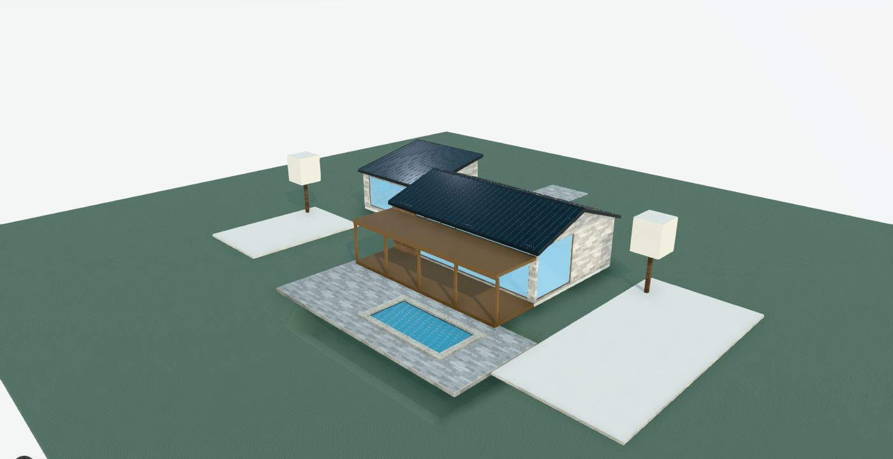 | 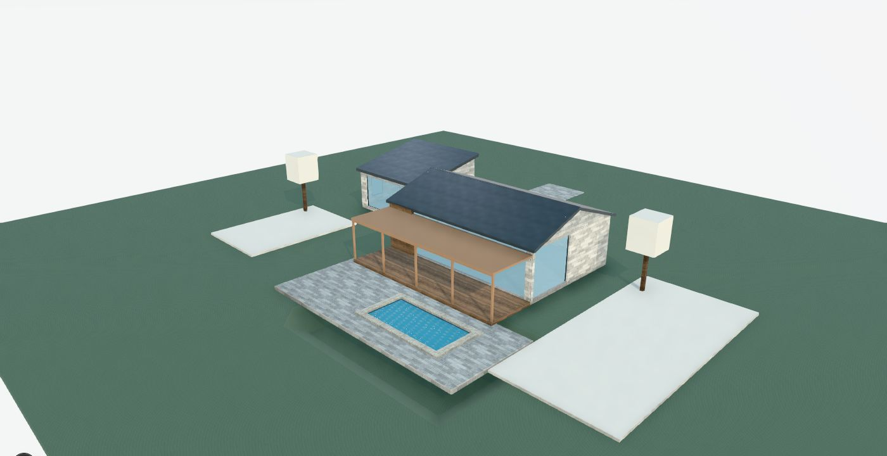 | 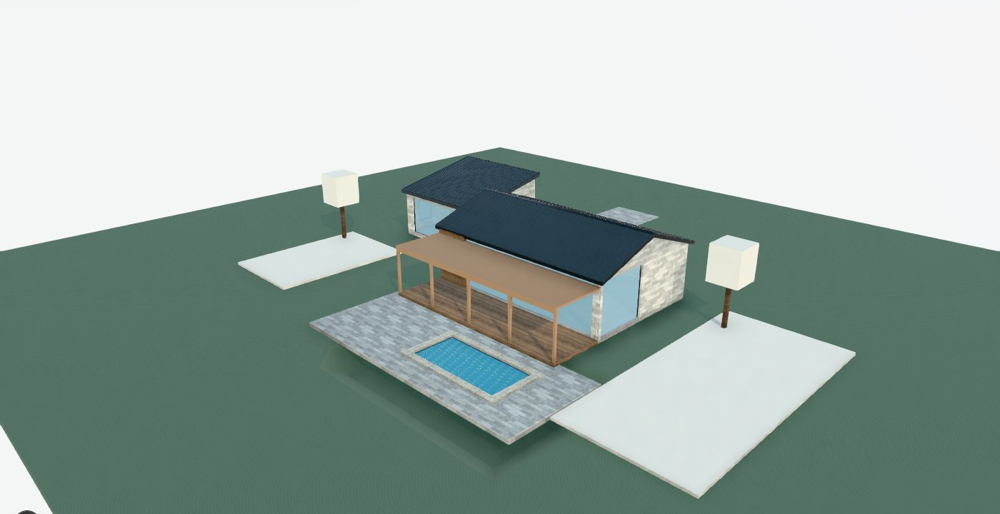 |
| Villa front | 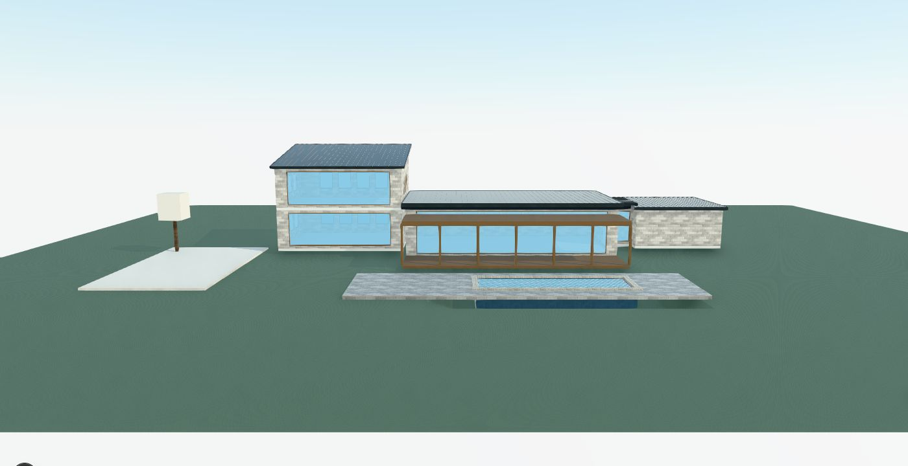 | 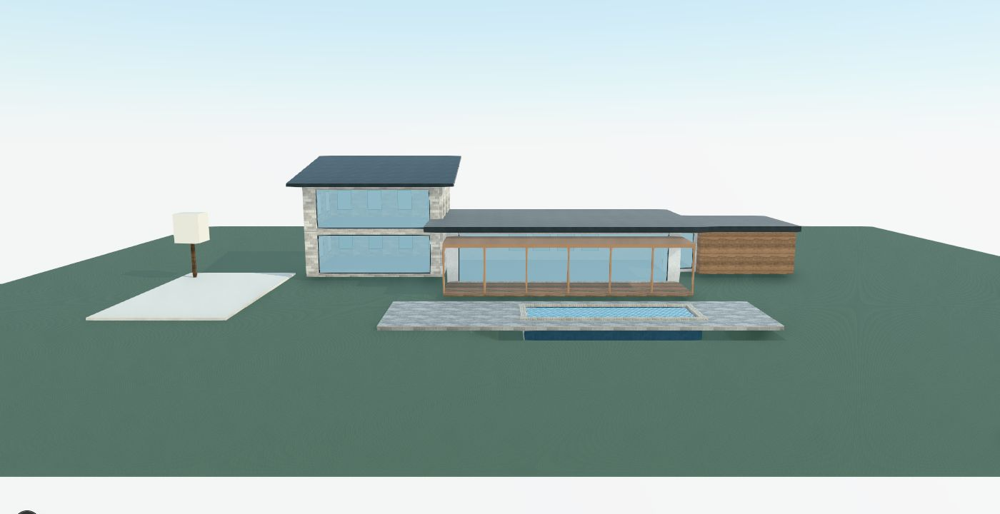 | 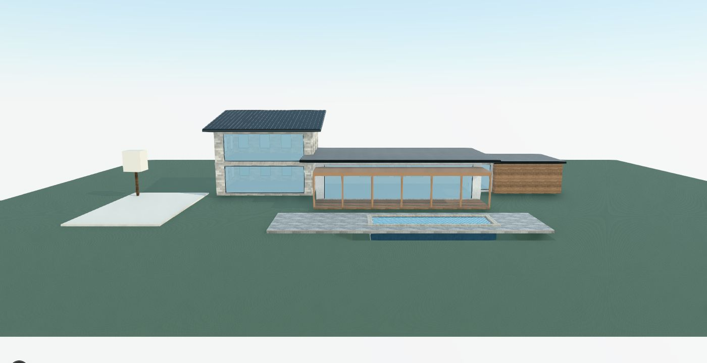 |
| Villa oblique | 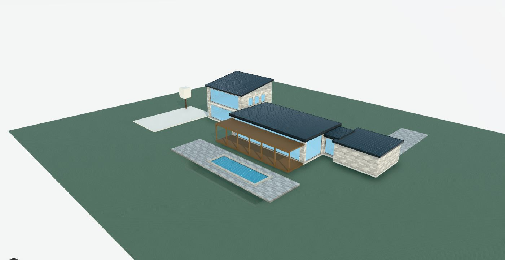 |  | 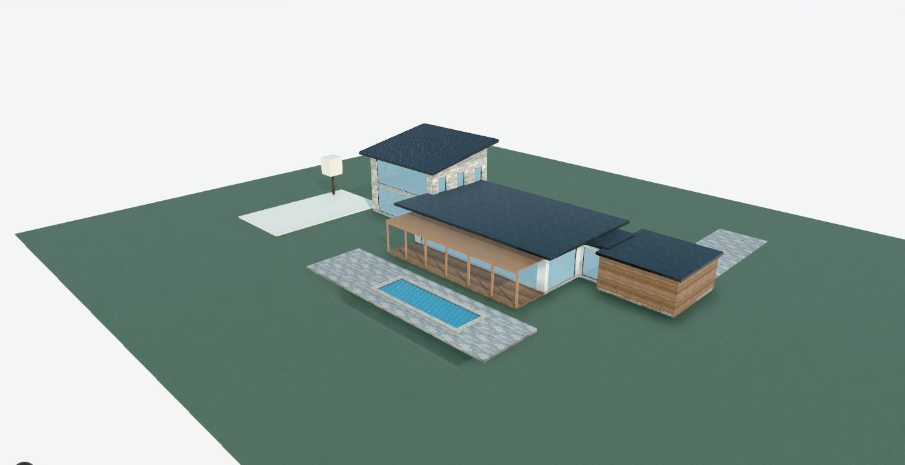 |
| Large front | 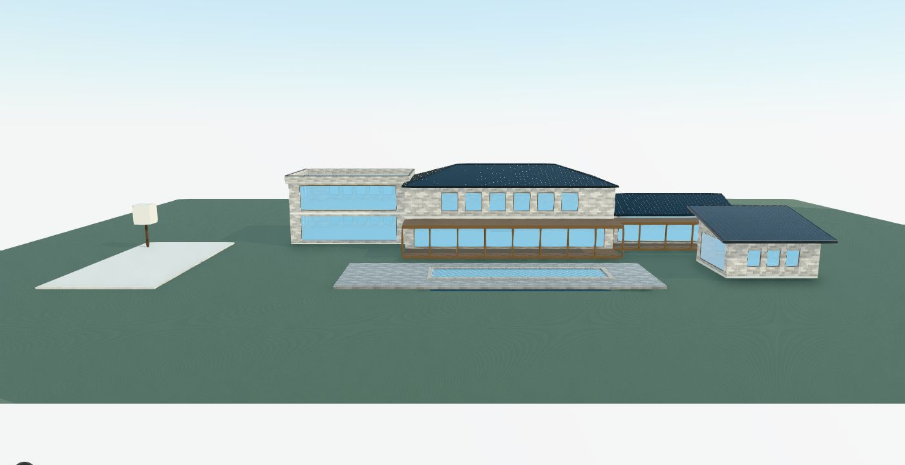 | 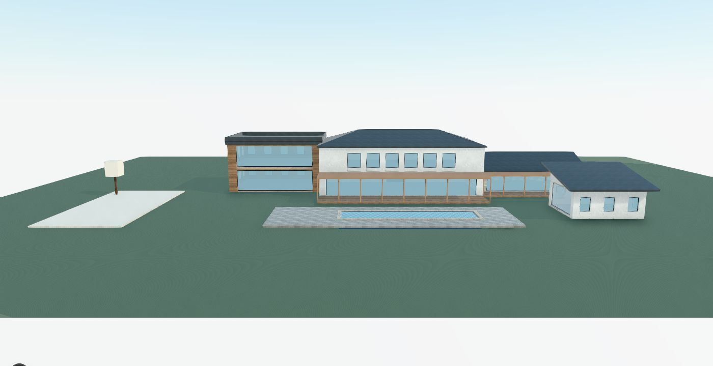 | 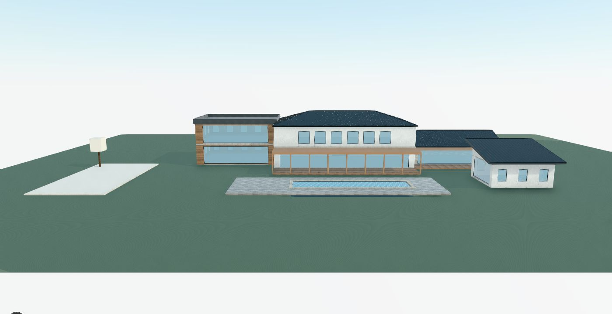 |
| Large oblique | 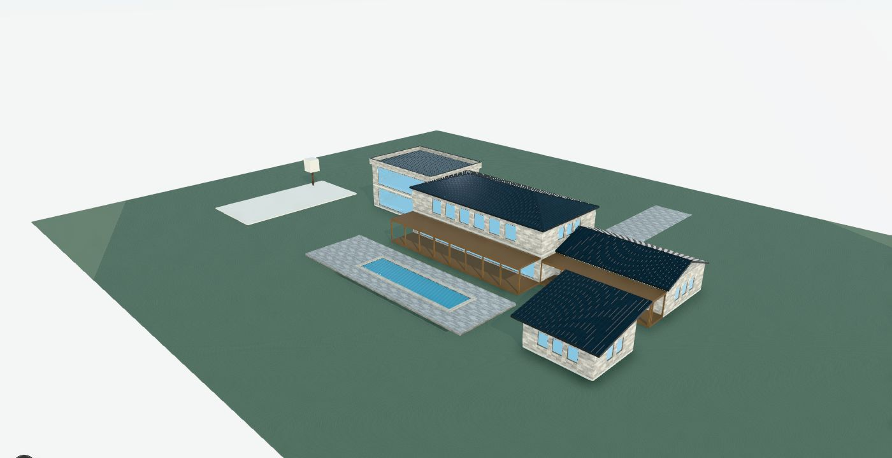 | 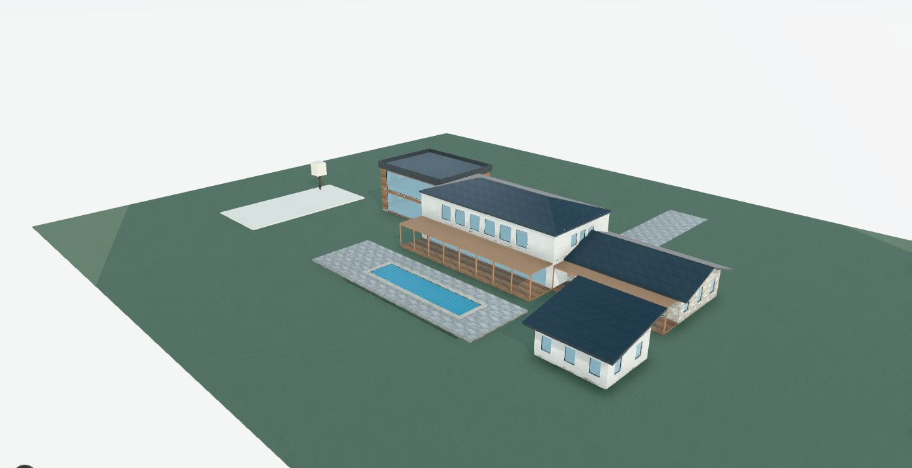 |  |
| Large entry | 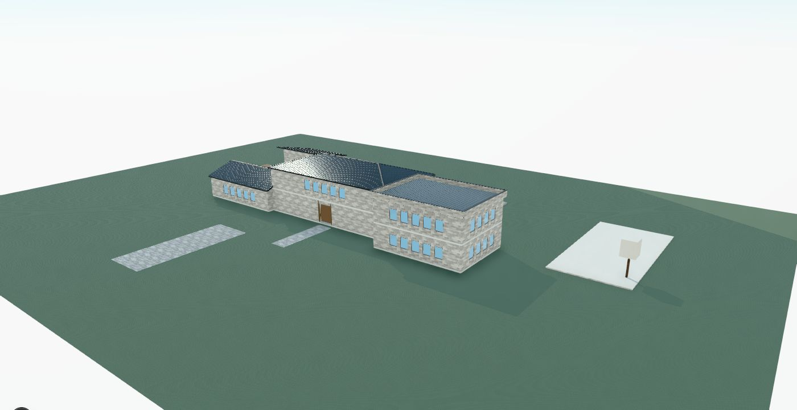 | 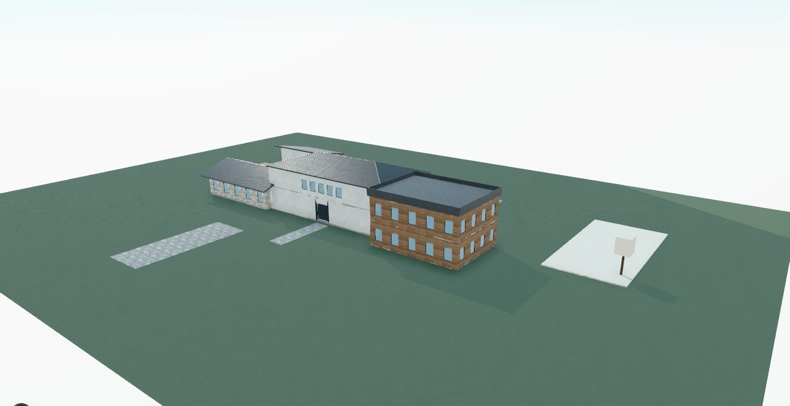 | 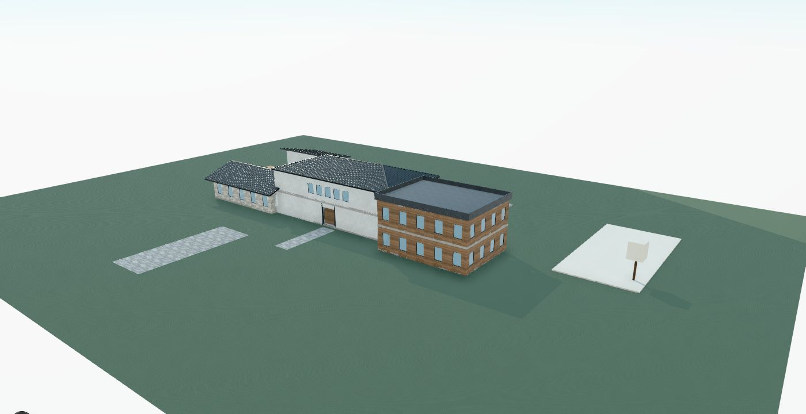 |

Entry views for cottage and villa are in the same folder.

7. Does V3 now match or beat V2?

- Roofs: matches. Same Roof System, same seams and flashing. Flat roofs are crisper than V2, which puts seams on near-flat decks.
- Floor articulation: matches.
- Material hierarchy: beats V2. Per-mass render, stone and timber zones against V2's single exterior.
- Entry: comparable.
- Veranda: comparable in proportion. V3 is now correct on all four orientations; V2 hosts verandas by facade.
- Overall: at parity or better at all three scales in these fixtures. This is a judgement from matched renders, not an aesthetic score, and primitive counts are not used as evidence.

8. What still prevents professional-looking architecture

- Window composition: preset and rhythm openings are uniform grids. There's no storey grading, no vertical alignment of upper and lower openings when counts differ, and no corner-glazing returns. This is the largest remaining gap; the upper floor of the large house still reads institutional.
- Entry: an accent finish is not an entrance. There's no canopy, recess return or step/plinth unless authored.
- Roof datum hierarchy: neighbouring roofs at nearly the same height read as accidental (villa main vs garage). This needs authored intent or a validation warning; silent height edits would break semantic authority.
- Articulated footprints (L/U/notched single masses), cross-mass roof valleys and skew-roof intersections remain out of scope.
- Rendering polish shared with V2: block landscape proxies, no soffit or fascia lighting nuance, and no wall-cladding variation per facade zone.

9. AI vs deterministic responsibility

Terra should author intent:
- mass hierarchy and heights, including deliberate datums;
- which facade is arrival and which is view, and which door is the primary entry;
- glazing intent per facade (open, punched, privacy) and any feature openings;
- material zone per mass;
- veranda and terrace placement;
- roof family and pitch.

V3 should derive deterministically:
- bays and post spacing (structural grid);
- sill and head datums;
- frames and reveals;
- slab edges;
- roof edges, flashing, seams, soffits and float gaps;
- veranda orientation and member sizes;
- roof clearance.

Recommended next contract addition: a primary-entry marker on doors and a facade role (arrival/view/service). These let V3 apply entry canopies and storey-graded openings without guessing.

Readiness for another live expressive generation: yes, for one bounded evaluation run. All authored-intent paths exercised by Terra (presets, explicit composition, veranda, mixed roofs) now pass through the improved rules with no new schema, and nothing observed should block a run. Expect window composition and entry treatment to be the visible weak points.

Validation

- `npx vitest run src/lib/v3 src/components/workspace/viewport/house/__tests__ src/store/__tests__/v3ScenePersistence.test.ts`: 34 files, 223 tests passed.
- `src/lib/architecture` (V2, unchanged): 3 tests (`roofSystems/render`, `pipelineInvariants`) failed only under the combined parallel run and passed when rerun alone. They are flaky under load, not regressions.
- `npx tsc --noEmit`, `npm run lint`, `git diff --check`: clean.
