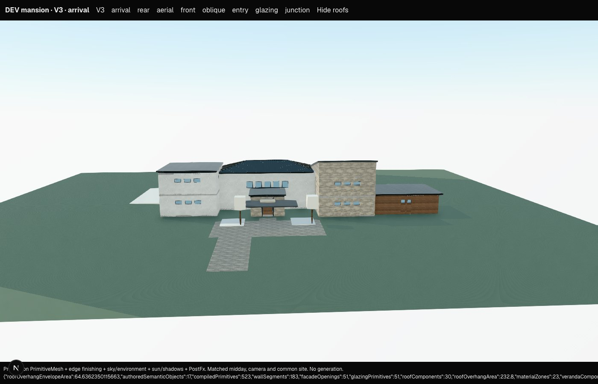
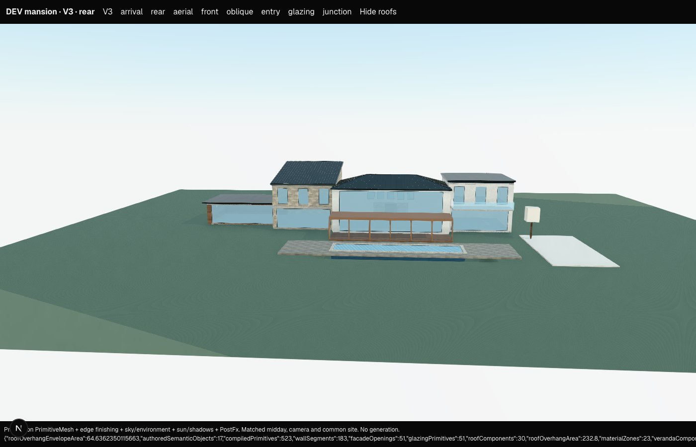
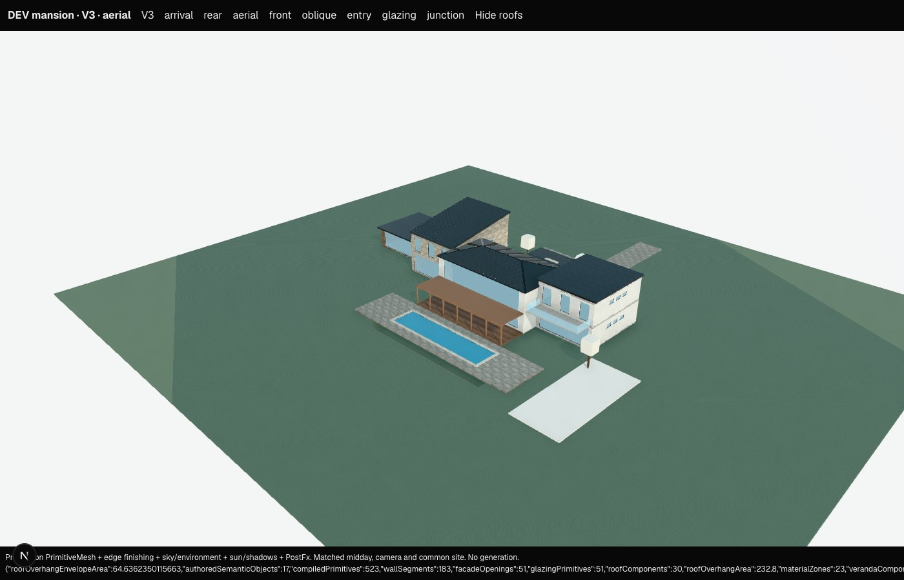

# V3 connected-mass junction compiler — 2026-10-14

**Implemented a bounded, derived connected-envelope compiler.** The 850 m² mansion now has four resolved mass connections, open internal connections instead of duplicate exterior facades, clipped roof meetings and material-preserving cut ends. This is a construction improvement; the matched views show only a modest improvement in overall architectural expression. They do not justify calling the mansion fully architect-resolved.

No Terra/OpenAI requests, V2 changes, collision, POV, physics, furniture, polygon authoring, partial floor voids or room-to-facade automation were added. The pre-existing working-tree changes were preserved. Existing V2 geometry/roof helpers are called read-only, as V3 already did.

## 1. Junction data model

`deriveV3MassJunctions(scene)` in `src/lib/v3/junctions.ts` returns derived junctions plus diagnostics. Each junction contains:

- `id: junction:<sorted mass A>|<sorted mass B>:envelope`;
- mass A/B and touching, overlapping or explicitly connected-but-separated relationship;
- supported orientation flag;
- shared facade regions: host, local facade, local horizontal span, absolute elevation range and internal/coincident/intentional-partition classification;
- relative base/top elevations and shared vertical interval;
- implicit/explicit roof owners and same/near/stepped/unsupported roof relationship;
- continuous versus expressed material edge and deterministic priority owner.

These records and their clipped geometry are never saved. Dimensions, mass hierarchy, facade composition, roof intent and materials remain semantic authority. Rotated parallel/orthogonal rectangular masses work in their host frames. Skew/tilted cases are conservative candidates with diagnostics, not guessed connections.

Existing primitive IDs survive clipping. New joint geometry uses sorted semantic mass IDs plus role and named roof planes; it does not use scene array position, coordinates or material IDs. Shared geometry lists contributors and has a semantic selection owner. Unrelated insertions do not rename existing joints.

## 2. Shared-wall strategy

The post-construction V3 pass clips only the facade parts belonging to each actual shared span/elevation. It removes both internal faces and their now-internal glazing, plus slab-edge bands within the connection. Exposed wall portions and exposed authored apertures remain. Coplanar overlapping exterior surfaces have one deterministic owner, using primary/secondary/connector hierarchy and stable ID as tie-breaker.

An explicitly authored connecting **door** retains its host aperture/partition; the opposite exterior wall is removed. This is reported as `JUNCTION_AUTHORED_PARTITION`. Conflicting authored doors on both sides produce `JUNCTION_OPENING_CONFLICT`, with hierarchy selecting one partition for review. Exterior glazing swallowed by an overlapping mass is internalized; its semantic opening remains in the scene and returns if the mass moves away.

The V3-only clipping utility interpolates fitted roof UVs. Cuts through a solid box receive closing faces in that box's own material, avoiding open stone/timber wall ends. Existing surface meshes are not assumed to be watertight solids. Multiple complex cuts are not a general solid-modelling system.

No new interior partition plan is inferred. A mass connection expresses an open envelope except where an explicit connecting door deliberately retains a partition.

## 3. Roof meetings supported

| Case | Deterministic treatment | Boundaries |
|---|---|---|
| Lower roof into taller mass | Clip roof plane, soffit/edge pieces and infill against occupied mass; add folded abutment flashing | Rectangular orthogonal meeting; no drainage/gutter engineering |
| Two aligned flat roofs | One finished rectangular roof assembly, split into stable host finish zones | Isolated pair; matching datum, thickness, orientation and eave intent |
| Partial/nonrectangular flat meeting | One owner for overlapping upper/underside coverage, buried vertical edges removed | Same flat family and top/base datum; does not create polygon authoring |
| Pitched into flat | Clip against the upper envelope; add transition flashing where planes meet, or abutment flashing at a taller wall | Supported rectangular hip/gable/shed/flat families |
| Aligned pitched roofs | Merge collinear gables into one roof, eliminating the internal rake/fascia | Isolated pair; matching ridge direction, pitch, height, thickness and eaves |
| Simple two-roof valley | Intersect the two visible roof planes, clip the line to both roof envelopes, add folded valley flashing | Orthogonal, two-participant convex roof envelopes |

Hip/gable planes come from the same shared production geometry functions. Shed and flat envelopes follow their production datum/thickness rules. Material finish zones are split at the semantic mass boundary even when their colours happen to match; recolouring does not switch between merged/unmerged topology.

Existing eave-clearance limits are retained outside the exact merged recipe. This pass does not redesign roof pitches or mass heights to force continuity.

### Explicit shared roof datums

The one new authored semantic field is optional `composition.roofDatumGroup`, on **explicit roof-form objects**. The primary host anchors the group; secondary/connector ranking and stable ID resolve ties. Compilation derives the common datum without changing saved roof or mass dimensions.

An adjustment may not penetrate its host, mismatch its orientation, fail to cover its host, or require more than 0.6 m of new wall above the host. A permitted raised roof gets a derived closure band in its host finish. Otherwise `DATUM_ALIGNMENT_BLOCKED` preserves the authored roof. Implicit mass roofs cannot use this group; `DATUM_EXPLICIT_ROOF_REQUIRED` requests an explicit roof object. Nearby unequal roofs without a group retain their heights and emit `JUNCTION_AMBIGUOUS_DATUM`.

This intent is in the runtime and generation composition schema and prompt. No live provider schema call was made.

## 4. Unsupported junction cases

Diagnostics are returned by derivation and surfaced as advisory scene-validation warnings:

- skew/tilted masses or roof orientations;
- terrace/parapet roof intersections;
- three mutually meeting roof participants;
- an explicit `connects` relationship whose masses do not share an envelope;
- unsafe or ambiguous roof datum alignment;
- conflicting authored connecting openings.

Unsupported roof meetings retain their authored roof geometry; supported shared-wall work can still proceed. Complex skew valleys, arbitrary polygons, multi-way roof topology, fully engineered gutters/drainage, partial double-height floor voids and automated room/exterior composition remain deferred. A finite-geometry pass is not a watertight-building certification.

## 5. Material termination

Clipped facade pieces and their closing faces keep their own host material. No stone or timber finish is propagated into another mass. Coincident continuous render has one owner; differing finishes terminate at the host/junction edge.

Merged roofs have stable per-host finish zones; hierarchy controls the shared roof construction family. Roof-family fallback is now scoped to the connected component, so an explicit roof's colour cannot recolour a detached building. A primary roof material change can intentionally affect implicit roofs in its connected component. Changing a secondary wall finish or an explicit secondary roof colour does not recolour unrelated parts.

The original global dependency registry remains conservative. The compiler remains a pure full-scene compile; this milestone adds **output locality**, not a new incremental cache or scheduler.

## 6. Locality and regression results

- Moving the primary wing changes its envelope and meeting geometry; the family/service wings, arrival link, detached wing, pool, deck and landscape remain byte-identical in the tested move.
- Changing the great-room roof affects its adjoining roof meetings. Pool, deck, landscape, service wing and detached wing stay unchanged.
- Changing a wall finish keeps geometry/IDs stable and leaves unrelated parts unchanged.
- Recolouring one zone of a merged explicit roof preserves every primitive ID and vertex and leaves the other zone unchanged.
- Adding an unrelated mass, reversing object order and save/reload preserve existing junction IDs and geometry.
- Roof changes are now correctly allowed to affect their connected neighbours. Earlier mansion tests that required neighbouring roofs to remain identical were updated to test the real dependency region.

The cottage/villa/large-house fixtures intentionally change at connected envelopes. Their old compiled hashes remain pinned on the explicit offline `junctions:false` comparison path; production uses the new compiler by default. Tests verify unchanged terrain and non-mass site/amenity geometry. The cottage loses two swallowed internal glazing panes: 15 → 13 visible glazing primitives. V2's 15-pane reference is unchanged. No global aesthetic or primitive-count threshold was substituted for geometric checks.

Geometric tests include shared wall span/height clipping, preserved external and connecting door apertures, exact flat-roof upper/underside union area, closed cut-end area, taller-wall penetration removal, aligned gables, pitched/flat transitions, simple valleys, UV interpolation, diagnostics and stable identities.

## 7. Matched mansion comparison

The existing 850 m² fixture and production renderer, cameras, midday lighting, sky/environment, edge finishing and PostFx are unchanged. Before images were preserved before implementation; after images were recaptured with `scripts/mansion-capture.mjs`. Provider requests are blocked by that capture script.

| View | Before | After |
|---|---|---|
| Arrival |  |  |
| Rear / view side |  |  |
| Aerial / oblique |  |  |

The arrival/link meeting now has an open internal connection and a finished roof abutment. The rear retains the authored large glazing, veranda and balcony composition; internal side glazing/walls disappear behind those visible facades. Aerial roof overlaps are trimmed, with local meeting/abutment flashing. Material blocks retain their intended ownership.

The overall silhouette, window rhythm and rectangular mass arrangement are deliberately unchanged. At these matched wide cameras, the exterior improvement is **subtle**, because many removed surfaces were hidden. The technical envelope continuity is a larger improvement than the visual composition. The primary/secondary hierarchy is preserved rather than strengthened through unrequested height or layout changes.

Final matched after-capture metrics: 17 semantic objects retained; primitives 667 → 523; wall segments 236 → 183; glazing 69 → 51; zero fallback/proxy renders. These counts describe removal of redundant construction, not architectural beauty. All three final captures passed camera-readiness checks and reported zero browser errors or provider requests.

## 8. Do the wings now read as one resolved building?

**More coherent construction, but not yet a fully architect-resolved mansion.** Shared occupied envelopes now join correctly in the supported cases. Common two-roof meetings have deterministic continuity, and materials terminate without replacing semantic objects. The fixture still has repetitive upper glazing, schematic landscape, abrupt authored roof-height changes and simple rectangular mass expression. Junction cleanup cannot cure those design choices on its own.

## 9. Remaining blockers before a live dream-mansion generation

For a broad quality claim: room/storey-aware facade constraints, richer arrival composition, roof/drainage topology beyond two participants and partial floor-void semantics remain. Facade/material-region design is still coarse. Those are not silently solved by this milestone.

For a **bounded concept evaluation**, require rectangular orthogonal wings, supported two-roof meetings, deliberately authored datums, and review of junction diagnostics before accepting the preview. No need to make the AI manually author construction pieces.

## 10. Live readiness and validation

**Ready for a constrained live concept evaluation within the supported junction cases; not ready for an unrestricted, reliably architect-finished dream-mansion promise.** No live run was performed or requested by this implementation.

Validation: **38 test files / 269 tests passed**, covering V3/mansion/parity, persistence and selection/inspector behavior. The **22 junction tests** also passed after the final material/datum boundary checks. `npx tsc --noEmit`, `npm run lint` and `git diff --check` passed. This report supersedes the previous audit's claim that connected-wall/roof construction was entirely absent; it does not erase the remaining architectural limitations.
