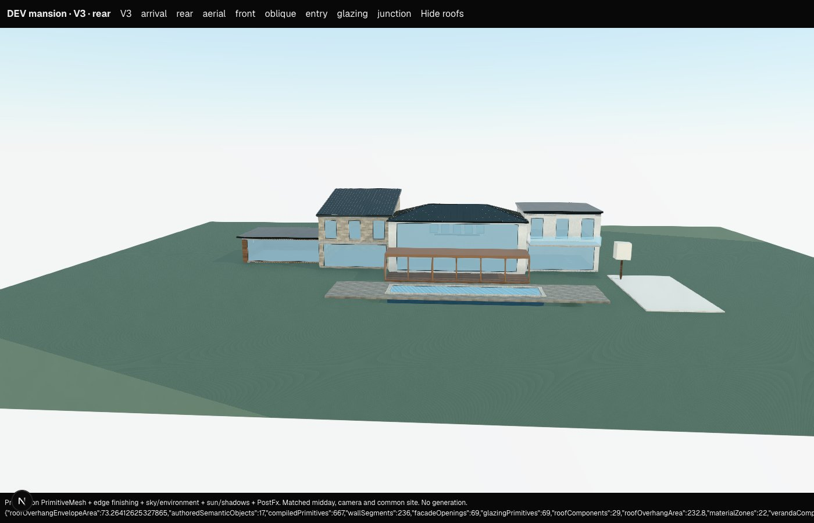

# V3 dream-mansion readiness audit — 2026-10-14

**Verdict: suitable for an editable mansion concept, not yet reliable for a genuinely bespoke, architect-resolved dream mansion. Do not use a live generation as the next quality milestone.** Strong AI intent helps arrangement; it cannot substitute for missing cross-mass construction rules. This audit made no Terra/OpenAI requests, changed no V2 code, and added no collision, POV, physics, furniture or automatic interior design.

The working tree already contained extensive V3 and shared-geometry work. That work was preserved. This audit's production changes are confined to V3 composition intent, its resolver, and primary-mass selection. Its remaining additions are an offline fixture, diagnostics, regression tests and DEV capture support.

## Fixture and evidence

`src/lib/v3/parity/mansion.ts` defines an **850 m²** enclosed gross-area tropical courtyard mansion: a 180 m², 7.2 m tall great-room pavilion; 280 m² family wing; 240 m² primary/guest/office wing; 36 m² arrival link; and 114 m² kitchen/service pavilion. Six bedrooms, primary bath/dressing, kitchen, dining, office and service rooms use the existing Storey/Room model. The house has two occupied levels in its wings and one tall level in its double-height pavilion.

Site intent includes an arrival court, driveway, porte-cochère, canopy/door axis, deep 5 m veranda, balcony, 18 × 4.5 m pool, pool deck and landscape zones. Render/limestone/teak and a dark metal roof family establish material hierarchy. Roofs deliberately combine hip, mono-pitch, flat and floating-flat forms at different datums. This is a demanding semantic concept fixture, not a furnished or circulation-complete floor plan. Connections express architectural relationships; they do not cut passages through touching mass walls.

Compiled output: 17 semantic objects, 667 primitives, 69 glazing primitives, zero fallback renders and zero proxies. Counts establish execution coverage, not design quality.

## Production WebGL review

Captured from `/dev/cottage-parity?fixture=mansion` using production `PrimitiveMesh`, edge finishing, sky/environment, sun/shadows and PostFx. The final capture reported no browser errors or blocked provider requests. The first attempt used the wrong dev origin and produced blank, unhydrated images; those were replaced after using `localhost` and explicit camera-readiness checks.

| Arrival / front | Main view / rear | Oblique aerial |
|---|---|---|
|  |  |  |

The front shows a legible central entrance and distinct service/privacy surfaces, but the high-sill rows still read repetitive. The rear shows the large double-height glass plane, veranda and pool axis; the surrounding wings still read as separate rectangles. The aerial makes the different roof heights legible but exposes abrupt mass junctions and discontinuous roof edges. Landscape remains schematic block/tree geometry. These images do **not** meet the requested luxury architectural finish. There is no matched pre-intent mansion render, so visual improvement is not quantified; the semantic effects are verified by regression tests.

## The eight audit areas

| Area | Finding | Remaining limit |
|---|---|---|
| Massing/hierarchy | Dimensions, setbacks, asymmetry, rotation, separate wings and lower connectors work. Explicit `composition.massHierarchy` now determines primary selection before label heuristics. | Shared walls remain independent; no envelope union or construction at inter-mass connections. A hierarchy flag does not compose a building automatically. |
| Facades | Optional facade roles now derive broad ground-level view glazing, smaller upper view bays, and high-sill private/service openings. Authored openings take precedence on their facade. | No room-driven facade spans, project-wide bay/datum constraints, per-specific-storey roles or seamless corner glazing. Privacy windows still use a regular rhythm. |
| Entry/arrival | `mainEntry` references a ground-floor semantic door. V3 derives a canopy, retains explicit reveal, and supports a targeted warm door accent. Site axis is explicit in the fixture. | No automatic forecourt/door alignment, entrance recess volume, steps or terrain-access solution. The canopy alone is not a complete arrival composition. |
| Roofs | Individual forms, heights, pitch, finishing and eaves compile. New diagnostic identifies near roof datums and overlapping oriented roof envelopes. | No roof unions, valleys, skew intersections, shared gutters or junction flashing. Existing clearance skips intersecting footprints and differing rotations and retains a 0.25 m minimum eave even at touching masses. |
| Materials | Per-mass finishes and common implicit roof finish support deliberate primary/secondary zones. Entry accent changes preserve identity. | No facade accent-region semantics or shared material termination solver. Materials terminate at rectangles, including buried or overlapping faces. Shared roof family is inferred from the primary roof, so its finish can affect other implicit roofs. |
| Rooms → exterior | Room purpose, host, local footprint and storey datum exist, and exterior room boundaries can be derived. | There is no declarative room-to-facade/view/privacy/balcony link. Editing a bedroom currently leaves its facade unchanged, intentionally verified. |
| Local edits | Suite enlargement, another wing, glazing enlargement, terrace depth, roof height/family, pool position and entry accent work without redesigning unrelated objects in the tested layouts. | Geometric locality is not architectural coherence: enlarging a suite does not move its balcony or solve its junction; a new wing does not open a connecting doorway. Pool movement correctly re-cuts its deck. |
| Growth | Existing room boundaries already support partitions and hosted doors; `interiorWalls.ts` derives wall segments/openings with stable semantic owners. | Furniture can later reference room/storey coordinates; collision can consume derived wall/opening geometry; POV needs navigation/clearance/vertical circulation. None requires replacing the mansion scene, but facade/storey coordination and partial floor voids need extensions. |

## Small foundational changes implemented

All intent lives in the existing optional `composition` object, so ingestion, save/load and `setComposition` edits use the same authority.

- `massHierarchy: primary | secondary | connector`: explicit ranking for the existing primary-composition/roof-family policy. Does not override mass dimensions or silently change roof heights.
- `facadeRoles: { north?, east?, south?, west? }`, each `arrival | view | private | service`: local facade names rotate with the host, not geographic compass headings after rotation. View glazing is graded by ground/upper level; privacy/service use high sill/head datums. Arrival defaults solid until a door is authored. Explicit openings on a facade completely override that facade's role policy. Legacy compositions without roles keep their previous all-facade semantics.
- `mainEntry: { openingId, canopyDepth, color? }`: must reference an explicit `door` with `floors: ground`. Its canopy is derived from the door span, with bounded height and a stable assembly identity. The generated assembly name is reserved against authored collisions. Entry colour affects only the marked door finish. Other doors retain existing behaviour.
- The generation composition schema/prompt and runtime schema describe the same optional intent. No provider call or live provider-schema validation was performed.
- `auditV3RoofComposition(scene)` reports `NEAR_ROOF_DATUM` and `ROOF_JUNCTION_REVIEW`, using oriented plan envelopes and vertical ranges. This is a conservative, callable audit helper, not an automatic repair, intersection proof, or a new live validation gate.

No `doubleHeight` boolean was added: a whole pavilion already represents this faithfully as `levels: 1` with a tall storey. A boolean cannot safely represent a partial void in an occupied upper floor; that requires a real floor-void/occupancy model. No roof solver was improvised during this focused audit.

## Edit evidence and limits

| Request | Tested change | Expected dependency |
|---|---|---|
| Enlarge primary suite | Increase wing width and shift centre to preserve its inner face; separately enlarge semantic bedroom footprint | Host geometry only; the room-only edit changes no exterior geometry |
| Add bedroom wing | Create one named secondary mass | New mass only in this separated test location; connecting it remains authored work |
| Enlarge living glazing | Override south view span while preserving other role-driven sides | Great-room facade only |
| Deepen pool terrace | Change terrace depth/centre | Terrace only |
| Change one roof | Change explicit roof datum; separately replace hip with gable through existing delete/create operations, retaining roof id | Explicit roof only for these cases |
| Move pool | Change pool x | Pool, deck opening and site excavation are legitimate dependencies |
| Change entry material | Recolour marked entry accent | Marked door finish only; stable canopy/other child ids |

Unchanged semantic objects and their compiled geometry are compared directly. This does not establish locality for every arrangement: eave limits depend on neighbours, the implicit roof material depends on the selected primary roof, and inferred support depends on nearby geometry. These derived relationships are broader than the authored dependency graph.

## AI versus deterministic V3

| AI should author | V3 should derive |
|---|---|
| Concept, primary/secondary mass arrangement and dimensions; intended arrival/view orientation | Construction from those dimensions and local coordinates |
| Room purpose/relationships, future facade-facing requirements and occupancy/void intent | Room boundaries, partitions/doors, future facade requirement resolution |
| Facade role, exceptional opening intent, primary entrance | Bays, actual glazing/frames, sill/head datums, canopy detailing |
| Roof family/pitch, deliberate common or separated height datums | Roof planes, eaves, finishing, and eventually cross-mass intersections/valleys |
| Material family/zone intent; terrace/pool/landscape placement | Member sizing, material termination, deck cutouts and architectural finishing |

The AI should not author hundreds of construction pieces. The fixture's facade/entry intent expands deterministically into its construction components.

## Eleven requested conclusions

1. **Can V3 currently build a genuinely bespoke dream mansion?** It can express a credible bespoke concept with editable parts. It cannot reliably finish arbitrary mansion architecture to the requested standard.
2. **What stops it?** Missing connected-envelope/roof-junction construction and room-aware facade constraints. Better prose does not eliminate duplicate walls, unresolved eaves or disconnected room/exterior intent.
3. **Top five weaknesses:** cross-mass roof junctions; shared-envelope and connector construction; room/storey-aware facade composition; material termination across joined masses; coordinated arrival/recess/site detailing.
4. **Minimum missing semantics:** a typed mass junction (meeting faces, connection/roof policy); shared roof datum/group intent; room-to-facade span with glazing/privacy/outdoor-access requirements; per-storey facade intent; partial floor-void extent; material accent zones with explicit termination. Existing roles and main entry now cover the smaller immediate intent gap.
5. **AI versus V3:** the responsibility table above. Design decisions belong to AI/authored semantics, construction decisions to deterministic V3.
6. **Improvements implemented:** optional mass hierarchy, facade purposes, validated entry reference/canopy/accent, roof diagnostics, offline mansion fixture, capture path and regression coverage.
7. **Cottage/villa/large regression?** None in compiled output: exact SHA-256 baselines were recorded before changes and all three still match. Existing fixtures were deliberately not upgraded with new intent, so no visual improvement is claimed for them.
8. **Can it stay coherent after local edits?** Identity and unrelated geometry remain stable in the tests. Automatic architectural coherence is partial: connected roof/wall/material and room/balcony relationships still require authored coordination.
9. **Unsupported complex architecture:** L/U/notched single-mass footprints, watertight cross-mass roof valleys/booleans, skew roof intersections, partial double-height voids, multi-storey atria with galleries, continuous frameless corner glazing, and automated cross-mass floor/wall/material continuity. L/U arrangements of rectangular masses are representable but their joints are unresolved.
10. **Ready for LIVE dream-mansion generation?** **No, for a reliable dream-mansion quality claim.** A bounded concept experiment is possible but would merely test the model's arrangement skills around known compiler limitations. No live generation was run.
11. **Single next milestone:** a **connected-mass junction compiler**, starting with explicit junction semantics for an L/U mansion: shared wall suppression/openings, deliberate roof datums, deterministic roof meeting/valley/flashing and finish termination. Prove it on this offline fixture plus rotated and near-coincident junction cases before spending a live generation.

## Verification

- Mansion regression file: 20 tests pass, covering scale/program, finite geometry, hierarchy, save/reload, ingestion, unique/order-stable IDs, material independence, room independence, local edits, entry validation and roof stress at 0°, 90°, a skew angle and a U-shaped arrangement.
- Final V3 + persistence + selection/inspector run: **37 files / 247 tests passed**, including all 20 mansion tests.
- Final `npx tsc --noEmit`, `npm run lint` and `git diff --check`: passed.
- Finite geometry validation is explicitly not proof of physically correct junctions or architectural beauty.
