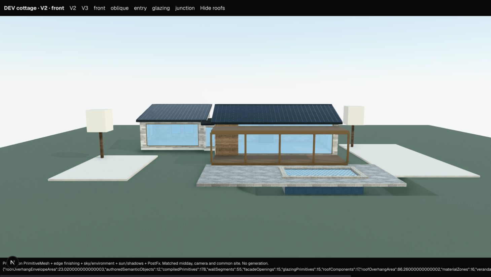
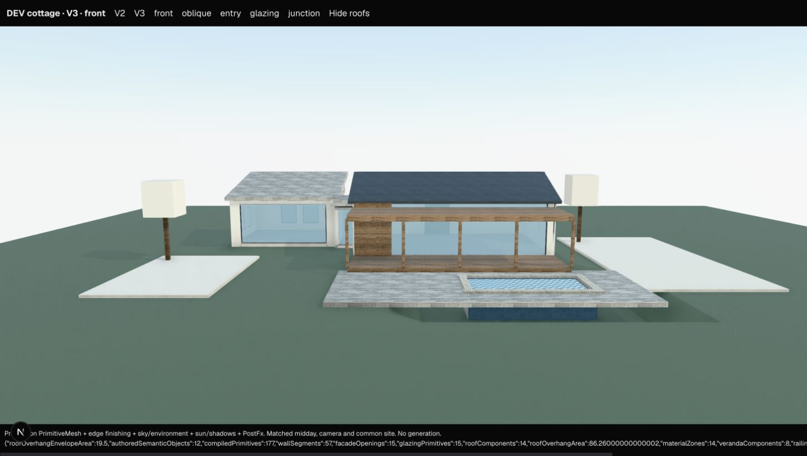
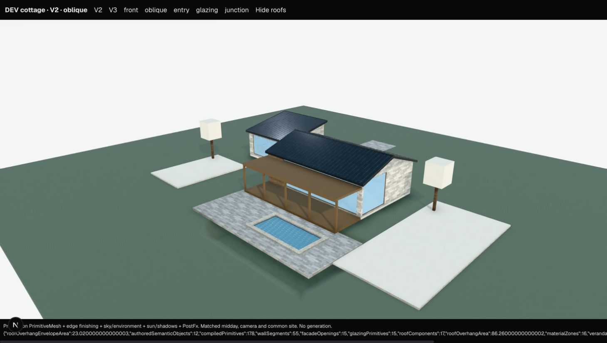
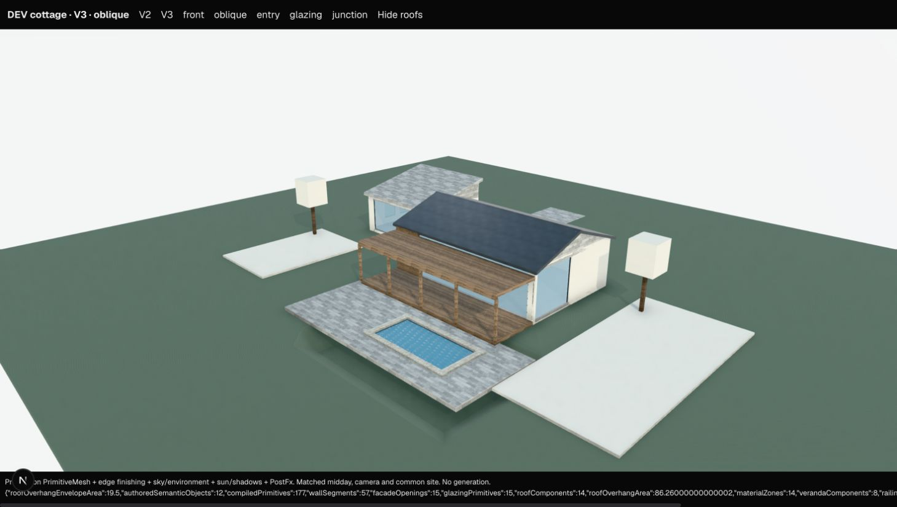

WebGL expressive-cottage verification — 2026-10-13

Result: V3 genuinely approaches V2 in the matched fixture's silhouette, offset mass proportions, facade rhythm and covered outdoor structure. This is a production-rendering-component comparison in Chrome WebGL, not another CPU geometry rendering. It is not full visual equivalence or a general architectural release certification.

Method and scope

Open `/dev/cottage-parity` on the local Next dev server. The server page returns notFound outside development. It compiles the existing matched fixture through the actual V2 and V3 compilers and renders their primitives with the unchanged production PrimitiveMesh (including glass, water and textures), applyEdgeDetail, SunLight, SceneEnvironment and PostFx. This read-only harness bypasses HouseRenderer's project/persistence/asset-replacement orchestration; it does not exercise generation or save project state. No Terra/OpenAI calls were made. No V2 production code was edited.

Both versions use perspective FOV 40, target (-3,2,2), front camera (-3,7,36), oblique camera (25,17,30), DPR [1,1.75], NeutralToneMapping, production midday lighting/environment/exposure and identical common site geometry. Rear, junction and eye-level glazing views were additionally reviewed, along with roof visibility switching. V3's optional presentation-light multipliers are deliberately not applied: illumination must match. Explicit primitive surfaces are retained; V2 exterior-color wall/roof surfaces receive the same stone inference used by its production material configuration. V3 implicit roofs inherit their authored stone material, unlike V2's global metal roof configuration. V2 standing seams, trim and veranda material behavior also differ. Those differences are visible and were not disguised for the comparison.

Findings and fixes

1. Roof clearance required a fix. The initial WebGL junction/rear views showed the bedroom eave overlapping the living roof. V3 now derives deterministic eave limits for parallel rectangular roof footprints whose vertical envelopes overlap. A 5 cm separation budget is shared between neighbors, retaining a minimum 25 cm eave when the authored reach permits it. Authored state is unchanged. The final cottage limits are 25 cm, comparable to V2's trimming. This is intentionally conservative and uniform around each roof, not a polygon intersection engine; skew roofs, overlapping footprints and complex valleys are outside its guarantee. The minimum eave is not a universal collision-free guarantee for touching masses; the final cottage junction was visually checked.

2. The pitched-roof builder used object centre Y as its wall bearing. It now uses authored base Y. Implicit mass roofs put their base at wall-top Y. The mass top slab previously extended 26 cm above the wall datum; it now caps below that datum. Final views show no detached pitched roof, canopy clipping or roof plane cutting through the visible glazing. Fascia/caps give the gable visible edge thickness; this pass did not add a full closed roof/soffit system. The fixture has no terrace parapet, so parapet burial is untested.

3. The most significant renderer-only discovery was duplicate child IDs. Passing all of V3Material as Paint overwrote builder-generated primitive IDs with material IDs. React emitted duplicate-key errors, and switching versions visibly left stale V3 pieces in the V2 view. The V3 construction adapter now passes only paint properties. Unique stable children survive material edits and reloads. After a clean reload, repeated version/view/roof switches showed no stale or detached compiler pieces. Remaining console warnings concern Three.Clock and PCFSoftShadowMap deprecations; no V2 renderer changes were made for these.

4. Articulated footprints did not require a fix for this fixture. The bedroom offset, small recessed connector and veranda projection remain visible in both versions; no important authored composed-mass articulation is flattened. The fixture consists of composed rectangular masses, not a single polygonal L/U-shaped mass. It cannot establish arbitrary notched/polygonal footprint parity. No CAD system or footprint feature was added.

5. Hosted openings did not require a cut fix for this fixture. Eye-level WebGL shows the interior floor, opposite windows and rear wall through the living and bedroom panes. The mass's semantic composition is already driving shared wall segmentation around openings. A regression checks all 15 pane centres against opaque host facade boxes. That numerical check supplements the visual evidence; it is not a complete aperture Boolean proof. Standalone hostId glass-wall/window-band subtraction is not exercised here and remains outside this sign-off. No transparency trick was added.

6. Remaining visible limits: V3 has a small dark speckled seam at the terminal east/south corner frame, consistent with coplanar frame/wall contact. It is not an intact wall behind the pane. The implicit stone roofs, textured veranda and absent V2 standing seams remain the largest finish differences. Pool water and deck cutout read correctly; common terrain/deck support edges and block-like landscape objects remain visible in both versions. No additional floating compiler children were observed after the identity correction. The corner seam and finish differences are nonblocking for one evaluation generation, but preclude a claim of polished visual equivalence.

Exact files changed in this pass

- `src/lib/v3/construction.ts`: sanitize shared-builder Paint; use base-referenced pitched roof placement.
- `src/lib/v3/roofClearance.ts`: small compile-only deterministic neighboring-eave limits.
- `src/lib/v3/scene.ts`: apply those limits to explicit/implicit roofs; correct implicit roof bearing and top-cap placement.
- `src/lib/v3/__tests__/webglParityRegression.test.ts`: identity/material-edit/reload, bearing/cap, clearance determinism/vertical separation and opaque-host aperture regressions.
- `src/lib/v3/__tests__/coordinateConvention.test.ts`: adjust one expected roof envelope for the new deterministic eave trim; retain height/axis assertions.
- `src/app/dev/cottage-parity/page.tsx` and `viewer.tsx`: development-only read-only production-component comparison harness.
- This report, `parity/webgl.json`, and `parity/webgl/*.jpg`: verification evidence. Earlier before/after captures were not overwritten.

Post-fix parity metrics

| Diagnostic | V2 | V3 |
|---|---:|---:|
| Authored objects | 12 | 12 |
| Compiled primitives | 178 | 177 |
| Wall segments | 55 | 57 |
| Glazing panes | 15 | 15 |
| Roof components | 17 | 14 |
| Roof envelope excess area (m²) | 23.02 | 19.50 |
| Authored overhang area (m²) | 86.26 | 86.26 |
| Color/surface combinations | 16 | 14 |
| Veranda components | 8 | 8 |
| Railing/edge components | 4 | 7 |
| Pool components | 10 | 10 |
| Fallback/proxy counts | 0 / 0 | 0 / 0 |

The pre-WebGL V3 roof envelope excess was 86.26 m². Metrics describe output, not an aesthetic score; envelope area uses the unrotated fixture's axis-aligned bounds and counts do not compare mesh complexity.

Validation

- `PARITY_CAPTURE=webgl npx vitest run src/lib/v3 src/components/workspace/viewport/house/__tests__ src/store/__tests__/v3ScenePersistence.test.ts`: 26 files, 127 tests passed. Generation-related tests use their existing offline mocks; no live generation was run.
- `npx tsc --noEmit`: passed.
- `npm run lint`: passed.
- `git diff --check`: passed.
- No unrelated V2 failures were modified. The worktree already contained the earlier parity implementation and other user changes; the file list above describes only this pass.

Recommendation: spend ONE live expressive-cottage generation next as an evaluation of authored intent reaching this rendering path. No observed remaining fixture issue should block that bounded test. Do not interpret it as coverage of arbitrary L/U polygons, independently hosted glazing cuts, terrace parapets or skew-roof intersections. No live call was made during this pass.

Captures

| View | V2 | V3 |
|---|---|---|
| Front |  |  |
| Oblique |  |  |

Additional evidence: [V3 rear](parity/webgl/v3-entry.jpg), [V3 genuine glazing openings](parity/webgl/v3-glazing.jpg).
