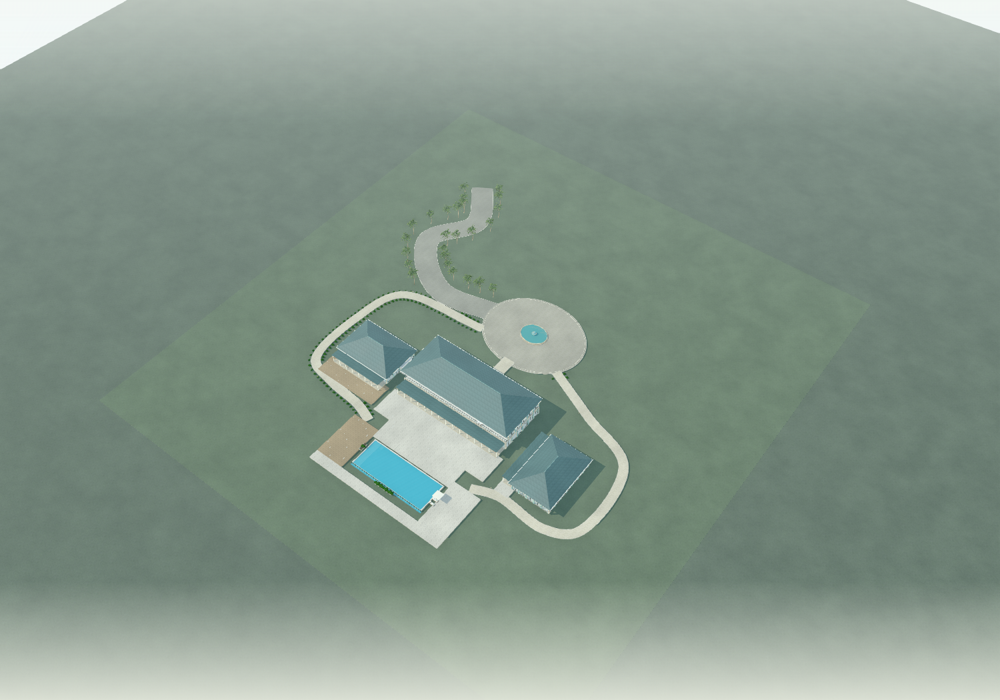
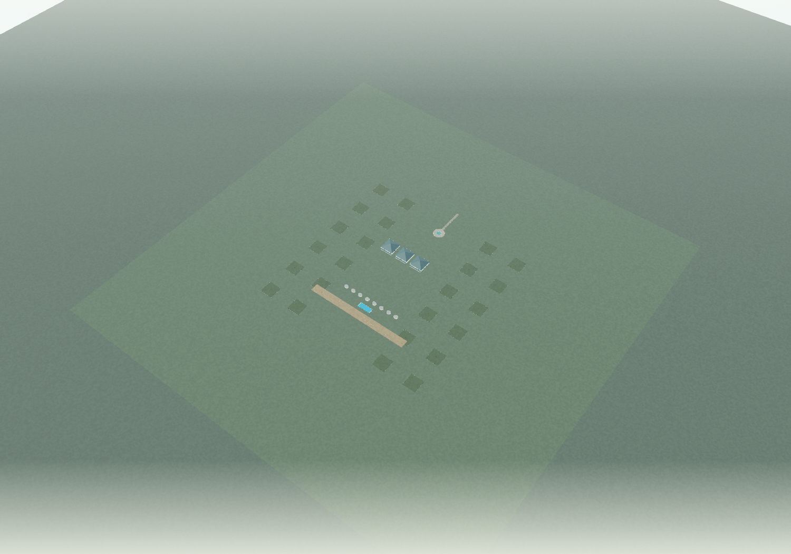

# Villa Playground creative limits audit

Terra remains the single creative designer. The existing composition executor, R3F component builders, roof kit, ellipse extrusions and route ribbons remain in use. No provider call, V3 generation, migration, commit or deployment was made. Existing working-tree changes were preserved.

## Pipeline and classification

Audited: development API request/provider output → `terra.ts` provider/local schemas and prompts → `composition.ts` atomic patches, site policy and clearance validation → `wing-composition.ts` local derivation/validation → `composed-villa.tsx`, `villa-kit.tsx`, `estate-grounds.tsx`, `curved-pavilion.tsx`, `architecture.tsx`, `scene.tsx`; component registry and legacy `design.ts` included. `numeric-inventory.txt` records numerical checks and bounded construction loops with source lines. `limits.ts` is now the shared creative envelope used by schema, prompt, registry, editor and wing validator. Provider JSON Schema comes from those schemas. Refinements such as clearances still execute locally; the prompt describes them because JSON Schema cannot express all spatial relationships.

Categories: **G** actual geometry/compatibility requirement, **P** browser/resource safeguard, **D** conservative design envelope. Historical intent is inferred from existing builder code, comments and tests where no explicit rationale exists; these were not documented structural engineering limits.

| Meaningful limit | Before | After | Classification and reason |
|---|---:|---:|---|
| Building wing width/depth | 32 m | 64 m | D: slabs/roofs scale directly; facades repeat bounded bays |
| Building wings | 8 | 16 | D/P: aggregate facade budget applies |
| Storeys | 1 or 2 | unchanged | G: only two-storey slabs, stairs and balconies exist |
| Storey height | 3–4.5 m | unchanged | G: fixed stair run, 22 treads and stair opening; do not double height |
| Wing veranda depth | 3 m | 6 m | D: existing lean-to/veranda builder, envelope clearance retained |
| Balcony depth | min(2.4 m, depth/3) | unchanged | G: supported balcony/slab proportion; requires two storeys |
| Placement x/z | ±200 m | ±512 m | D: coordinate precision is sufficient at this range |
| Galleries: count | 8 | 16 | D/P: aggregate facade budget applies |
| Gallery width / span | 5 / 32 m | 10 / 64 m | D: straight rectangular builder; aligned faces and host height remain required |
| Terraces/courtyards: count | 16 | 32 | D/P: finite object count; timber seams use existing instancing |
| Terrace/courtyard rectangle axes | 256 m | 512 m | D: constant-cost slabs; courtyard occupancy and water exclusions remain |
| Pool length × width | 32 × 12 m | 64 × 24 m | D: same rectangular water, coping and channel builders |
| Garden/site axes | 1024 m | 2048 m | D: constant-cost terrain plane and fixed boundary planting count |
| Garden centre x/z | ±256 m | ±512 m | D: consistent with component placement |
| Derived landscape margin | 30 m | 60 m | D: does not multiply vegetation with site area |
| Detached curved pavilions | 4 | 8 | D/P: same version-pinned approved builder |
| Pavilion width × depth / height | 10 × 8 / 4.2 m | 20 × 16 / 6 m | D: fixed-segment ellipse extrusion; entry chord and clear approach retained |
| Driveway / pedestrian path width | 6 / 3 m | 12 / 6 m | D: wide processional routes supported by existing ribbon builder |
| Motor court axes | 28 m | 56 m | D: fixed-segment ellipse, not a turning simulation |
| Central island axes | 12 m | 24 m | D: clear lane still >=3.5 m on every side |
| Landscape bed axes | 12 m | 64 m | D: supports retained 30 m bed and larger parterres; decorative planting now bounded separately |
| Beds | 12 | 24 | D/P: bounded decoration density |
| Routes / controls per route | 10 / 8 | unchanged | P: collision and hairpin checks grow with route samples/pairs |
| Route tessellation | .65 m target, 1200 samples | unchanged | G/P: now reject interpolated lengths >780 m rather than silently coarsening safety sampling |
| Aggregate facade work | no explicit limit | 2048 perimeter-metres × storeys | P: sum 2×(width+depth)×storeys, including derived galleries. Preserves the old eight maximum building wings' facade workload; prevents stacking all enlarged maxima |
| Bed decoration | shrubs every ~.8/.85 m | at most 8 shrubs per edge | P: distribute decoration across the whole authored bed; preserve soil/edge dimensions |
| Circulation decoration | potentially thousands of plants | at most 128 plants | P: decoration only; no route controls or pavement widths changed |
| Provider output budget | 6000 tokens | 12000 tokens | resource safeguard expanded for larger configurations; timeout/retry policy unchanged |
| Patch operations | 2× old collection capacity | 2× new collection capacity | P: allows remove/replace transactions; final state still validates |

## Numerical geometry rules retained

- Positive rectangle minimum .6 m; building axes >=4 m; two-storey building width >=8 m; pavilion axes >=6/5 m and height >=3 m; pool axes >=8/4 m; garden axes >=12 m; landscape margin >=2 m; beds >=1.5 m; court >=12 m; island >=2 m. These retain tested builder domains and positive slab/opening dimensions; no minima were doubled.
- Exactly one main wing, parent hierarchy to it, unique IDs, version-pinned builders, one optional court/pool, cardinal main/attached rotations; secondary detached wings retain 15° increments (0–345°), pavilion yaw 0–359°. No diagonal galleries or pitched shared-wall roof junctions. Angles were not doubled.
- Connected wall contact >=1.2 m; gallery width >=1.2 m and common face span >=width; gallery roof height min(3.3 m, host storey heights), hosts rise >=.3 m above it. Secondary detached wings cannot touch or attach through galleries.
- Roof/veranda/pavilion envelope separation .2 m; conservative eaves .7 m modern, 1.15 m Caribbean, .65 m Mediterranean; front veranda envelope includes .4 m. Pavilion roof eave .65 m and pedestrian approach 2.4 × 2.4 m. Fixed roof pitches/rises (.26 Caribbean, .22 Mediterranean; .13 low) and overhang construction remain unchanged.
- Pool reserve west/east/rear/front 2.2/3.8/1.2/2.2 m; paving-to-water .15 m; no buildings inside open courtyard rectangles. Fixed sites never grow to fit a design.
- Path control separation >=2 m; walk width >=.9 m, driveway >=3.5 m; paved collision radius width/2+.12 m; bed clearance width/2+.3 m; hairpin separation/run tests width+.2 m and 2×width+.5 m; court island lane >=3.5 m. Route crossings, obstacles, island encroachment and drive/court connection checks remain active.
- Numerical tolerances .01/.02 m in contact and overlap tests, epsilon denominators, finite-number checks, normalized/clamped interpolation factors and time interpolation are mathematical/geometry requirements, not creative limits. Fixed wall/slab/roof thicknesses, glazing/furniture sizes and facade bay targets are construction details in reused builders; they are not model-authored parameter ceilings.
- Ellipse extrusion remains 64 curve segments, one extrusion step, no bevel; arc subdivisions ~2°, masonry arches 28 curve segments; these are fidelity/performance choices, not restrictions on estate dimensions. Facades retain ~3.5/4.5 m bay targets and verandas ~3.3 m column bays. No new geometry engine.

## Other preserved resource and compatibility boundaries

Request brief 1–4000 characters; IDs 1–48 slug characters; name/character/summary/unsupported text limits 80/160/600/200, provider unsupported count 8; generation timeout 160 s, route maxDuration 180 s and zero automatic retries. These control transport/display/resource use, not architectural dimensions. Response retention/replay still uses content hashes and no provider import.

Legacy preset-only `villaSchema`/`villaPatchSchema` keep scale .85–1.05, wingRatio .85–1.1, veranda/terrace 1.6–2.8 m, pool 10–18 × 4–6.4 m and one/two levels. These constrained templates have fixed pool/deck/stair offsets and style/composition compatibility checks, so their scalars cannot safely be doubled independently. New Terra generation uses the expanded authored composition contract; these bounds only remain for older preset configurations and their edits. They do not limit new estates. A future conversion of a saved preset into authored wings would be a separate compatibility change.

Canvas DPR remains 1–1.75; orbit polar limits .12 through π/2−.025 and minimum distance 6 remain. Orbit maximum distance scales with property span. Camera far clipping now explicitly scales to 10×site span (minimum 800), updating the projection matrix, and the sky box scales with estate extent. Previously the large-site overview camera could leave the 1000-unit sky box and the sky obscured the property. Fog remains scaled with extent. The playground enables Three.js logarithmic depth buffering (the existing N8AO pass detects it) to keep thin beds, route paving and stacked ground surfaces stable at kilometre-scale overview distances; ordinary perspective depth caused visible interference between those surfaces. Sun shadow map remains 4096² with the existing ±50 m shadow camera; distant wings can have less detailed/no sun shadows. Large-site geometric support is not a promise of uniform shadow fidelity or structural certification.

## Retained failure recovery

Original retained file: `.data/villa-responses/b5d43a156cd743f02daa2a4b837a06a44172b56d502b296f50523eb16f02c7e9.response.json`. A byte-for-byte copy is preserved as `original.response.json`. Its fifth bed (`sea-edge-planting`) is **30 × 5 m**. It now passes size validation without clamping.

**Original property was not recovered as a valid render.** Offline replay exposes four independent clearance failures:

1. `west-retreat-walk`: paved width intersects building/pool clearance.
2. `east-retreat-walk`: same.
3. `pool-promenade`: same.
4. `pool-west-tropical-bed`: obstructs circulation.

The raw architecture was neither modified nor substituted, and meaningful clearance validation was not bypassed. `geometry-checks.json` records the exact findings. These failures need explicit layout repair before the original can render through the supported executor. No second AI call was made.

## Evidence and reproduction

`examples.json` contains offline provider-shaped fixtures, including enlarged Palmhaven/Splay/Cortile estates, a sixteen-wing property, 64 m pitched/flat wings, 64 ×24 m pools, eight 20 ×16 m pavilions, a 64 m straight gallery of width 10 m, the original compact family villa, and a fixed 2048 m site with 24 beds and a 56 m court. The stress fixtures exercise capability boundaries; they are not proposed finished architectural compositions.

- `npx vite-node --config vitest.config.mts scripts/villa-expanded-evidence.ts`: actual provider/local contract, executor, local builder derivation, site and clearance checks; records raw recovery result and rejected cases.
- `npx vitest run src/lib/villa src/app/dev/villa-playground/wing-composition.test.ts`: regression suite, including original response rejection, exact fixed-site policy, route sampling protection and facade/plant budgets.
- `npm run typecheck`; targeted ESLint of changed implementation and evidence code.
- `scripts/villa-expanded-capture.mjs`: Chrome/Metal, viewport 1500×1050, real R3F scene traversal, finite mesh vertices, expected wing/gallery counts, GPU geometry/texture counts and 60 animation-frame intervals (renderer draw/triangle counters represent only the final post-processing pass, not total scene draws). Every `/api/ai/**` request is intercepted and fulfilled locally. **Provider calls: 0.** Measurements are local development results, not cross-device guarantees or load-time benchmarks.

Validation completed: **120 tests passed**, TypeScript and targeted ESLint passed. `browser-checks.json` contains final measurements. Above/Poolside PNGs contain real rendered properties. `*-clear.png` hides overlays only. `rejected-performance-stress.json` preserves the earlier sixteen maximum-size, two-storey wing run: 15,810 meshes, median 66.8 ms, p95 83.4 ms. That combined design is now rejected by the workload safeguard. The revised sixteen-wing estate uses smaller wings and renders at ~16.7 ms; three maximum-size two-storey wings plus eight pavilions render at ~33.3 ms. Enlarged design-study estates and compact family villa render at ~16.7 ms here. Browser performance is verified separately from schema acceptance.

### Final browser measurements

| Property | Meshes | Median frame ms | p95 frame ms |
|---|---:|---:|---:|
| estate-palmhaven-large | 2065 | 16.7 | 16.8 |
| estate-splay-large | 1128 | 16.7 | 16.8 |
| estate-cortile-large | 2494 | 16.7 | 16.8 |
| large-modern | 3979 | 16.7 | 16.7 |
| large-caribbean | 5938 | 16.8 | 33.4 |
| large-spanish | 5992 | 33.3 | 33.4 |
| large-tuscan | 5992 | 33.3 | 33.4 |
| large-gallery | 3223 | 16.7 | 33.3 |
| large-fixed-grounds | 6647 | 16.7 | 33.4 |
| estate-splay | 837 | 16.7 | 16.7 |
| family-breeze | 319 | 16.7 | 16.7 |

All eleven cases had finite vertex data, the expected wing/gallery count and no browser page errors. The fixed-site case rendered 24 beds at 64 ×64 m, a 56 m court and eight pavilions inside the exact 2048 ×2048 m boundary.

